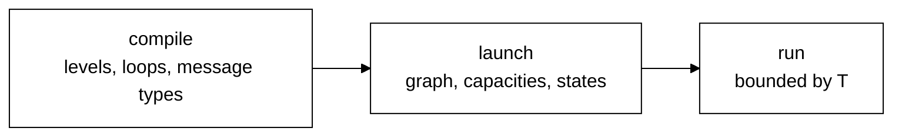
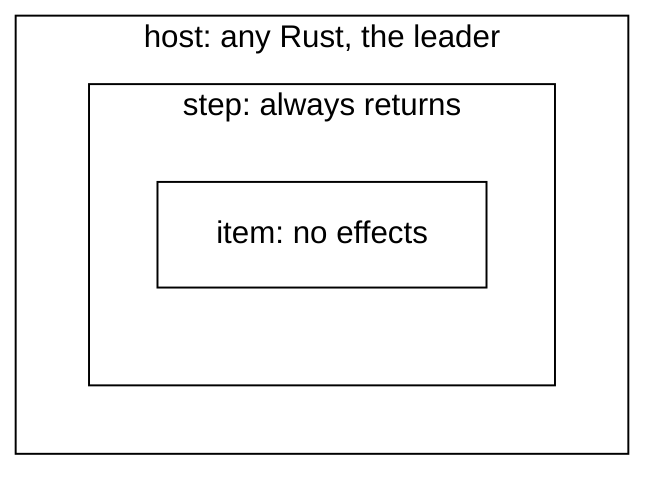
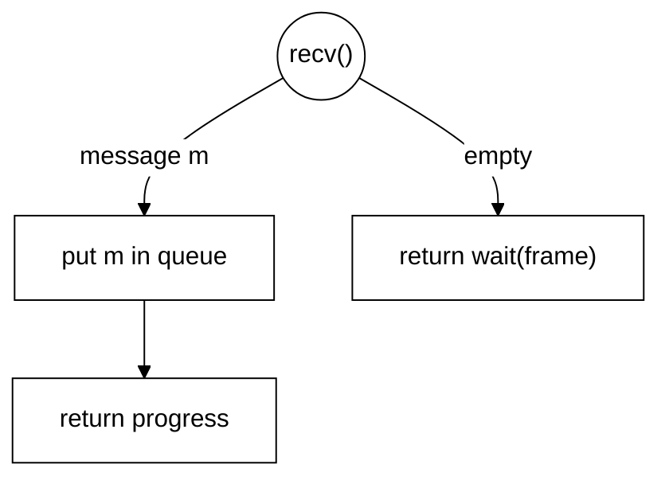
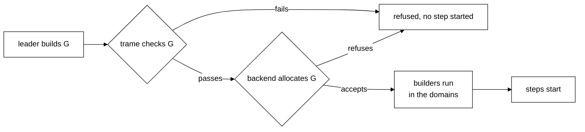
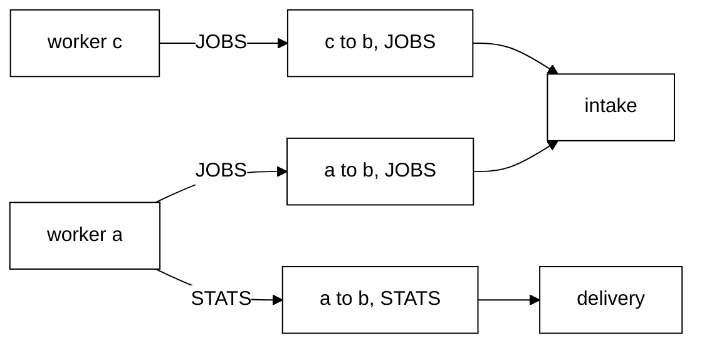
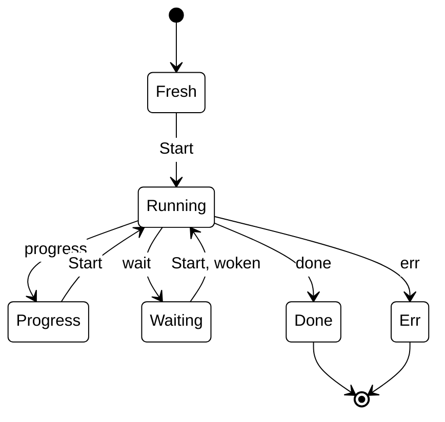
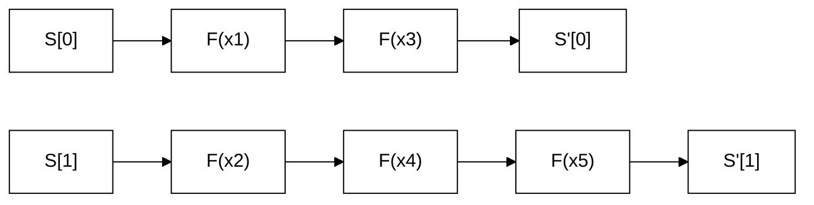
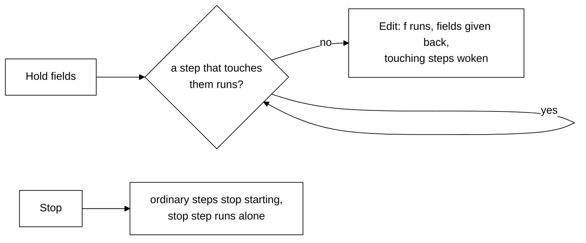

# The trame interface

This file is what a program written against trame may rely on. It defines the meaning of a program;
nothing else in the repository adds to it.

A program asks its environment for things: send this message, give me the next one, what time is it.
These requests are *effects*. An abstract machine $T$ answers them, and in doing so it defines every
behaviour the program may have. A backend answers the same effects on real hardware, and you may
assume it shows only behaviours that $T$ allows.

Trame narrows what can happen in three phases. Compiling checks the code. Launching fixes the
communication graph and builds every state, before any step starts. Running is then bounded by $T$.
Each phase removes possibilities, and every possibility removed is one your program does not have to
handle.



**Reading this file.** Quoted blocks and displayed formulas are normative. Plain paragraphs, code and
diagrams explain them and never add a requirement.

## 1. Levels

A program has three levels. Each runs inside the one above it and may perform fewer effects. A
worker is not a level: it is a state with steps, and its code is its steps.



Each restriction buys one guarantee.

**Step.** A step reaches the outside world only through trame's effects. It never calls the operating
system, so a backend can run it where there is none, on a GPU or a bare-metal core. Every step
returns, and it holds its fields only while it runs, so every field is eventually released.

**Item.** An item performs no effect at all. Its result depends only on its arguments, so it is the
same in whatever order the backend runs the items.

> **Definition (Effect sets).** The effects allowed at each level are $\Sigma_I = \varnothing$ for
> items and $\Sigma_C = \{\mathsf{send}, \mathsf{recv}, \mathsf{me}, \mathsf{now}, \mathsf{parallel}\}$
> for steps. Each effect's answer type is given in the section that defines the effect.

## 2. Programs as interaction trees

Code under trame runs until it requests an effect. The environment answers, and the answer decides
what the code does next.

```rust
#[trame::step(Intake, receives = Job)]
fn intake(queue: &mut Queue) -> Status {
    match trame::recv::<Job>() {
        Some(job) => { queue.put(job); Status::Progress }
        None => Status::wait().frame(),
    }
}
```

Drawn as a tree, each effect is a node and each possible answer is an edge.



A step's tree is finite, because a step always returns. A worker has no tree of its own: it is the
scheduling of its steps (Section 5.3).

> **Definition (Interaction tree).** An interaction tree over effects $\Sigma$ with results in $R$
> either returns a value of $R$, or performs an effect $\sigma \in \Sigma$ and continues with a tree
> chosen by the answer (Xia et al., POPL 2020). The finite trees, which always return, are the
> inductive reading of the equation below.

$$
\mathit{ITree}^{\mathrm{fin}}(\Sigma, R) = R + \textstyle\sum_{\sigma \in \Sigma} \big(\mathit{Ans}_\sigma \to \mathit{ITree}^{\mathrm{fin}}(\Sigma, R)\big)
$$

> **Definition (Denotation).**
> - One call of a step function applied to the fields of its read and write sets denotes a tree in
>   $\mathit{ITree}^{\mathrm{fin}}(\Sigma_C, \mathit{Status})$ (Section 5.3).
> - One call of an item function $F$ denotes a function $I \times S \times C \to S$.
> - Host and leader code is not denoted. It is part of the environment.

These sets embed into each other, so code valid at an inner level can be used at every outer level.

$$
(I \times S \times C \to S) \hookrightarrow \mathit{ITree}^{\mathrm{fin}}(\varnothing) \hookrightarrow \mathit{ITree}^{\mathrm{fin}}(\Sigma_C)
$$

## 3. Compile time

The checker (`cargo trame`, a rustc driver) judges every function on MIR after monomorphization, at
the level where the function is used, so Rust types carry no capability tokens. A function may call
items of `core` and `alloc` only from two nested lists $A_I \subseteq A_C$, each item with a summary
of its effects. The driver cannot read the bodies of non-generic `core` items, so these lists are
trusted.

> **Requirement (All levels).** No `unsafe`, FFI, `std`, threads, globals or indirect calls. Drop
> glue counts as a call. No `UnsafeCell`, so no interior mutability: a step changes a state only
> through the fields of its write set.

> **Requirement (Step).** A step calls only items of $A_C$ and effects of $\Sigma_C$. Every loop is
> counted, and it does not recurse. It neither allocates nor frees: it rewrites in place the buffers
> its state holds. It writes only the fields of its write set $W(i)$ (Section 5.3).

> **Requirement (Item).** An item calls only items of $A_I$. Every loop is counted, and it neither
> recurses nor allocates. It writes only its slot.

> **Definition (Counted loop).** A loop is counted when it is a `for` over a range, a slice or an
> array, or over one of these reversed, that the body does not mutate.

Counted loops over an acyclic call graph are LOOP programs (Meyer & Ritchie, 1967), and LOOP programs
always terminate. This is why every step returns. It bounds the work of a step but not its duration.
Unbounded work must be split into more steps or more items.

### 3.1 What a step body may call

The lists $A_C$ and $A_I$ are the files `crates/driver/lists/A_C.txt` and `A_I.txt`; the checker reads
them and nothing else. What they mean for a program:

| In a step | Allowed | Refused |
| --- | --- | --- |
| Control flow | `for` over a range, slice or array; `if`, `match`, `?` | `while`, `loop`, recursion |
| `Vec`, `String`, `Box` | read and rewrite in place: `len`, `is_empty`, `capacity`, indexing, `as_slice`, `as_mut_slice`, borrowing iteration, `==`, `cmp` | anything that grows, shrinks, copies or frees: `push`, `pop`, `insert`, `remove`, `clear`, `truncate`, `extend`, `resize`, `clone`, `collect`, dropping a value that owns a buffer |
| Slices, arrays | every `core::slice` method, `core::mem::{swap, replace, take}` | |
| Other collections | none | `VecDeque`, `BTreeMap` and the rest of `alloc::collections`; `HashMap` and `HashSet` in any level, because no hasher is listed |
| Text | reading a `String` or `&str` | `format!`, building a `String` |
| Numbers | `+ - * /` with overflow checks, comparisons, `Option` and `Result` combinators, the float operations listed under Floating point | `std` anything, so `f64::exp`, `ln`, `powf`, `sqrt`; use `trame::math::f64::exp` and the like (`math::f32` for `f32`). `f64::max` and `min` |
| Memory | the fields of the write set | `static`, `thread_local!`, `Cell`, atomics, `Rc`, `Arc`, raw pointers, `unsafe` |

A field is a buffer of fixed capacity. The builder or an edit allocates it at the size it will need, and
the step keeps how much of it is in use in another plain field. A queue is an array, a head and a
length; a table that grows is built by an edit between steps. A step that needs room it was not given
returns `Status::wait()` or fails, because it cannot ask for more.

A function a step calls is judged at the step's level, whatever crate it is in, so a helper that
allocates or loops with `while` is refused where the step calls it. A function reached from several
levels is judged at the strictest. The checker does not yet judge builders and edits, which the
driver calls the worker level; Section 1 says a host is any Rust, and this section says "all levels".
The driver is the authority until the two agree.

To run the checker on a crate, build `trame-driver` from `flake.nix`, put its `bin/` on `PATH`, and run
`cargo trame check --features <backend>` under the toolchain in `crates/driver/rust-toolchain.toml`
(`nix develop "path:$PWD#driver"` provides it). A checked build compiles with `--cfg trame_checked`,
which `cargo trame` sets; a crate that does not declare it as a known cfg gets one `unexpected_cfgs`
warning per state.

> **Requirement (State and step).** A state is a struct with named fields, at most 63 of them, and at
> most 64 steps, the stop step included. A step's parameters each name a field of its state, with the
> field's type, as `&T` (read) or `&mut T` (write), or are `pool: &P`, the pool of the state's pool
> type $P$. A parameter that names no field, or a field of another type, is a compile error. A step
> takes the pool only as `&P`. A state cannot be generic.

> **Requirement (State memory).** Every field of a state, its pool type and its error type are
> `trame::Plain`. Numbers, `bool`, `char`, arrays, tuples, `Option`, `Result`, `Vec`, `Box`, `String`,
> the `alloc` collections, `Duration`, `Reading`, `WorkerId`, `HostId` and message types are plain
> when what they hold is; a user type is plain by `#[derive(trame::Plain)]`, which requires it of
> every field. A function pointer, a closure, a trait object, a reference, a raw pointer, an `Rc`, an
> `Arc`, a cell, an atomic and a lock are not.

A state is read in place by every process of its host, so a value in it must mean the same in each.
`Plain` is a check on types: a `usize` that holds an address is plain, and means nothing elsewhere.
An `unsafe impl Plain` written by hand is your promise, not trame's.

> **Definition (Tags).** A program declares a finite set of message types, and each message type is a
> tag: $M_t$ is the type of tag $t$. Two kinds of message with the same fields are two types.

> **Requirement (Messages).** Every message type is plain data: no padding, no pointer, and no bit
> pattern that is invalid (bytemuck's `Pod`). `#[trame::message]` on a struct makes it so, and refuses
> references, pointers, function pointers and padding. A message is sent as its bytes in its
> `repr(C)` layout, little-endian. Trame supports little-endian targets only, and does not check the
> byte order of the target.

> **Requirement (Run-time aborts).** Overflow, an index out of range, division by zero, and running
> out of memory abort the launch. Overflow checks are on in every build profile.

With overflow checks always on, `+` means the same thing in every build. An item's abort depends
only on its inputs, so items stay deterministic.

> **Requirement (Floating point).** Floating point follows IEEE 754 with round to nearest even, no FMA
> contraction and no flush to zero. Results are bit-identical except for the sign and payload of NaNs,
> which Rust leaves unspecified. An operation is allowed at every level when Rust specifies its result
> bit for bit: the arithmetic operators, negation, comparisons, `abs`, `copysign`, `signum`, `clamp`,
> `total_cmp`, the classification predicates, `to_bits` and `from_bits`. `max` and `min` are not: the
> sign of a zero result is unspecified. Every other numeric function comes from `trame::math`.

> **Requirement (Checked builds).** A checked build compiles with `--cfg trame_checked`. Without it,
> `#[trame::state]` and `parallel!` expand to `compile_error!`.

The flag prevents accidental unchecked builds. Set by hand without the checker, it lifts the error
and checks nothing: the requirements of this section then hold only if your code keeps them.

## 4. Launch time

The leader builds the communication graph, the *topology*, while it runs, so it can use its own data:
the number of devices, a partition of the work. A worker is declared first and given its state
afterwards, so a state can name workers declared after it. Trame checks the topology, the backend
allocates everything it needs or refuses, and no step starts before both accept and every state is
built. Once workers run, the graph never changes and no route can run out of room it was promised.
Memory is the one resource a program can still exhaust, by allocating, and that aborts.

```rust
let mut t = Topology::new();
let a = t.worker::<Produce>();
let b = t.worker::<Consume>();
let table = t.pool::<Table>();
t.set(&a, || Produce { /* ... */ });
t.set(&b, || Consume { /* ... */ });
t.set(&table, || Table { /* ... */ });
t.route::<Job>(a.id(), b.id(), 64);
t.lossy::<Stat>(b.id(), Leader, 4);
let run = t.launch()?;
```

`worker` and `pool` give a handle and no value. `set` gives the value, as a closure the backend runs
at launch in the memory where the value is used; a second `set` replaces the first. An end of a route
is a worker (`w.id()`, or `(HostId(h), k)` for worker `k` of host `h`) or `Leader`. A route from the
leader to itself panics. A topology has at most one pool.

A backend may run the host program in several operating-system processes. Each process
then runs the host code up to `launch` and builds $G$, and `launch` refuses unless every process built
the same $G$. In the leader's process `launch` returns the run. In a worker's process it runs that
worker and ends the process, so host code after `launch` runs only in the leader's.

> **Definition (Topology).** A topology $G$ consists of the following.
> - Hosts, each with one leader, and devices, each on one host.
> - A set $W$ of workers. Each worker $w$ has a state type $S_w$ with its steps, and is placed on a
>   device $\mathrm{dev}(w)$, which the backend chooses when it accepts $G$.
> - At most one pool, of a type $P$, which no worker owns.
> - A builder for each worker and for the pool, given by `set`.
> - A list $R$ of routes. Each route $r$ has a sender $\mathit{from}(r)$ and a receiver
>   $\mathit{to}(r)$, each a worker or a leader, a tag $\mathrm{tag}(r)$, a capacity
>   $\mathrm{cap}(r) \geq 1$ and a flag $\mathrm{lossy}(r)$. Both ends may be the same worker. The
>   position of $r$ in $R$ is its rank.

> **Requirement (Launch checks).** Before any step starts, `launch` refuses $G$ with a `Refused`
> value unless all of these hold.
> - Every route names workers of $G$ (`UnknownWorker`), and has capacity at least 1 (`ZeroCapacity`).
> - No two routes have the same sender, receiver and tag (`Duplicate`).
> - `trame::Alloc` is the program's global allocator (`Alloc`).
> - The pool and every worker have a builder (`PoolUnset`, `Unset`).
> - Every worker whose steps take a pool has the pool type of $G$ (`PoolType`).
> - No two steps of one worker receive the same tag (`TwoOwners`).

> **Requirement (Acceptance).** The backend then accepts or refuses $G$ (`Refused::Backend`, whose
> message says why, with the numbers). It may refuse for any reason: memory for the queues or the
> domains, links between devices, room to run every worker at once. A backend that accepts allocates
> everything $G$ needs before any step starts, and never refuses for lack of resources afterwards.

A refusal happens on every process of the launch or on none, and before any step starts.



A message of any size is one frame. A backend whose transport has a smaller unit splits it, and that
is invisible to $T$.

A *domain* is the memory in which a worker's state lives, and in which its agents and its leader
address it at the same addresses. `trame::Alloc` gives the allocations of a builder or of an edit to
the domain; every program installs it as its `#[global_allocator]`.

> **Definition (Building).** Each builder runs once, in the domain of the worker or the pool it fills,
> before any step starts. Every byte that the built value owns lies in that domain. A domain has a
> size fixed at launch; an allocation that does not fit stops the process with Rust's allocation
> failure, after the backend has said the domain is full.

A send names its receiver and its message type, and the route is looked up in $G$. A send with no
such route aborts, so no worker can reach a route outside $G$.

## 5. Run time

A run is a sequence of transitions $\Gamma \xrightarrow{\ell} \Gamma'$ between configurations. A
configuration $\Gamma$ is the state of the whole launch. Each subsection introduces the components of
$\Gamma$ that its rules read and write, with their initial values.

> **Definition (Agents).** An agent is a step instance or a leader. $w(x)$ is the worker whose state
> step $x$ runs over, and $w(x) = x$ when $x$ is a leader.

> **Definition (Run).** The rules of this section, and the endings of Definitions (Abort) and
> (Deadlock), are the only transitions. A label $x : \sigma / v$ records that agent $x$ performed the
> effect $\sigma$ and received the answer $v$. Transitions without a label are internal.

> **Definition (Residual trees).** $\Gamma$ contains $\Pi$. $\Pi(p)$ is the remaining tree of step $p$
> while $p$ runs, and $\bot$ otherwise. $\Pi(p) = \sigma \cdot k$ means that $p$ is about to perform
> $\sigma$ and then continues with $k$ applied to the answer. Every labelled rule $x : \sigma / v$ also
> sets $\Pi(x) := k(v)$, and the rules leave this update implicit.

> **Definition (Initial configuration).** $\Gamma_0$ gives every component the initial value stated
> where the component is introduced.

> **Definition (Identity).** The effect $\mathsf{me}$ answers the identity of $w(x)$. In Rust it is
> `trame::me`.

> **Definition (Abort).** If any code panics, the run ends. Every worker that has no result yet unwinds
> at its next effect, and every leader call on the ended run, including one already blocked, panics
> with `trame: worker <w> panicked: <message>`. Here $w$ is the first worker that panicked and
> $\mathrm{message}$ its panic message, or `<non-string panic payload>` when the payload is neither a
> `&str` nor a `String`. The leader observes no result of an aborted run.

> **Definition (Join).** The leader's last act is $\mathsf{join}$. After it, no transition of that
> leader occurs. In Rust it is `Run::join`, which returns once every worker has a result and answers
> them in declaration order. After it, the leader may take every state (`Worker::take`) and every
> error (`Worker::error`); both panic before the join.

> **Definition (Deadlock).** A worker $w$ is stuck in $\Gamma$ when no run from $\Gamma$ contains a
> Start of a step of $w$. A backend may end a stuck worker, and it then gets the result
> $\mathsf{deadlock}$. A leader call that can never return is stuck too. A backend that shows it
> panics that call with `trame: deadlock: the leader waits and nothing can arrive`.

Stuckness is undecidable in general, so a backend reports $\mathsf{deadlock}$ only where it can show
it. One case is cheap. Once the leader is in `join`, a worker is stuck when no step of any worker can
start, now or after time passes. A worker waiting for a frame before then is never reported, since
the leader may still send. A leader blocked in `wait` is stuck when no worker can move now or after
time passes. Both backends show this case; on several hosts, only once every host's leader waits,
joins or has ended.

### 5.1 Time

Programs never see real time directly. They read clocks, and each clock shows real time plus an
unknown offset. Two readings compare only when they come from the same clock, so trame never needs
to synchronize clocks.

> **Definition (Time).** $\Gamma$ contains the real time $\tau \in \mathbb{R}_{\geq 0}$, initially $0$.
> Each device has one clock, and $\mathrm{clock}(x)$ is the clock of $\mathrm{dev}(w(x))$ for a step
> $x$. $\Gamma_0$ fixes an arbitrary offset $\theta(c)$ for each clock $c$, and no rule changes it. The
> effect $\mathsf{now}()$ answers a reading, which pairs a clock with a value. `since` between two
> readings of the same clock answers the span between them, and between readings of different clocks
> it aborts. `after` adds a span to a reading, giving a reading of the same clock. Spans are
> `core::time::Duration`. In Rust the effect is `trame::now`.

$$
\frac{\tau' \geq \tau}{\Gamma \to \Gamma[\tau := \tau']}
\ \textbf{Tick}
\qquad
\frac{c = \mathrm{clock}(x)}{\Gamma \xrightarrow{x\,:\,\mathsf{now}\,/\,(c,\ \tau + \theta(c))} \Gamma}
\ \textbf{Now}
$$

### 5.2 Communication

Every route has its own queue. When a frame is sent, the environment chooses the time at which it
arrives, which models latency. Arrival times never decrease along a route, so every route is FIFO.
Each tag a worker receives belongs to one of its steps, and that step receives every route with that
tag. Since each tag has its own queue, one step's backlog fills only its own routes.



Here `intake` owns `JOBS` on worker `b`, so it receives from two routes. Each route is FIFO, but
nothing orders the two against each other: `recv` may take the head of either. Ordering frames across
routes would need one clock every sender agrees on, which trame does not have.

> **Definition (Queues).** $\Gamma$ contains $Q$. $Q(r)$ is the sequence of frames on route $r$,
> initially empty. A frame $f = (m, a)$ has a message $m$ and an arrival time $a$. It is *available*
> when $a \leq \tau$. $a_{\mathrm{last}}(Q(r))$ is the arrival time of the last frame of $Q(r)$, or $0$
> when $Q(r)$ is empty. $\Gamma$ also contains $U$. $U(r)$ counts the frames taken from $Q(r)$ whose
> slot the sender has not yet got back, initially $0$. It stays $0$ on a lossy route.
> $\mathrm{held}(r) = |Q(r)| + U(r)$ is the number of slots of $r$ in use.

> **Definition (Ownership).** Step $i$ of worker $w$ owns the tags $\mathrm{tags}(i)$, the message
> types in its `receives` list (at most 16). A step owns route $r$ when $\mathit{to}(r) = w$ and
> $\mathrm{tag}(r) \in \mathrm{tags}(i)$. A `recv` of a tag the calling step does not own answers
> $\mathsf{empty}$. A leader owns every route that ends at it.

Frames still queued when an edit or a stop happens stay queued. What a leader receives is the
environment's business: **Take** removes frames from its routes in any order. In Rust the leader takes
frames with `Run::recv`, which never blocks.

> **Definition (Offers).** A frame $f$ is an offer to agent $x$ on route $r$ when $x$ owns $r$, $f$ is
> the first frame of $Q(r)$, and $f$ is available.

> **Definition (Communication effects).** $\mathsf{send}(r, m)$ with $m \in M_{\mathrm{tag}(r)}$
> answers $\mathsf{ok}$ or $\mathsf{full}$. $\mathsf{recv}(t)$ answers a message of type $M_t$, or
> $\mathsf{empty}$. In Rust these are `trame::send(to, m)`, where $r$ is the route of $G$ from $w(x)$
> to `to` with the tag of `m`'s type, and `trame::recv::<M>()`. The leader's are `Run::send` and
> `Run::recv`.

$$
\frac{\mathit{from}(r) = w(x) \quad \mathrm{held}(r) < \mathrm{cap}(r) \quad a \geq \max(\tau, a_{\mathrm{last}}(Q(r)))}
{\Gamma \xrightarrow{x\,:\,\mathsf{send}(r,m)\,/\,\mathsf{ok}} \Gamma[Q(r) := Q(r) \cdot (m,a)]}
\ \textbf{Send}
$$

$$
\frac{\mathit{from}(r) = w(x) \quad \neg\,\mathrm{lossy}(r) \quad \mathrm{held}(r) = \mathrm{cap}(r)}
{\Gamma \xrightarrow{x\,:\,\mathsf{send}(r,m)\,/\,\mathsf{full}} \Gamma}
\ \textbf{Full}
$$

$$
\frac{\mathit{from}(r) = w(x) \quad \mathrm{lossy}(r) \quad Q(r) = f \cdot q \quad |Q(r)| = \mathrm{cap}(r) \quad a \geq \max(\tau, a_{\mathrm{last}}(Q(r)))}
{\Gamma \xrightarrow{x\,:\,\mathsf{send}(r,m)\,/\,\mathsf{ok}} \Gamma[Q(r) := q \cdot (m,a)]}
\ \textbf{Overwrite}
$$

$$
\frac{\mathrm{tag}(r) = t \quad f \text{ is an offer to } x \text{ on } r \quad Q(r) = f \cdot q}
{\Gamma \xrightarrow{x\,:\,\mathsf{recv}(t)\,/\,m_f} \Gamma[Q(r) := q,\ U(r) := U(r) + [\neg\,\mathrm{lossy}(r)]]}
\ \textbf{Recv}
\qquad
\frac{\text{no frame on a route of tag } t \text{ is an offer to } x}
{\Gamma \xrightarrow{x\,:\,\mathsf{recv}(t)\,/\,\mathsf{empty}} \Gamma}
\ \textbf{Empty}
$$

$$
\frac{\mathit{to}(r) \text{ is a leader} \quad Q(r) = f \cdot q}
{\Gamma \to \Gamma[Q(r) := q,\ U(r) := U(r) + [\neg\,\mathrm{lossy}(r)]]}
\ \textbf{Take}
\qquad
\frac{U(r) > 0}
{\Gamma \to \Gamma[U(r) := U(r) - 1]}
\ \textbf{Release}
$$

$$
\frac{\mathrm{lossy}(r) \quad Q(r) = q \cdot f \cdot q' \quad q' \neq \varepsilon}
{\Gamma \to \Gamma[Q(r) := q \cdot q']}
\ \textbf{Drop}
$$

$[\varphi]$ is $1$ when $\varphi$ holds and $0$ otherwise.

These are the only answers. **Full** applies only to a route that is not lossy, and only when all its
slots are in use. So a backend cannot answer $\mathsf{full}$ to every send and deliver nothing.

A receive frees its slot only at **Release**, which the environment fires later. Across a network the
receiver's progress is a message on its way back to the sender, and until it arrives the sender may
still be answered $\mathsf{full}$. You therefore learn that a route has room only from
$\mathsf{room}$ or from an $\mathsf{ok}$, never from knowing that the receiver received.

A lossy route never makes its sender wait. When its queue is full, a send replaces the oldest frame
(**Overwrite**), and the transport may lose any frame except the newest (**Drop**). A receiver that
keeps receiving ends up with the latest frame.

### 5.3 State, steps and scheduling

A worker is a state and its steps. Each step names the fields it reads and the fields it writes, and
steps of one worker run at once when their fields do not conflict. A step takes all its fields before
it starts and gives them back when it returns.

```rust
#[trame::state(steps(intake, delivery), stop = flush, error = E)]
struct Pipe { queue: Queue, stats: Stats }

#[trame::step(Pipe, receives = Job)]
fn intake(queue: &mut Queue) -> Status { ... }

#[trame::step(Pipe, weight = 0.5)]
fn delivery(queue: &Queue, stats: &mut Stats) -> Result<Status, E> { ... }
```

Here `intake` writes `queue` and owns `Job`, and `delivery` reads `queue` and writes `stats`. The two
touch `queue` and `intake` writes it, so they never overlap. A third step that touched only `stats`
could overlap `intake` but not `delivery`.



A step waiting for a frame, for room on a route or for a deadline returns $\mathsf{wait}$ instead of
polling. Each wait condition is a state the scheduler rechecks, not an event that could be missed.

> **Definition (States and steps).** A worker $w$ has a set of fields $F_w$ and steps
> $0, \dots, n-1$, and at most one stop step $n$. Step $i$ has a read set $R(i)$ and a write set
> $W(i)$, both subsets of $F_w \cup \{\mathsf{pool}\}$, a set of tags $\mathrm{tags}(i)$, and an
> initial weight $\omega_0(i) \in [0, 1]$, 0 unless the step's attribute gives one.
> $\mathrm{fields}(i) = R(i) \cup W(i)$. Steps $i$ and $j$ *conflict* when
> $W(i) \cap \mathrm{fields}(j) \neq \varnothing$ or $W(j) \cap \mathrm{fields}(i) \neq \varnothing$.
> $\Gamma$ contains, for each step $p$, its latest status $\mathit{St}(p)$, initially $\mathsf{fresh}$;
> a flag $D(p)$, initially false, that records that a conflicting step ended since $p$ last ended; its
> weight $\omega(p)$, initially $\omega_0(p)$; its pass $\pi(p)$, initially $0$; and the count $\ell(p)$
> of the start at which it last started, initially $0$. $\Gamma$ also contains, for each worker, the
> set $E(w)$ of fields that its leader holds for an edit, initially empty, and a flag $Z(w)$, set by a
> stop, initially false.

> **Definition (Status).** A step returns
> $\mathit{Status} = \{\mathsf{progress}, \mathsf{done}\} + \mathsf{wait}(\Omega) + \mathsf{err}(E)$,
> where $\Omega$ is a set of conditions. Any status but $\mathsf{done}$ may carry a weight
> $\omega' \in [0, 1]$ for the step's next start.
> - $\mathsf{frame}$ holds when some frame is an offer to $p$.
> - $\mathsf{room}(r)$ holds when $\mathrm{held}(r) < \mathrm{cap}(r)$ or $r$ is lossy.
> - $\mathsf{until}(d)$, where $d$ is a reading of $\mathrm{clock}(p)$, holds when
>   $\tau + \theta(\mathrm{clock}(p)) \geq d$. Waiting on a reading of another clock aborts.
>
> $\Omega$ may be empty, and then only $D(p)$ wakes $p$. In Rust, `Status::Progress` and `Status::Done`
> are constants, `Status::wait()` is $\mathsf{wait}(\varnothing)$, and `.frame()`, `.room::<M>(to)` and
> `.until(reading)` each add one condition. `.room` names one of the worker's first 64 outgoing routes,
> and aborts when the worker has no such route. `.weight(w)` sets $\omega'$, and panics on `Done` or
> outside $[0, 1]$. A step of a state that names an error type $E$ returns `Result<Status, E>`, and
> `Err(e)` is $\mathsf{err}(e)$.

> **Definition (Enabled and wanting).** Step $p$ is enabled when $\mathit{St}(p)$ is $\mathsf{fresh}$
> or $\mathsf{progress}$, or when $\mathit{St}(p) = \mathsf{wait}(\Omega)$ and either some condition in
> $\Omega$ holds or $D(p)$ is true. Step $p$ wants to start when $\Pi(p) = \bot$, $p$ is enabled, no step
> of $w(p)$ has status $\mathsf{err}(\_)$, and either $Z(w(p))$ is false and $p$ is an ordinary step,
> or $Z(w(p))$ is true, $p$ is the stop step and no step of $w(p)$ runs.

> **Definition (Rank).** The rank of $p$ is the triple
> $(\omega(p) = 0,\ \omega(p) > 0\,?\,\pi(p) : \ell(p),\ \text{index of } p)$, and a smaller triple
> ranks higher, with false below true. Priority goes by rank: positive weights before weight 0, then
> the least pass, or the earliest last start for weight 0, then the lowest index.

In **Start**, $q$ ranges over the steps of $w(p)$.

$$
\frac{p \text{ wants to start} \quad \forall q \neq p.\ \Pi(q) \neq \bot \Rightarrow \neg\,\mathrm{conflict}(p, q) \quad \mathrm{fields}(p) \cap E(w(p)) = \varnothing \quad \neg\exists q \neq p.\ \big(q \text{ wants to start} \wedge \mathrm{rank}(q) < \mathrm{rank}(p) \wedge \mathrm{conflict}(p, q)\big)}
{\Gamma \to \Gamma\big[\Pi(p) := \mathit{step}_p,\ \ell(p) := 1 + \max_q \ell(q),\ \pi(q) := \max(\pi(q), \pi(p)) \text{ for each } q \text{ with } \mathit{St}(q) = \mathsf{wait}(\_)\big]}
\ \textbf{Start}
$$

$$
\frac{\Pi(p) = \mathsf{ret}(s) \quad \mathit{ser} \text{ is the service the backend measured for the step}}
{\Gamma \to \Gamma\big[\Pi(p) := \bot,\ \mathit{St}(p) := s,\ D(p) := \mathsf{false},\ \pi(p) := \pi(p) + \mathit{ser} \cdot 2^{24} / \omega(p),\ \omega(p) := \omega'(s),\ D(q) := \mathsf{true} \text{ for each } q \neq p \text{ with } W(p) \cap \mathrm{fields}(q) \neq \varnothing\big]}
\ \textbf{End}
$$

In **End**, $\omega'(s)$ is the weight $s$ carries, or $\omega(p)$ when it carries none, and the pass
grows only when $\omega(p) > 0$. The service is the backend's measure of what the step used: 1 per
step on one backend, nanoseconds on another (`src/backends/README.md`). Under contention, steps of positive weight therefore receive service
in proportion to their weights (stride scheduling, Waldspurger and Weihl, 1995), and a weight-0 step
may wait for ever behind steps of positive weight.

Any step that ends wakes the steps it conflicts with through a write, even one that returns
$\mathsf{wait}$, because it may have changed a field before waiting. So two steps that wait only on
each other's fields keep waking each other. That run is not stuck, so it is not a deadlock. It spins,
and the spinning is the program's error.

A step takes all its fields at once and never waits while holding them, so fields cannot deadlock,
whatever the number of agents. A step waits for another for at most one step's duration, and is
overtaken by no conflicting step of lower rank.

> **Definition (Result).** $\mathrm{ans}(w)$ is undefined while a step of $w$ runs. Otherwise it is
> $\mathsf{failed}(e)$ when a step of $w$ has status $\mathsf{err}(e)$, taking the first; otherwise,
> when $Z(w)$ is true, $\mathsf{stopped}$ if $w$ has no stop step or its stop step has status
> $\mathsf{done}$; otherwise $\mathsf{returned}$ when every ordinary step has status $\mathsf{done}$.
> The result of $w$ is the first value $\mathrm{ans}(w)$ takes along the run, or $\mathsf{deadlock}$
> when a backend ends $w$ by Definition (Deadlock). In Rust, `Run::join` answers `Outcome::Returned`,
> `Stopped`, `Failed` or `Deadlock`.

Once a step fails, no new step of its worker starts. The running steps finish, and the worker's
result is $\mathsf{failed}(e)$. A panic in a step is not a result: it aborts the run.

### 5.4 Items

`parallel!` applies an item function to many inputs. Each input has a key, and each key selects a
slot. The inputs with the same key are folded into their slot in input order. Different keys are
independent, so a backend may run them in parallel. A map is the case where each input has its own
key. The fold works in place and allocates nothing.



Here $x_1$ and $x_3$ have key $0$, and $x_2$, $x_4$ and $x_5$ have key $1$. The two chains may run at
the same time; each runs in input order.

> **Definition (Parallel effect).** $\mathsf{parallel}(F, \kappa, C, \bar x, S)$ takes an item
> function $F$, a key function $\kappa$, a shared context $C$, inputs $\bar x$ and slots $S$. It
> aborts, before running any item, unless $\kappa(x_i) < |S|$ for every $i$. Otherwise it answers the
> slots $S'$ defined below. For each key $k$, let $i_1 < \dots < i_m$ be the positions whose key is $k$.
> In Rust, an item is `#[trame::item(key = ...)] fn f(item: &I, slot: &mut S, cx: &C)`, where the key
> is an expression over `item`, run as `parallel!(f, &cx, &items, &mut slots)`.

$$
s_0 = S[k], \qquad s_j = F(x_{i_j},\ s_{j-1},\ C), \qquad S'[k] = s_m
\qquad\qquad
\frac{a \text{ is the answer defined above}}{\Gamma \xrightarrow{x\,:\,\mathsf{parallel}(F, \kappa, C, \bar x, S)\,/\,a} \Gamma}
\ \textbf{Parallel}
$$

### 5.5 Leader acts

Besides sending and receiving, the leader waits, edits a state or the pool, stops the workers, and
joins. These acts are part of the environment, so no step performs them. A worker that wants the pool
changed sends the leader a message.

**Waiting.** `Run::wait` blocks until something changed for the leader since its last `wait`: a frame
reached it, a worker got a result, or the run aborted. A leader that calls `recv`, and `wait` only
when `recv` found nothing, never polls. Dropping a `Run` does not stop the workers.

```rust
loop {
    match run.recv::<Report>() {
        Some(r) => handle(r),
        None => run.wait(),
    }
}
```



> **Definition (Pool).** $\Gamma$ contains the pool value, initially the one its builder made. Steps
> with $\mathsf{pool} \in R(i)$ read it. Only an edit writes it.

> **Definition (Edit).** The leader's act $\mathsf{edit}(h, f)$ on a handle $h$ is two rules. For a
> worker $w$, $\varphi = F_w$. For the pool, $\varphi = \{\mathsf{pool}\}$ in every worker. **Hold**
> adds $\varphi$ to $E(w)$, so that no step touching $\varphi$ starts. **Edit** applies $f$ and gives
> the fields back once no step touching $\varphi$ runs. It answers $\mathsf{false}$, and applies
> nothing, when $w$ already has a result; a pool edit answers $\mathsf{true}$. In Rust it is
> `Run::edit(&h, |v| ...)`, whose closure may allocate and resize: what it allocates lands in the
> domain.

$$
\frac{}{\Gamma \to \Gamma[E(w) := E(w) \cup \varphi]}
\ \textbf{Hold}
\qquad
\frac{\varphi \subseteq E(w) \quad \forall p \text{ of } w.\ \Pi(p) \neq \bot \Rightarrow \mathrm{fields}(p) \cap \varphi = \varnothing}
{\Gamma \xrightarrow{\mathsf{edit}(w, \varphi, f)} \Gamma\big[\varphi \text{ of } w \text{ := } f(\varphi \text{ of } w),\ E(w) := E(w) \setminus \varphi,\ D(q) := \mathsf{true} \text{ for each } q \text{ with } \mathrm{fields}(q) \cap \varphi \neq \varnothing\big]}
\ \textbf{Edit}
$$

For a pool edit, **Edit** applies to every worker at once: its premise holds for
$\varphi = \{\mathsf{pool}\}$ in every worker, and it replaces the pool once. What the edit wrote is
visible to every step that starts after it returns and to no step that ran during it. Queued frames
are kept. A pool edit waits for the slowest reader in every worker, so it is a pause of every step
that reads the pool, everywhere.

> **Definition (Stop).** The leader's act $\mathsf{stop}$ sets $Z(w) := \mathsf{true}$ for every
> worker $w$. In Rust it is `Run::stop`, which returns at once.

$$
\frac{}{\Gamma \xrightarrow{\mathsf{stop}} \Gamma[Z(w) := \mathsf{true} \text{ for every worker } w]}
\ \textbf{Stop}
$$

After a stop no ordinary step starts, and the stop step starts when no step of its worker runs. A stop
step may send, so keep receiving until `join`.

## 6. Hosts

A deployment may have several hosts. A host is one memory domain with one leader. Every host runs the whole program and declares its own topology, with its workers
numbered from 0, so a program that wants different work on each host branches on `trame::host()`.

> **Definition (Hosts).** Hosts are numbered $0, \dots, H-1$, fixed for the run. `trame::host()`
> answers this host's `HostId`, on its leader and in its workers, and `trame::hosts()` answers $H$. A
> worker of another host is named `(HostId(h), k)`, as host $h$ declared it.

> **Requirement (Routes between hosts).** A route between workers of two hosts is a route of $T$
> (Section 5.2). Both hosts declare it, with the same ends, message type, kind and capacity. Hosts
> whose declarations differ are both refused at launch, with a message naming the route. A route that
> one host declares and the other does not is refused on the declaring host, at the latest when the
> other host's leader ends. A route between a leader and a worker of another host is refused.

Only hosts that share routes wait for each other's launch. A message type crossing hosts is identified
by a hash of its type path and its size, so both hosts must compile the same type under the same
path.

> **Definition (Peer channel).** A peer of a leader is the leader of any other host: with $H$ hosts,
> every leader has the $H - 1$ others, whether or not their hosts share a route. Leaders exchange
> messages over a channel that is not a route. `Run::leader_send(HostId(h), m)` sends to host $h$'s
> leader, and `Run::leader_recv::<M>()` answers the next message of type `M` from a peer leader with
> the host it came from, or `None`. Messages of one type from one peer arrive in the order they were
> sent. A host is not its own peer, and a host number of $H$ or more names no host; a send to either
> panics.

A leader may rely on a peer having launched when its host shares a route with the peer's host,
because those hosts wait for each other's launch. For any other peer, a program that must know the
peer is running has to be told so by a message.

Each host has its own clocks, so readings of two hosts never compare (Section 5.1). Definition
(Deadlock) holds across hosts: a worker waiting on a route from a host that has ended is stuck.

## 7. Rust surface

Every public name of the crate is listed here with the part of $T$ it stands for. A name not listed is
not part of the interface, and a name with a leading `__` is internal. All names are at the crate
root, except the functions of `trame::math`.

| Name | Kind | Stands for |
|---|---|---|
| `#[trame::message]` | attribute on a struct | a tag and its message type (Section 3) |
| `#[trame::state(steps(a, b), stop = f, pool = P, error = E)]` | attribute on a struct | a worker's fields $F_w$ and its steps; `stop`, `pool` and `error` are optional (5.3) |
| `#[trame::step(S, receives = A, B, weight = w)]` | attribute on a fn | a step of `S`: $R(i)$, $W(i)$, its tags and $\omega_0(i)$; `receives` and `weight` are optional (5.3) |
| `#[trame::item(key = e)]` | attribute on a fn | an item function $F$ and its key $\kappa$ (5.4) |
| `parallel!(f, &cx, &items, &mut slots)` | macro | $\mathsf{parallel}$ (5.4) |
| `#[derive(trame::Plain)]` | derive | `Plain` for a struct or enum whose fields are all plain (Section 3) |
| `Plain` | unsafe trait | a type a state, the pool or an error may hold (Section 3) |
| `send(to, m) -> Result<(), Full>` | fn | $\mathsf{send}$ on the route from this worker to `to` with the tag of `m` (5.2) |
| `recv::<M>() -> Option<M>` | fn | $\mathsf{recv}(t)$ for the tag of `M` (5.2) |
| `me() -> WorkerId` | fn | $\mathsf{me}$ (5); panics outside a worker |
| `now() -> Reading` | fn | $\mathsf{now}$ (5.1) |
| `host() -> HostId` | fn | this host (6) |
| `hosts() -> u32` | fn | the number of hosts $H$ (6); 1 on a backend that runs one host |
| `Reading` | type: `since`, `after` | a reading of one clock (5.1) |
| `Status` | type: `Progress`, `Done`, `wait()` with `.frame()`, `.room::<M>(to)`, `.until(r)`, and `.weight(w)` | $\mathit{Status}$ (5.3) |
| `Full` | type | the answer $\mathsf{full}$ (5.2) |
| `Message` | trait, implemented by every plain-data type: `zeroed` | plain data of a tag (Section 3) |
| `Alloc` | type: `Alloc::new(inner)`, a global allocator | the domain allocation of builders and edits (4, Definition (Building)) |
| `Topology` | type: `new`, `worker::<S>`, `pool::<P>`, `set`, `route::<M>`, `lossy::<M>`, `launch` | $G$, its declaration and its launch (4) |
| `Worker<S>` | type: `id`, `take`, `error` | a declared worker, and the leader's access to its state after the join (4, Definition (Join)) |
| `Pool<P>` | type | the declared pool (4) |
| `Handle` | sealed trait, implemented by `Worker<S>` and `Pool<P>` | what `Topology::set` and `Run::edit` act on |
| `WorkerId` | type, from `Worker::id` or `(HostId, k)` | a worker of this host or another (4, 6) |
| `HostId` | type, `HostId(pub u32)` | a host (6) |
| `Leader` | type, unit | this host's leader as an end of a route; not a worker: no index, state or steps |
| `End` | type, hidden | an end of a route, made from `WorkerId`, `(HostId, k)` or `Leader`; programs pass those, never an `End` |
| `Refused` | enum: `UnknownWorker`, `Duplicate`, `ZeroCapacity`, `TwoOwners`, `PoolType`, `Alloc`, `PoolUnset`, `Unset`, `Backend`; `Display` | a refusal at launch (4) |
| `Run` | type: `send`, `recv`, `wait`, `edit`, `stop`, `join`, `leader_send`, `leader_recv` | the leader's side of a run (5.2, 5.5, 6, Definition (Join)) |
| `Outcome` | enum: `Returned`, `Stopped`, `Failed`, `Deadlock` | a worker's result (5.3, Definition (Result)) |
| `math::f32::exp` | fn | the portable f32 exponential. Its accuracy is claimed for inputs in $[-30, 0]$: relative error below 2e-6 against `f64::exp`, tested in `src/math/f32/tests.rs`. Outside that range, no accuracy claim |
| `math::f64::{exp, ln, exp_m1, powf}` | fn | ports of fdlibm (`e_exp.c`, `e_log.c`, `s_expm1.c`, `e_pow.c`) in plain IEEE arithmetic. The tests assert at most 2 ulp from glibc on 200,000 samples each; the largest measured was 1 ulp (`src/math/f64/tests/sweep.rs`). A sample, not a proof. `powf(1, NaN)` and `powf(-1, ±inf)` are NaN, as in fdlibm |
| `math::f64::{sqrt, round}` | fn | correctly rounded square root and round-half-away-from-zero, in integer arithmetic: exact |
| `math::f64::powi` | fn | integer power by squaring in a fixed order, not correctly rounded |

`trame::math` holds pure numeric functions: item-level code, not effects, each giving the same bits on
every backend. A function is added there when a program needs it. Every program installs `trame::Alloc`
as its `#[global_allocator]`; `launch` refuses one that does not.

## 8. Backends and limits

A build selects one backend by a cargo feature. The features are exclusive, and a build with none of them
does not compile. `src/backends/README.md` lists the backends and what each one does with the clauses.
Your source is the same for every backend.

Limits, which are implementation limits, not part of $T$:
- A state has at most 63 fields and at most 64 steps; a step receives at most 16 message types; a
  `.room` wait names one of a worker's first 64 routes. Exceeding one is refused or aborts with a
  message naming it.
- A program cannot size a domain: no call of `Topology` states how much memory a state or the pool
  will hold, and the backend chooses the size (Section 4, Definition (Building)). An allocation past
  it, including one in an edit, ends the process. A program that must hold a value whose size it
  knows only at run time, such as a graph read from a file, cannot tell the launch.
- A route between a leader and a worker of another host is refused.
- A backend may hold back the detection of a stuck run across hosts while a leader runs its own code
  rather than waiting or joining.
- No latency is guaranteed. $T$ leaves latency to the environment.
