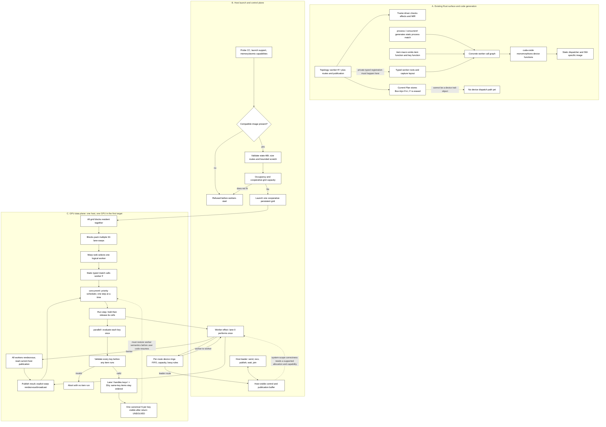
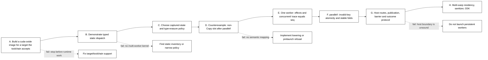

# NVIDIA backend: persistent workers on CUDA

**Blocking objection, narrowed in step 4:** the warp-per-worker sketch assumes every lane can resume the same worker after `parallel!`, and that a worker's state has one meaning across the 32 lanes. Trame has one mutable slot per key, and CUDA lanes have separate registers and local stacks. The earlier stated reason, that non-`Copy` state is the problem, is wrong. A non-`Copy` slot that owns no memory passes the host check and matches `seq` (`programs/post_parallel_pod.rs`; evidence table). What remains: state that owns memory cannot live on the device, because the device has no allocator; the plan cannot see state a worker body creates; and the lane-replica semantics have not been run on any device. No canonical-state mechanism has been shown. Until that is solved or unsupported plans are refused before launch, this is a research direction, not a correct backend design.

**What would change this assessment:** a device run, on a GPU whose compute capability the pinned toolchain builds, that matches `seq` on a post-`parallel!` state counterexample, effects, and barriers; or a representability check wired into `Topology` that refuses unsupported plans before any worker starts and also sees state a worker body creates. A plan-field check cannot see body state, so it cannot be the complete gate. Neither may add public bounds or change `spec.md`. The `sm_61` prototype named in the earlier version of this paragraph is not available with the measured toolchain (evidence table), so it is no longer a usable criterion as written.

**Status after step 4.** Evidenced: the plain-data non-`Copy` case on the host path; the plan-field check (9 tests in `backends/nv/tests/representable.rs`); the refusal of `sm_61` by the measured toolchain; the absence of a pinned cuda-oxide revision. Not evidenced: any device execution; a target GPU; lane-replica semantics; host/device atomicity; whether the check can be wired into `Topology` without a public change. The literal `cargo test` in `backends/nv` fails (evidence table), so the 9-test claim holds only for `cargo test --test representable` until that is fixed.

The target is one persistent, cooperative CUDA grid on one GPU, with one warp per logical worker. `concurrent!` remains sequential within a worker; `parallel!` is the intended lane-parallel region. The design below marks proved constraints separately from unresolved bridges.

## Evidence reviewed (cutoff: 2026-01-25)

The cutoff applies to the external sources below. They were not re-read in step 4. Rows marked **MEASURED** are local runs: each gives its command and versions. Step 4 re-ran only the cargo test; the toolchain and program rows are the previous session's runs and are marked as such. Local book paths are under `/home/pkd/code/cuda-oxide/cuda-oxide/cuda-oxide-book/`.

| Source and evidence | Consequence for Trame | Limit |
|---|---|---|
| [NVIDIA CUDA Programming Guide: SIMT and independent thread scheduling](https://docs.nvidia.com/cuda/cuda-programming-guide/03-advanced/advanced-kernel-programming.html). A warp has 32 threads. Before CC 7.0, a warp shared one program counter; CC 7.0+ has per-thread execution state. | `sm_61` cannot safely rely on sibling lanes making progress while one lane spins. On newer SMs, implicit lockstep is not a correctness guarantee either. Use explicit, valid warp collectives; avoid intra-warp locks. | Architecture rules, not evidence that this mapping preserves Rust worker semantics. |
| [NVIDIA Cooperative Groups](https://docs.nvidia.com/cuda/cuda-programming-guide/04-special-topics/cooperative-groups.html), not re-read in step 4: group collectives require participating threads; `invoke_one` callbacks cannot communicate or synchronize within their group. cuda-oxide `gpu-programming/launching-kernels.md`, read in step 4: grid-wide barriers need a cooperative launch with every block resident. Its refusal, `CooperativeGridTooLarge`, is in the cluster-plus-cooperative path, where the grid is checked against `cuOccupancyMaxActiveClusters`. For a plain cooperative launch the page only advises sizing the grid from `cuOccupancyMaxActiveBlocksPerMultiprocessor`. | Keep effects outside group callbacks if they need a warp rendezvous. Size the worker grid from the occupancy API, and refuse before launch if every worker warp cannot be resident. | The book has no plain-cooperative refusal to copy; the capacity check is designed here and not implemented. The `invoke_one` rule is unchecked. |
| [NVIDIA CUDA C++ Memory Model](https://docs.nvidia.com/cuda/cuda-programming-guide/05-appendices/cuda-cpp-memory-model.html). System-scope atomicity on mapped host memory depends on `hostNativeAtomicSupported`; aligned loads/stores do not establish a general host/device read-modify-write protocol. | Query the capability and use a matching allocation and atomic protocol for leader routes and publication. Otherwise refuse; do not infer coherence from a shared pointer. | The host/device protocol and exact Pascal behavior have not been tested on the target machine. |
| Cheng et al., [MPK: A Compiler and Runtime for Mega-Kernelizing Tensor Programs](https://arxiv.org/abs/2512.22219), arXiv v1 dated 2025-12-22. It uses a persistent megakernel, SM-level task graph, and decentralized worker/scheduler roles; the preprint reports up to 1.7× lower end-to-end LLM inference latency than kernel-per-operator systems, evaluated on A100, H100, and B200. | Persistent execution and scheduling inside a kernel are a credible systems direction. Separate work scheduling from task semantics; Trame routes should not become one global work queue by default. | Preprint result, not independently reproduced here and not a Trame workload. The paper's reported multiplier is not a Trame estimate; the cited abstract does not give a rerunnable command or full toolchain manifest. |
| Gupta, Stuart, and Owens, [A Study of Persistent Threads Style GPU Programming for GPGPU Workloads](https://doi.org/10.1109/inpar.2012.6339596), InPar 2012. Their LightKernel experiment reports roughly 10× lower host trigger cost than ordinary launch for a GTX 980 test, but host wait costs remain similar; tiny mailbox transfers could stall. | Persistent workers can reduce dispatch overhead, but the host/device control path can erase the gain. Keep transport and compute measurements separate. | Published experiment: 100 runs, GTX 980, Ubuntu 14, Intel i7 quad-core; timings are host clock cycles for a 20k-iteration compute-bound loop. The accessible paper gives no rerunnable command or CUDA/compiler version. This is not our timing. |
| Troendle, Ta, and Jang, [A Specialized Concurrent Queue for Scheduling Irregular Workloads on GPUs](https://doi.org/10.1145/3337821.3337837), ICPP 2019. Its abstract identifies contention and retries on shared resources as active persistent-thread count rises. | Prefer per-route queues with known producer/consumer ownership; profile contention before adding a centralized scheduler queue. | The design implication is narrow; the abstract alone supplies no benchmark value to transfer. |
| cuda-oxide local documentation, read in step 4: `gpu-programming/kernels-and-device-functions.md` and `closures-and-generics.md`. Device code has no device-side `#[global_allocator]`; `Vec`, `String`, and `Box` are unsupported there, and `alloc` fails at link time. By-value closure captures work when their contents have a device-valid ABI. Reference-closure HMM requires Turing+ (`sm_75`), Linux 6.1.24+, and CUDA 12.2+ (`appendix/supported-features.md`). | `sm_61` needs explicit device-resident state, not host-pointer dereference. The Trame `Context` holds a `Vec<WorkerId>` (`topology.rs:25`); the worker scheduler and `parallel.rs` (`thread_local!`, `Vec` scratch) and the barrier return type (`Arc<[u8]>`, `backend.rs:69`) need private device paths or a sound representability boundary. | No cuda-oxide revision is pinned by this repository. No Cargo.toml or flake here names cuda-oxide, a `cuda` feature, or an `nv` feature (grep, step 4). The one revision measured is the local checkout at 9df9e7cef. |
| **Measured, book (step 4):** `getting-started/installation.md` requires an NVIDIA GPU of Ampere+ (`sm_80+`); `appendix/supported-features.md` says PTX output targets `sm_80` through `sm_100a`; `appendix/api-quick-reference.md` lists the `atomic` and `grid` modules at `sm_70+` and the `warp` module (shuffle, vote, match) at All. | The documented floor for this compiler is `sm_80`, below every target this plan names. The brief for this step put warp match at `sm_70+`; the book lists it as All, so no sm_70 claim is made here. | Documentation only. The rows below test it. |
| **MEASURED, toolchain:** in `nix develop --no-write-lock-file "path:/home/pkd/code/cuda-oxide?dir=cuda-oxide"` at cuda-oxide 9df9e7cef (CUDA 13.2.51, cargo-oxide 0.2.1, rustc 1.99.1): `ptxas -arch=sm_61` says "Value 'sm_61' is not defined for option 'gpu-name'"; `nvcc -arch=sm_61` says "Unsupported gpu architecture 'sm_61'"; `nvcc --list-gpu-arch` starts at `compute_75`. Previous session's run, not repeated in step 4; the log does not record the machine. | The devShell's toolkit does not build `sm_61` at all, so gate A cannot pass with it. An `sm_61` plan needs another CUDA toolkit, which is not tested here. | Compile-time facts only. No GPU was run. |
| **MEASURED, compiler:** `cargo oxide build --arch sm_61` on a vecadd copy, same shell: "CUDA target sm_61 cannot lower detected feature Basic; cuda-oxide requires a target compatible with sm_80 for this module". The control `--arch sm_80` builds, and its embedded PTX reads `.target sm_80`. Previous session's run, not repeated. | The refusal is made by cuda-oxide itself, not only by the assembler. The sm_80 path builds in the same shell. | A plain vecadd, not a Trame program. |
| **MEASURED, program check:** `cli/trame build --check` on `programs/post_parallel_pod.rs` and `post_parallel_heap.rs` passes, and both match `seq`; the `.expected` files were derived by hand. Previous session's run, not repeated. | On the host path, a non-`Copy` plain-data slot after `parallel!` is representable. The heap-slot program also passes, though the plan cannot see its heap; that is the gap. | Host only. No device run. |
| **MEASURED, representability:** `cargo test --test representable` in `backends/nv`, default dev shell of the pinned flake (rustc 1.98.1, cargo 1.98.0), Linux 7.2.7 x86_64, step 4: 9 passed, 0 failed (rerun: `nix develop --no-write-lock-file .#default -c bash -c 'cd backends/nv && cargo test --test representable'`). | The check accepts and refuses on the stated numbers. It is not wired into Trame. `accepts_the_heap_slot_program_because_the_plan_cannot_see_its_body` pins gap (a). | Host only. The check is over given numbers, not probed device limits. |
| **MEASURED, failing:** literal `cargo test` in `backends/nv`, same shell, step 4: the library compiles, then both examples fail with "build with cargo trame" (`macros/lib.rs:180`). `trame::parallel!` expands to `compile_error!` unless the driver passes `--cfg trame_checked`. The `[[example]]` entries set `test = false`, which does not stop cargo building them. The earlier report of 9 passing under `cargo test` is true only for `--test representable`. | The programs need the driver (`cli/trame build --check`), not cargo test. A fix belongs in `backends/nv` (for example, gating the programs behind a feature); not made in step 4. | Rerun: `nix develop --no-write-lock-file .#default -c bash -c 'cd backends/nv && cargo test'`, which exits 101. |

**Evidence correction.** The [RingKernel/RustCompute architecture page](https://mivertowski.github.io/RustCompute/guide/01-architecture-overview.html) describes benchmark runs dated April 2026, after this review's cutoff. Its reported 55 ns injection and 5.54 Mops/s are excluded; they are not evidence available on 2026-01-25.

No Trame CUDA execution or timing was run, in step 3 or step 4. The prior environment check found neither `nvidia-smi` nor a `cargo oxide` subcommand in the Trame shell; `cargo oxide` exists only in the cuda-oxide devShell (evidence table). Any later timing must record the Nix/cuda-oxide revision, command, GPU, driver, and toolkit; none of the published values above are Trame timings.

## System map

The diagram joins the compile-time code path, launch preflight, device data plane, and host control plane. Dashed edges are unresolved requirements, not implemented calls. The redirection point before closure erasure and the canonical slot bridge are both blockers.

## Revised execution model

1. **Typed code must survive registration.** `Topology::worker<F>` checks `F` and then boxes it in `Plan`. A GPU entry cannot call that erased object under the no-indirect-call rule. The backend needs a private typed root before the box, and a way for the device image to statically cover every worker type present in a runtime topology. cuda-oxide monomorphizes concrete generic kernels, but that alone does not build a heterogeneous runtime dispatcher. This needs a compile-time inventory or a deliberately narrower first-launch policy; neither is settled.

2. **A worker warp is not yet a worker-state representation.** The obvious SPMD attempt calls the worker body from all 32 lanes, lets the leader perform effects, and has the lanes cooperate at `parallel!`. That only works if process state, cells, and every value used after a parallel region have Trame's single-worker meaning. Private lane stacks break the easy “each lane has a replica” story. A non-`Copy` slot that owns no memory does not break it by itself (host evidence only); a slot that owns memory does, because the device has no allocator. Do not add `Copy`, `Pod`, `Sync`, or device-memory bounds to the public API. Decide whether the compiler can lower the state, or whether the backend can prove representability and refuse before launch.

3. **Preserve `parallel!` exactly.** The device baseline evaluates and stores each key once, validates the complete key vector before invoking any item, and then gives lane `l` keys `l + 32q`. Each lane processes a key's items in original input order. A direct scan over stored keys is an acceptable O(items × slots) correctness baseline. It does not solve canonical `S` storage. The current `parallel.rs` uses `std::thread_local!` and `Vec` scratch, which are not a device implementation.

4. **Keep `concurrent!` sequential.** Its priority scheduler, cell exclusion, wait conditions, error result, and “finish started steps before reporting failure” behavior must match `sched.rs`. Its generated process `match` is a useful static-dispatch root. The device path needs bounded per-worker scratch rather than host `Vec`/`String` machinery. The worker's `Context` currently contains a `Vec`, and `barrier()` returns `Arc<[u8]>`; those types cross the public worker call graph and need a device-compatible implementation without changing their signatures.

5. **Make effects single-shot.** All lanes must reach an effect uniformly. One lane updates the route, clock, idle, or barrier state; its answer is published and explicitly made visible to the warp before user code continues. A group callback must not hide a warp collective. Worker-to-worker traffic stays in device-global per-route queues. Host-leader routes, publication, cancellation, and results need a separate host/device memory-ordering protocol; mapped host-memory atomicity is capability-dependent, so `sm_61` may not assume ordinary host/device atomics are coherent.

6. **Preflight the actual resident grid.** The first target was `sm_61`. The measured toolchain does not build it, so the target is open: a CUDA toolkit that still accepts `sm_61` (not tested here), or a newer GPU that the pinned cuda-oxide builds (documented floor `sm_80`). Architecture-specific code stays under `backends/nv/gens/sm_<x>`. Pack several worker warps per block. Query the selected kernel's resource use and cooperative capacity; reject if every worker warp cannot be resident. This creates a real worker-count ceiling. Do not silently time-slice workers: barrier and blocking effects make remapping a different scheduler and require persistent state and progress proofs.

7. **Separate device data from the host interface.** Routes, worker control, and per-worker scratch are allocated before launch. The host leader is outside the CUDA grid. A grid barrier alone does not publish host data or order host/device accesses. Preflight must verify the exact host-visible buffer and system-scope atomic path for the selected GPU; if there is no correct implemented path, refuse the launch.

## Falsification gates

Status: gate A fails on the measured toolchain for `sm_61` (evidence table); no gate has a device result.

**Status after step 5 (sm_80 prototype, `gpu/`).** Gate A passes for `sm_80` at compile level: cargo-oxide builds `post_parallel` (one block of 32 threads, `gpu/nv_post_parallel_gpu.ptx`), and `ptxas` assembles it for sm_80 and sm_86 (CUDA 13.2.51). Gate D is not run: no GPU is on this machine, and no node was held. Gate E (the one-worker trace) is not reached. The heap variant of the device kernel is refused by the toolchain itself, "heap allocation is not supported in kernels", so state that owns memory cannot be a device slot; this answers the heap question at compile level, not at run level. The host harness and the nixsci experiment (`gpu/README.md`) are built and were run locally with no driver (`no-driver`, three rows) and with a C stand-in driver (CPU code, a wiring test only, not a GPU result). Phase B (a held node, three runs of `nix run .#post-parallel-gpu`) is blocked: the reserve loop requested upper-case names, which `reserve` rejects, so no node was held; and an earlier request left OAR job 6998376 on nancy (gres) whose release failed. That job needs a person to check it. Gate D is decisive: use a slot whose post-item value changes a later branch or effect, and compare the complete observable trace with `seq`. Also test a non-`Copy` slot and captured state. If the implementation cannot preserve those cases, it must identify them before launch and return `Refused`; it may not partially start workers.

**Status after Phase B (device run, gate D, one case).** Node `gruss-3.nancy.grid5000.fr` (Grid'5000 Nancy, held by the orchestrator), two NVIDIA A40 (sm_86, 46068 MiB each), driver 580.178.04, CUDA 13.0 in `nvidia-smi`. The harness used GPU 0. Command: `cd backends/nv && nix run .#post-parallel-gpu`, three replicates, through nixsci with the target `gruss3` (`~/.config/nixsci/providers.json`, targets file `~/.config/nixsci/targets-gpu.json`, which carries `"driver": "nvidia"`). The run is `post-parallel-gpu-6dad293dbe47-r1..r3`, with rows in `.nixsci/runs/post-parallel-gpu/` (local, not committed) and `lab.lock`.

| Replicate | ran | verdict | device | cc | driver_version (int) | stdout sha256 = seq sha256 |
|---|---|---|---|---|---|---|
| r1 | true | ok | NVIDIA A40 | 8.6 | 13000 | 3d5f386d... = 3d5f386d... |
| r2 | true | ok | NVIDIA A40 | 8.6 | 13000 | 3d5f386d... = 3d5f386d... |
| r3 | true | ok | NVIDIA A40 | 8.6 | 13000 | 3d5f386d... = 3d5f386d... |

Each run's stdout equals `programs/post_parallel_pod.expected` (four lines: `slot 0 acc 60 branch 2` to `slot 3 acc 144 branch 1`, then `outcomes: [Returned]`). The PTX sha256 in every row is 7b6c88e3... Each manifest has state `ok`.

This shows that the one-warp kernel, with global-memory slots and plain-data state, gives the seq result on this A40 with driver 580.178.04. It does not show lane-replica semantics for body-created state: the case is 4 keys, and the fold is not order-dependent across lanes. No timing was taken.

Not done in Phase B: the health check on a dead launch (the local no-driver run in Phase A is the only dead-launch evidence); the second, larger case; the heap variant re-run. Nixsci note: the first attempts failed for three reasons, all in the apparatus: nixpkgs 2.34.9 against nixsci's nix-2.34.8 assertion (fixed by following nixsci's lock, commit c946e76); the hosts form of the static provider has no `driver` option, so the target needed the targets-file form (commit 8df6373); and nixsci refuses a dirty tree.

### Integration boundary

The repository still has no selectable NV backend. A runnable implementation needs private hooks outside this directory: root/backend selection, typed worker registration, and a CUDA-specific `parallel!`/`concurrent!` path. No such files are changed here. The work remains in `backends/nv/` until those minimal hooks are explicitly approved.
