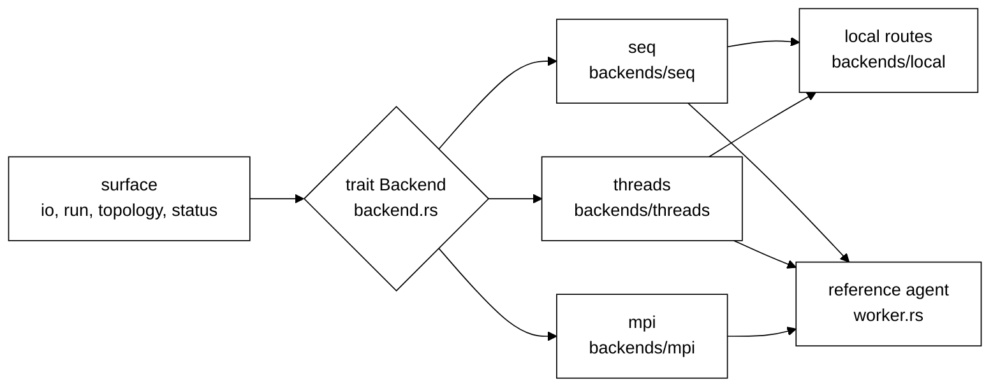

# Backends

A backend runs a launched topology. It implements the trait `Backend` in `backend.rs`, the one seam
between the surface and the hardware, and keeps the clauses of `CONTRACT.md`. A build selects one
backend by a cargo feature: `seq` (the default), `threads` or `mpi`. The features are exclusive.

## Seam

The surface calls `Backend` functions and nothing else in a backend. They fall in four groups.

**Launch.** `agree` checks that every process of the launch holds the same plan. `launch` accepts a
checked plan or refuses it, and has allocated everything the plan needs when it accepts.

**Worker.** `worker_send`, `worker_recv`, `worker_offer`, `worker_route`, `worker_room`,
`worker_now`, `worker_epoch` and `worker_idle` serve the agents of one worker.

**Leader.** `leader_send`, `leader_recv`, `leader_edit`, `leader_stop`, `leader_wait`,
`leader_join` serve the leader.

**Domain.** `domain_alloc`, `domain_contains` and `domain_dealloc` serve `trame::Alloc`
(`memory-domains.md`).

## How each backend maps the parts

| part | seq | threads | mpi |
|---|---|---|---|
| worker | one thread, one agent | one thread per agent, several per worker | one rank, several agents |
| scheduler | reference agent, service 1 per step | reference agent, service in nanoseconds | reference agent, service in nanoseconds |
| routes | rings under one lock | rings under one lock | rings in a shared window, relays across nodes |
| wake | one counter of acts | one counter of acts | epoch words and futexes |
| domain | the heap | the heap | a shared segment (`backends/mpi/segment.rs`) |
| leader | a thread outside the baton | a thread | the last rank |
| `Deadlock` | reported | reported | never reported |

## seq

seq is the reference. Each worker has one thread, because a step may loop for a long time. A baton
passes between workers at each effect, so exactly one agent executes at any moment, and the schedule
is deterministic. The leader runs outside the baton, under the same lock.

seq follows `Sched::choose` exactly, so `sched::check` replays its traces with `exact`
(`PROOFS.md`, Replay). When every agent that can move has moved, and no idle worker has seen a
change, the run is stuck. The backend ends each remaining worker with `Deadlock`, and panics a
leader whose `wait` can never return (`backends/seq/stuck.rs`).

`TRAME_SEQ_STEP_LIMIT=n` ends the process at the baton's step n + 1, with a message and exit status
3. The mutant checks use it to kill a mutant that loops for ever.

## threads

threads runs the workers in one process with no baton. Each worker has up to as many agents as the
host has cores, never more than its steps. Steps of one worker whose fields do not conflict run truly
in parallel, and so do steps of different workers.

A worker's result is set once every one of its agents has returned, so `join` hands the leader a
state that no agent touches. `Deadlock` is judged as on seq: no agent can move now, and no deadline
is pending.

## mpi

mpi runs one MPI rank per worker, and the leader on the last rank, so `mpirun` needs W + 1 ranks.
Workers of one shared-memory node share a window with one ring per route. An agent that waits sleeps
on a futex word of its worker, and every act that can change its wait moves that word. Across
nodes, a relay of two threads sends frames, credits and results between nodes.

The backend never reports `Deadlock`. The design, tests and measurements are in
`backends/mpi/README.md`, `NODES.md`, `SCALING.md` and `RESULT.md`. Edits, `take` and the pool on
mpi live in the segment (`backends/mpi/segment.rs`).

## A new backend

A new backend implements `Backend`, keeps the clauses of `CONTRACT.md`, and prints the same output as
seq on the programs of `programs/` (`programs/run.sh`). It may reuse the reference agent of
`worker.rs` or schedule by itself.
