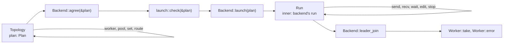

# The leader

The leader is the host code that declares a topology, launches it and drives the run. Its side of
the code is `topology.rs` (declaration), `launch.rs` (checks) and `run.rs` (the run). None of it is
a level the driver checks: it is ordinary Rust.

## Declaring

`Topology` wraps a `Plan` and a shared join flag. `worker::<S>()` pushes an empty `Core<S>` (as
`Arc<dyn Erased>`) and a `None` builder, and answers a `Worker<S>` holding the `Arc<Core<S>>` and its
index. `pool::
()` does the same with a `PoolCore
`, and records `P`'s `TypeId` and name. `set`
stores a boxed closure that runs the user's builder and fills the core with its value. `route` and
`lossy` push a `launch::Route` with the message's `TypeId`, name, size, capacity, lossy flag and, where
the backend crosses processes, the cross-host tag `io::tag::<M>()`.

`WorkerId` is `(index, host)`, with `topology::HERE` (`u32::MAX`) as the host of a worker declared
here. `End` is a worker or `Leader`; programs pass `WorkerId`, `(HostId, k)` or `Leader`, which
convert into it.

## Launching

`Topology::launch` runs three stages, and nothing starts unless all pass. `Backend::agree` checks
that every process of the launch built the same plan. A backend whose processes are ranks compares an
exact encoding across them (`src/backends/README.md`, Where each part lives). `launch::check` runs the surface checks in a fixed order and answers
the first `Refused`. `Backend::launch` allocates what the plan needs, runs the builders in arena mode
(`launch::build_all`), and answers the backend's run, or `Refused::Backend` with a message.

The checks live in one function so every backend refuses the same topologies for the same reasons
(L1). A refusal on a backend with several processes is decided on all of them together, because `agree`
runs before anything process-specific.

## The run

`Run` holds the backend's run (`<Selected as Backend>::Run`), the leader's last seen counter for
`wait`, the pool's address, the number of workers and the join flag. Each method is one backend call:

| `Run` | backend |
|---|---|
| `send` | `leader_send(inner, to, TypeId, name, bytes)` |
| `recv` | `leader_recv(inner, TypeId, out)`, through `io::read` |
| `wait` | `leader_wait(inner, seen)`, which answers the new counter |
| `edit` | `leader_edit(inner, target, f)` |
| `stop` | `leader_stop(inner)` |
| `join` | `leader_join(inner)` |
| `leader_send`, `leader_recv` | `object::peer_send`, `object::peer_recv`, which cut an object into frames of the backend's `peer_send`, `peer_recv` (INTERFACE.md 6) |

`Run::edit` turns the handle into a target: a worker index with all of its field bits, or the pool
with `POOL`. It checks the pool belongs to this run by its address. The closure runs in arena mode,
so what it allocates lands in the domain. A backend whose leader shares the workers' process calls
`Slot::edit` or `worker::edit_pool`. A backend whose leader is another process writes a request word and
waits for each agent to acknowledge it (`src/backends/README.md`).

## Join and take

`join` sets the join flag the handles share, so `Worker::take` and `Worker::error` stop panicking.
`take` moves the state out of the block and marks `taken`, so `Core::drop` does not drop it again.
`__join_checked(exact)` joins with the traces and replays each through `sched::check`; the
conformance tests use it.

A panic in a worker reaches the leader as a panic of its next backend call. `run::panic_message`
turns a payload into the message, with `<non-string panic payload>` for anything that is neither
`&str` nor `String`.
