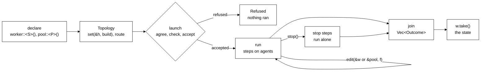
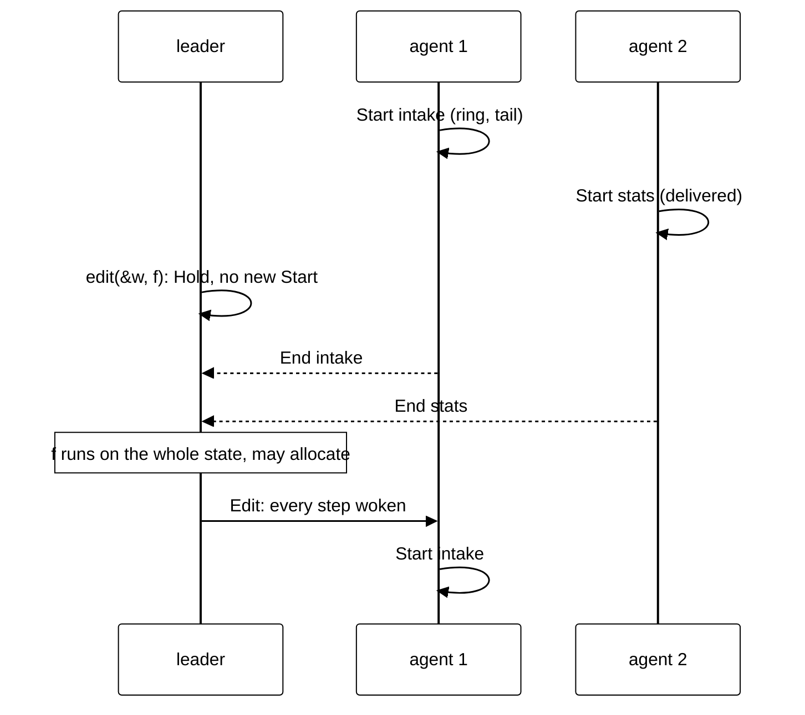
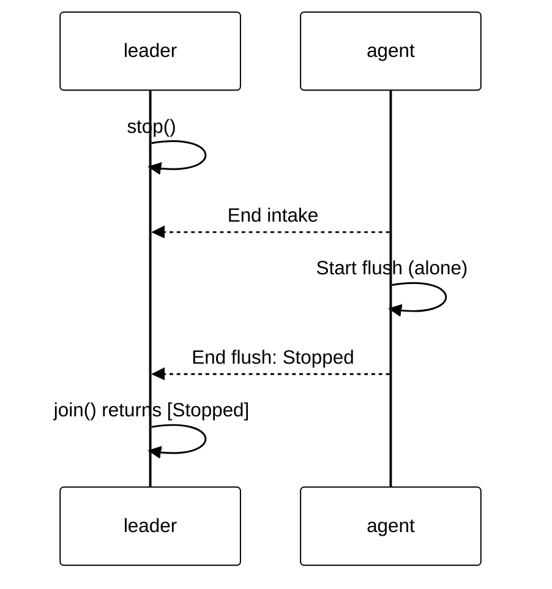

# The leader

The leader is the host code that builds a topology, launches it and drives the run. It is an agent
of its own, outside every worker, and it may be one end of a route. Its operations are not rules of
T: the backend records what the leader does (`spec.md`, Section 5).



## Topology

A `Topology` is the plan under construction: workers, routes and the pool. `Topology::new()` makes
an empty one.

**Declare.** `t.worker::<S>()` returns a `Worker<S>`; `t.pool::<P>()` returns a `Pool<P>`. A
declaration gives an identity and a handle, and no value. A state can therefore name workers
declared after it. A topology has one pool.

**Set.** `t.set(&h, || value)` gives the worker or the pool its value. The backend runs the closure
at launch, in the memory where the value is used (`memory-domains.md`). A second `set` replaces the
first.

**Route.** `t.route::<M>(from, to, cap)` and `t.lossy::<M>(from, to, cap)` add a route
(`transport.md`). An end is a worker (`w.id()`, `(HostId, k)`) or `Leader`. The leader is not a
worker: it is the process outside them that holds the `Run`, a rank of its own on MPI, the host
program on a device. A route from the leader to itself panics.

```rust
let mut t = Topology::new();
let w = t.worker::<Pipe>();
t.set(&w, || Pipe { ring: vec![0; 64], head: 0, tail: 0, delivered: 0, flushed: 0 });
t.route::<Job>(Leader, w.id(), 16);
let run = t.launch()?;
```

## Launch

`Topology::launch` consumes the topology. It agrees with the other processes of the launch that all
hold the same plan, runs the checks of `launch.rs`, then asks the backend to accept it. No worker
starts unless all three succeed (`CONTRACT.md`, L1 to L3).

The checks refuse a topology with the `Refused` value that names the reason.

**UnknownWorker.** A route names a worker the topology does not contain.

**Duplicate.** Two routes have the same sender, receiver and message type.

**ZeroCapacity.** A route has capacity 0.

**TwoOwners.** Two steps of one worker receive the same message type.

**PoolType.** A worker's steps read a pool of another type than the declared one.

**Alloc.** `trame::Alloc` is not the program's global allocator.

**PoolUnset.** The pool was declared and never set.

**Unset.** A worker was declared and never set.

**Backend.** The backend cannot allocate what the topology needs, or refuses for its own reason.

## Run

`launch` answers a `Run`. Dropping it does not stop the workers.

**send.** `run.send::<M>(to, msg)` sends from the leader on the route of type `M` to `to`. It
answers `Full` only on a lossless route at capacity, and panics when no such route exists.

**recv.** `run.recv::<M>()` takes the next frame of type `M` addressed to the leader, or answers
`None`. It never blocks.

**wait.** `run.wait()` blocks until something changed for the leader since its last `wait`: a frame
reached it, a worker got a result, or the run aborted. A leader that calls `recv` and then `wait` on
`None` does not poll.

**edit.** `run.edit(&h, |v| ..)` runs the closure on a worker's state or on the pool, between steps.

**stop.** `run.stop()` ends the run. It returns at once.

**join.** `run.join()` waits until every worker has a result and answers them in declaration order.

## Edit

An edit holds a set of fields: all of a worker's, or the pool. From the hold on, no step that
touches a held field starts. The closure runs once none runs, and may allocate and resize. Then the
fields are given back and every step touching one is woken. Queued frames are kept (`CONTRACT.md`,
S4).

`run.edit` answers `false`, without running the closure, when the worker already has a result. A pool
edit answers `true` (`pool.md`).



## Stop

`run.stop()` sets the stop flag of every worker. No ordinary step starts afterwards. Each worker
runs its stop step, if it has one, alone once no step runs, and its result is `Stopped`. A stop step
may send, so the leader keeps receiving until `join`.



## Join and take

`join` returns when every worker has a result, and no step runs after it. Then `w.take()` gives the
leader the worker's state, and `w.error()` the error of a failed step. Both panic before the join.

A panic in any worker aborts the run: the leader's next call, including one already blocked,
panics with `trame: worker <w> panicked: <message>` (`spec.md`, Definition (Abort)).
