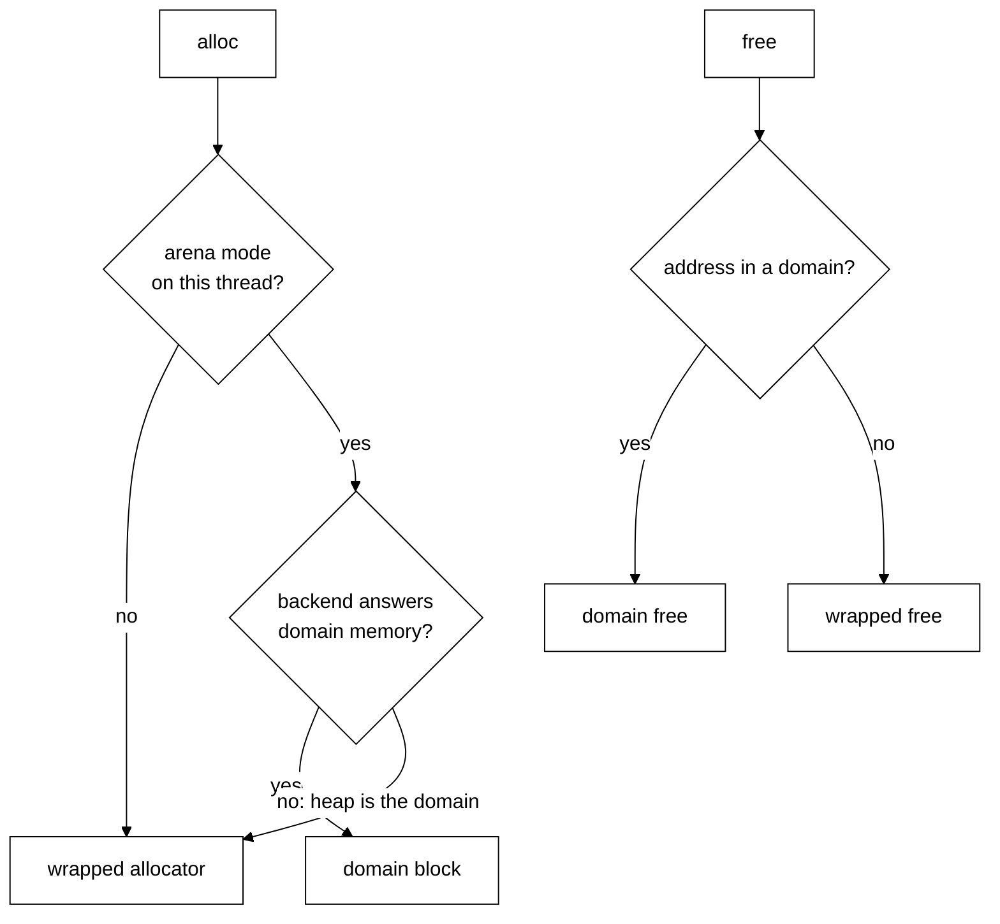

# Memory domains

A worker's *domain* is the memory in which its state lives, and in which its agents and its leader
address it at the same addresses (`CONTRACT.md`, Terms). `trame::Alloc` puts everything a state or
the pool owns there.

## Why

The leader builds a state, and the worker's agents use it in place. On some backends the agents run
in another process or on a device. A `Vec` that the state owns would then hold a pointer into the
leader's heap, which means nothing there. The domain makes the state's bytes, with every byte it
owns, lie where the agents can address them (`CONTRACT.md`, M1).

## Alloc

`trame::Alloc` is a global allocator that wraps the allocator a program would use otherwise:

```rust
#[global_allocator]
static ALLOC: trame::Alloc = trame::Alloc::new(std::alloc::System);
```

Every trame program installs it. `Topology::launch` refuses a program without it
(`Refused::Alloc`), on every backend, so the source of a program is the same whichever backend its
features select.

## Arena mode

*Arena mode* is a flag of the calling thread. The runtime sets it while a builder (`Topology::set`)
or an edit (`Run::edit`) runs. An allocation made in arena mode asks the backend for domain memory;
outside arena mode, every allocation goes to the wrapped allocator.



A block that lies in a domain is freed and resized in it, whoever does it. A state taken by the
leader can therefore be dropped or grown by the leader. A heap block that grows in arena mode moves
into the domain. The cost outside arena mode is one thread-local read, and on free one range check.

## Domains by backend

**seq.** The domain is the process heap. The wrapper forwards every call.

**mpi.** The domain is a shared segment of the node, mapped at one address in every rank of it
(`backends/mpi/segment.rs`).

## Bound

A domain has a size fixed at launch. An allocation that does not fit allocates nothing outside the
domain: the backend says the domain is full, and the process stops (`CONTRACT.md`, M6).

## What a state holds

A state holds no value whose meaning depends on the process that made it: no reference, raw
pointer, function pointer, trait object, `Rc` or handle. This is a type, `trame::Plain`, which
every field must have; a user type gets it from `#[derive(trame::Plain)]`, which requires it of
every field in turn. Steps neither allocate nor free (`CONTRACT.md`, M2 to M4). The driver refuses allocation in items, and `tests/alloc.rs` counts
allocations in steps (`PROOFS.md`, M4).
