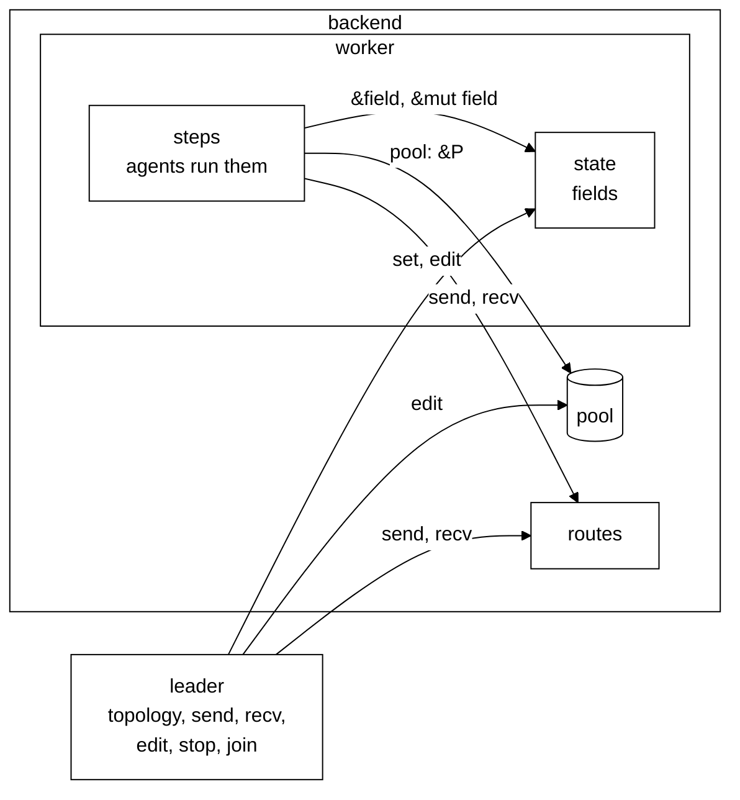

# Trame: system design

Trame runs a Rust program as workers that hold state and exchange messages over declared routes. A
leader builds the workers, feeds them, edits them and collects them. A backend runs the result on
real hardware, and `spec.md` defines which behaviours it may show. This directory describes the
parts, one file each.

## Parts

**Worker.** A state and the steps that run over its fields (`workers-and-steps.md`).

**Scheduler.** The rules that decide which step of a worker starts: field locks, rank, weights
(`scheduling.md`). `sched.rs` is its model.

**Leader.** The host code that declares the topology, launches it and drives the run: sends,
receives, edits, stops and joins (`leader.md`).

**Pool.** Read-only data that every worker's steps read and only the leader writes (`pool.md`).

**Memory domain.** The memory in which a state lives, and `trame::Alloc`, which puts what a builder
or an edit allocates there (`memory-domains.md`).

**Transport.** Routes, frames and lossy routes (`transport.md`).

**Backend.** The code that runs the parts: seq and mpi (`backends.md`).

## Phases

**Compile.** The macros `#[trame::state]`, `#[trame::step]` and `#[trame::message]` check the shape
of the code. The driver (`driver/README.md`) checks each level's effects.

**Launch.** `Topology::launch` agrees on the plan, checks it, and asks the backend to accept it.
The plan is fixed from then on: no route and no worker is added.

**Run.** Agents run steps under the scheduler. The leader may send, receive, edit and stop.

**Join.** Every worker has a result, and the leader takes the states back.

## Where the rules are

**Behaviour.** `spec.md` defines the transition system T that every backend's runs must be runs of.

**Backend obligations.** `CONTRACT.md` states them as named clauses.

**Checks.** `PROOFS.md` says how each clause is checked, and where the check stops.

**Code.** The parts above live in `worker.rs`, `sched.rs`, `status.rs`, `topology.rs`, `run.rs`,
`launch.rs`, `domain.rs`, `io.rs`, `backend.rs` and `backends/`.
