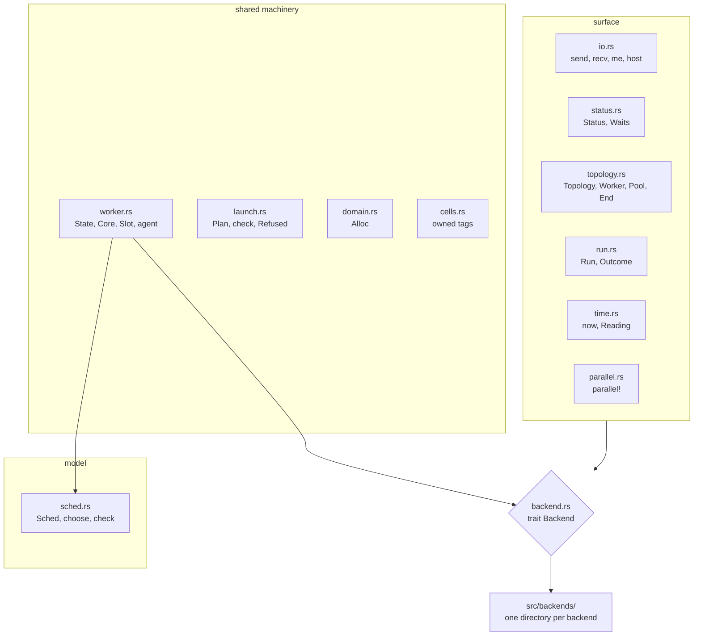

# Source map

These notes describe how the code is put together: which file owns which part, and what calls what.
The behaviour a program may rely on is in `INTERFACE.md`, what a backend must keep is in
`CONTRACT.md`, and how each clause is checked is in `PROOFS.md`. A note here that disagrees with the
code is wrong.

## Layers

The crate has three layers. The *surface* is what a program calls. The *model* is plain data and pure
functions with no clock, thread or I/O. A *backend* runs the surface on hardware, behind one trait.

| file | owns |
|---|---|
| `lib.rs` | the public names, the backend selection by feature, `extern crate self as trame` |
| `crates/macros/` | `#[trame::state]`, `#[trame::step]`, `#[trame::message]`, `#[trame::item]`, `parallel!`, `#[derive(Plain)]` |
| `plain.rs` | the `Plain` trait and its implementations |
| `worker.rs` | `State`, the type-erased worker `Erased`, its block `Core`, the reference agent |
| `sched.rs` | the scheduling model and the trace checker |
| `status.rs` | `Status` and the wait conditions `Waits` |
| `topology.rs` | declaration: `Topology`, handles, `WorkerId`, `HostId`, `End` |
| `launch.rs` | `Plan`, the launch checks, `Refused`, `build_all` |
| `run.rs` | the leader's `Run`, `Outcome` |
| `io.rs` | worker effects, the message trait, the cross-host tag |
| `cells.rs` | the tags the running step owns, per thread |
| `domain.rs` | the `Alloc` wrapper and arena mode |
| `time.rs` | `now`, `Reading`, clock ids |
| `parallel.rs` | the item fold behind `parallel!` |
| `check.rs` | level markers the driver finds after monomorphization |
| `backend.rs` | the trait `Backend`, the one seam to hardware |
| `src/math/` | portable numeric functions |

Around the crate: `crates/driver/` is the compile-time checker, `check/rejections/` its case suite, `check/programs/`
the shared conformance programs, `check/mutants/` the mutants, `check/proofs/` the TLA+ models, `lab/bench/`
the scaling runs and `lab/` the nix experiments.

## A step's path

`#[trame::step]` turns a function into a case of the state's `State::run`, with its read and write
masks in `State::STEPS`. A backend's agent asks `Sched::choose` for a step, calls
`Erased::run(i, pool)`, and that projects the fields out of the block and calls the function.
Inside, `trame::send` becomes `Selected::worker_send` and `trame::recv` becomes
`Selected::worker_recv`, guarded by `cells::owns`. The returned `Status` goes back to `Sched::end`.

## Files of these notes

`workers-and-steps.md` covers `worker.rs` and the macros. `scheduling.md` covers `sched.rs`.
`leader.md` covers `topology.rs`, `launch.rs` and `run.rs`. `pool.md` covers `PoolCore` and pool
edits. `transport.md` covers `io.rs`, `cells.rs` and the route rings. `memory-domains.md` covers
`domain.rs`. `src/backends/README.md` covers `backend.rs` and the backends.
