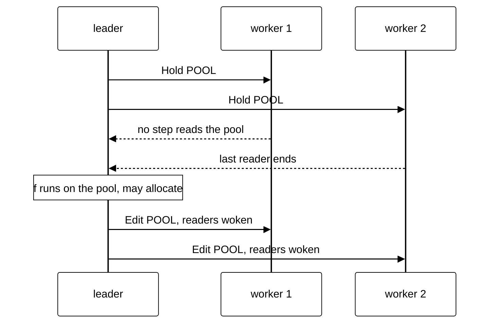

# The pool

The pool is read-only data shared by every worker of a topology. Steps read it, and only the leader
writes it, in an edit (`CONTRACT.md`, P1, P2).

## Declare and fill

A state names the pool type its steps read: `#[trame::state(steps(..), pool = P)]`. A step reads the
pool with a parameter `pool: &P`. `#[trame::step]` refuses a `&mut` pool.

The topology declares the pool and gives it a value as it does a worker:

```rust
let p = t.pool::<Table>();
t.set(&p, || Table { weights: vec![0.5; 1024] });
```

A topology has one pool. Launch refuses a worker whose steps read a pool of another type
(`Refused::PoolType`) and a declared pool that was never set (`Refused::PoolUnset`). A worker whose steps read a pool, in a topology
that declares none, is refused the same way.

## Pool bit

The pool is one more field in every worker's locks: bit 63 of the read sets (`POOL` in `sched.rs`).
A step that takes `pool: &P` reads that bit. A step that does not never conflicts with the pool.

## Edit

`run.edit(&p, |v| ..)` is an edit that holds the pool bit in every worker at once. Only steps that
read the pool wait. The closure runs once no step that reads the pool runs, in any worker. Then
every worker gets the bit back, and the steps that read it are woken. A step that starts after the
edit returns reads the edited pool, and none reads it during the edit (`CONTRACT.md`, M5).



The leader takes the holds one worker after another. This cannot deadlock: only the leader holds more
than one, and a step never waits for a hold.

## Asking for a change

A worker that wants the pool changed sends the leader a message. The step that sends returns, which
gives its read of the pool back, and the leader edits. A worker cannot write the pool, so no step
needs to wait for another worker to finish reading.
