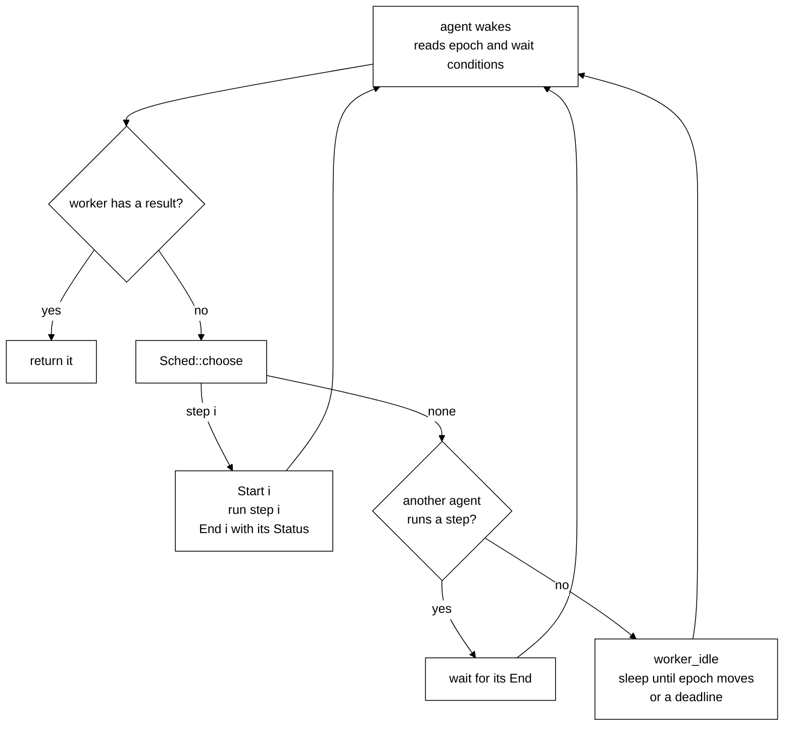
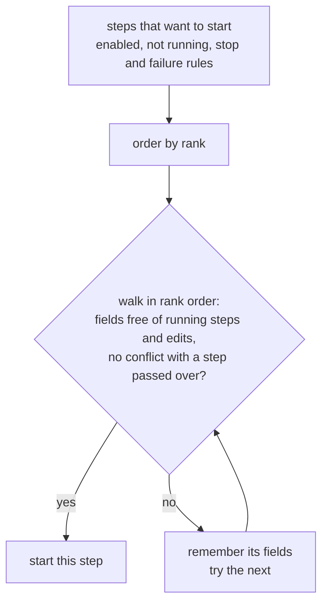

# Scheduling

Scheduling decides which step of a worker starts next. `sched.rs` is the model: plain data and pure
functions, with no clock, thread or I/O. The reference agent in `worker.rs` calls it under a lock. A
backend may schedule by itself, but every start it makes must be one the model allows (S2).

## Agents

An *agent* is a thread that runs a worker's steps. A worker has one agent on a backend that runs one
thread per worker, and on a backend with ranks up to as many as its rank's share of the host's cores, never
more than the worker has steps. The reference agent,
`agent` in `worker.rs`, loops: read the conditions, ask the model for the next step, run it, record
its end, sleep when nothing can start.

## Data

`Sched` is one worker's scheduler state, a `Copy` value of fixed size. `ps` holds one `Proc` per
step: its read and write masks, its last status `St`, the wake flag `d`, `running`, its `weight`, its
`pass` and `last`, the start count at its last start. `locks` counts the fields held by running steps,
a written mask and a reader count per field. `editing` is the mask the leader holds for an edit,
`stopping` is set by a stop, and `starts` counts starts. The backend passes the conditions that hold
now as `Now`, three masks of one bit per step: `frame`, `room` and `until`.

## Functions

`enabled(i, now)` is true for a `Fresh` or `Progress` step, and for a waiting step whose `d` is set
or one of whose named conditions has its bit in `now`. `wants(i, now)` adds the stop rule and the
failure rule. `rank(i)` is the triple `(weight == 0, pass or last, i)`, compared lexicographically,
smaller first.

`may_start(i, now)` holds when i wants to start, `locks.free` admits its masks, none of its fields is
in `editing`, and no conflicting step of better rank wants to start. `choose(now)` walks the wanting
steps in rank order and answers the first whose fields are free and that conflicts with no step
passed over on the way.

A step passed over keeps its place, so a writer of weight 1 starts against two overlapping readers
of weight 0.1 (S6). `start(i)` takes the locks, sets `last`, and raises the pass of each waiting step
to at least i's, so a waiting step banks no credit. `end(i, e)` frees the locks, stores the status,
adds `service × 2^24 / weight` to the pass of a positive-weight step, sets the new weight if the
status carries one, and sets `d` on every step that touches a field i writes. `answer()` derives the
result once nothing runs.

Weights are `Weight(u16)`, fixed point over [0, 1], so the arithmetic is exact and, on a backend that
chooses as the model does, the schedule is deterministic. Passes grow by stride scheduling (Waldspurger and Weihl, 1995): a step of
weight w receives service in proportion to w (S7).

## Service

*Service* is the backend's measure of what a step used. Each backend states its measure and its choice of
start in `src/backends/README.md` (How each backend meets the parts). A measure of 1 per step keeps a
backend deterministic, and a measure of wall time makes the shares shares of time.

`shares_follow_weights` in `tests/conformance.rs` measured the shares on the reference backend: weights 1, 1/2, 1/4
and 0 on one contended field, 22 923 steps, gave 13 098 : 6 550 : 3 275 : 0, that is 0.5714 :
0.2857 : 0.1429 against the model's 4/7 : 2/7 : 1/7. Command: `cargo test --test conformance shares`
on gros-101, rustc 1.98.1, reference backend.

## Edits and stop in the model

`Event::Hold` marks fields as held by the leader. From then on no step touching them starts, and
`Sched::touching` tells the leader when none runs. `Event::Edit` gives them back and wakes every step
that touches one, as the end of a writer does. `Event::Stop` sets `stopping`: ordinary steps stop
starting, and the stop step, the last index, starts when no step runs. `leader.md` describes the
leader's side.

## Trace

When the launch asks for one (`Topology::__trace`), each worker records Start, End, Stop, Hold and
Edit events. `sched::check` replays them against the model and names the first event the model
forbids (`CONTRACT.md`, S9; `PROOFS.md`, Replay).
