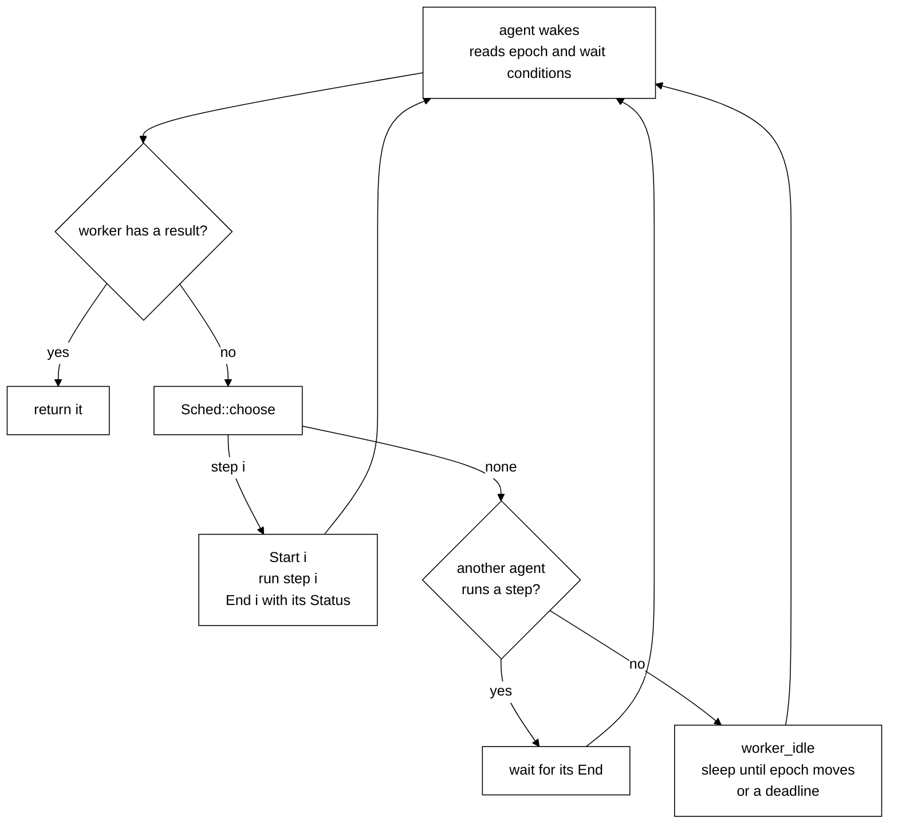
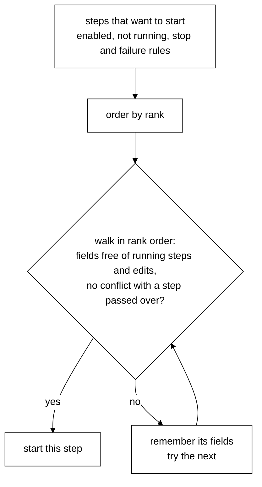

# Scheduling

Scheduling decides which step of a worker starts next. `sched.rs` is the model: plain data and pure
functions, with no clock, thread or I/O. A backend may schedule by itself, but every start it makes
must be one the model allows (`CONTRACT.md`, S2).

## Agents

An *agent* is a thread that runs a worker's steps. A worker has one agent on seq, and on mpi up to as
many as its rank's share of the host's cores, never more than the worker has steps. The reference agent,
`agent` in `worker.rs`, loops: read the conditions, ask the model for the next step, run it, record
its end, sleep when nothing can start.

## Rank

Each step has a *rank*: positive weights before weight 0; among positive weights the lowest pass;
among weight 0 the earliest last start; then the lowest index. A lower rank value is a better rank.
The rank decides who gets a contended field first and who starts first.

## Start

`Sched::may_start` holds for step i when four things hold: i is enabled, i is not running, its
fields are free, and no better-ranked step that wants to start conflicts with it. A step *wants* to
start when it is enabled and the stop and failure rules allow it. `Sched::choose` answers the best
ranked step that may start.

A step passed over still holds its place: a lower-ranked step that conflicts with it does not start
first. A writer of weight 1 therefore starts against two overlapping readers of weight 0.1
(`CONTRACT.md`, S6).

## Enabled

Step i is enabled when it is `Fresh` or `Progress`, or when it waits and either a step that writes
one of its fields has ended since it last ended, or a condition it named holds. The backend reports
which conditions hold at each start, one bit per step: a frame for the worker, room on a route, a
deadline reached.

## Weights

Each step has a weight in [0, 1], 0 by default. A static weight is set in the attribute
(`weight = 0.5`); a status may replace it (`Status::Progress.weight(0.2)`), for instance from how
full a queue is. Weights are 16-bit fixed point, so seq is deterministic.

Each step also has a *pass*, a counter. When step i ends, its pass grows by the service it used
times 2^24 divided by its weight. The best-ranked step is the one with the least pass, so a step of
weight w receives service in proportion to w (stride scheduling, Waldspurger and Weihl, 1995;
`CONTRACT.md`, S7). A step of weight 0 starts only when no step of positive weight can, and may
wait behind them for ever.

A step that waits does not bank its absence. When a step starts, the pass of every waiting step is
raised to at least the started step's pass.

## Service

*Service* is the backend's measure of what a step used. It is 1 per step on seq, which keeps seq
deterministic, and nanoseconds on mpi, which makes the shares shares of time.

| backend | service | choice |
|---|---|---|
| seq | 1 per step | follows `Sched::choose` exactly |
| mpi | nanoseconds | any start that `may_start` allows, with the reference agent's choice |

`shares_follow_weights` in `tests/conformance.rs` measured the shares on seq: weights 1, 1/2, 1/4
and 0 on one contended field, 22 923 steps, gave 13 098 : 6 550 : 3 275 : 0, that is 0.5714 :
0.2857 : 0.1429 against the model's 4/7 : 2/7 : 1/7. Command: `cargo test --test conformance shares`
on gros-101, rustc 1.98.1, seq backend.

## Edits and stop in the model

`Event::Hold` marks fields as held by the leader. From then on no step touching them starts, and
`Sched::touching` tells the leader when none runs. `Event::Edit` gives them back and wakes every step
that touches one, as the end of a writer does. `Event::Stop` sets `stopping`: ordinary steps stop
starting, and the stop step, the last index, starts when no step runs. `leader.md` describes the
leader's side.

## Trace

When the launch asks for one (`Topology::__trace`), each worker records Start, End, Stop, Hold and
Edit events. `sched::check` replays them against the model and names the first event the model
forbids (`CONTRACT.md`, S9; `PROOFS.md`, Replay).
