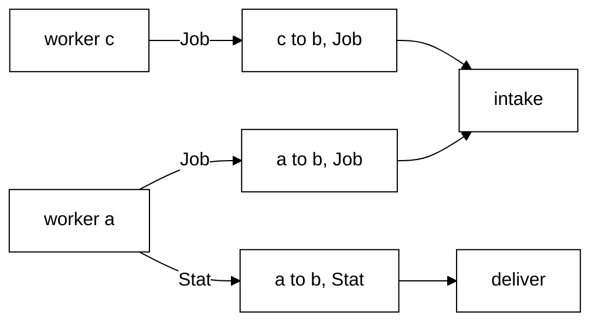

# Transport

Workers and the leader exchange messages over routes. A route is declared in the topology and fixed
at launch. This file describes routes and frames; `INTERFACE.md`, Section 5.2 defines their rules.

## Message

A message is plain data: a type with no padding, no pointer and no invalid bit pattern
(bytemuck's `Pod`). `#[trame::message]` makes a struct a message, and refuses references, pointers,
function pointers and padding. A message travels as its bytes in `repr(C)` layout, little-endian.
The message type is the tag of its routes, so two kinds of message with the same fields are two
types.

## Route

A route has a sender, a receiver, a message type, a capacity of at least 1 and a lossy flag. Sender
and receiver are each a worker or the leader, and may be the same worker. At most one route exists
for a sender, receiver and type.

**route.** `t.route::<M>(from, to, cap)` is lossless. A send at capacity answers `Full`.

**lossy.** `t.lossy::<M>(from, to, cap)` never makes its sender wait. A send at capacity replaces the
oldest frame.

## Frame

A message of any size is one frame. A backend whose transport has a smaller unit splits it
internally, and that is invisible to a program. A frame is *available* to the receiver once it has
arrived.

## Send and receive

**send.** `trame::send(to, msg)` from a step, or `run.send` from the leader, names the receiver and
the type, and so a route. It answers `Ok(())` or `Full`, and panics when the topology has no such
route.

**recv.** `trame::recv::<M>()` takes the next available frame of type `M` addressed to the calling
worker, or answers `None`. A step receives only the types in its `receives` list.

**room.** `Status::wait().room::<M>(to)` waits until a send on that route would not answer `Full`. A
lossy route always has room.

**frame.** `Status::wait().frame()` waits until a frame of a type the step receives is available.

## Order

Frames on one route are received in the order they were sent (`CONTRACT.md`, T1). Nothing orders two
routes against each other: with several routes of one type to a worker, `recv` takes the head of
any of them. A backend takes the routes in turn, so a route that keeps a frame is taken within one
round of its siblings.

In the picture, `intake` owns `Job` on worker `b`, so it receives from two routes. Each route is FIFO.

## Capacity

A lossless route holds at most `cap` frames. A slot that a receiver has taken stays in use until the
sender gets it back, so across a network a sender may be answered `Full` after the receiver took a
frame (`INTERFACE.md`, Release). A program learns that a route has room only from `room` or from an `Ok`
answer (`CONTRACT.md`, T2).

A lossy route may lose any frame except the newest. A receiver that keeps receiving ends up with the
latest frame (`CONTRACT.md`, T3).

## Leader routes

The leader receives with `run.recv` and sends with `run.send`. What the leader receives is the
environment's business: its takes are not rules of T.

## Rings

On a backend whose workers share one process, every route is a ring of `cap` slots of the message's size,
allocated once at launch (`src/backends/README.md`, Where each part lives). A send copies into a slot and a receive copies out of one, so
neither allocates. Among the routes of a worker with a frame of the wanted type, the one taken least
recently is taken. A route that does not fit in memory refuses the launch (`Refused::Backend`).

On a backend whose workers share a window, a route is a ring in that window, with a counter owned by each
end. Each shared-memory node is a host of its own on that backend (`src/backends/README.md`).
