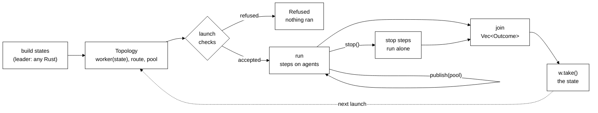
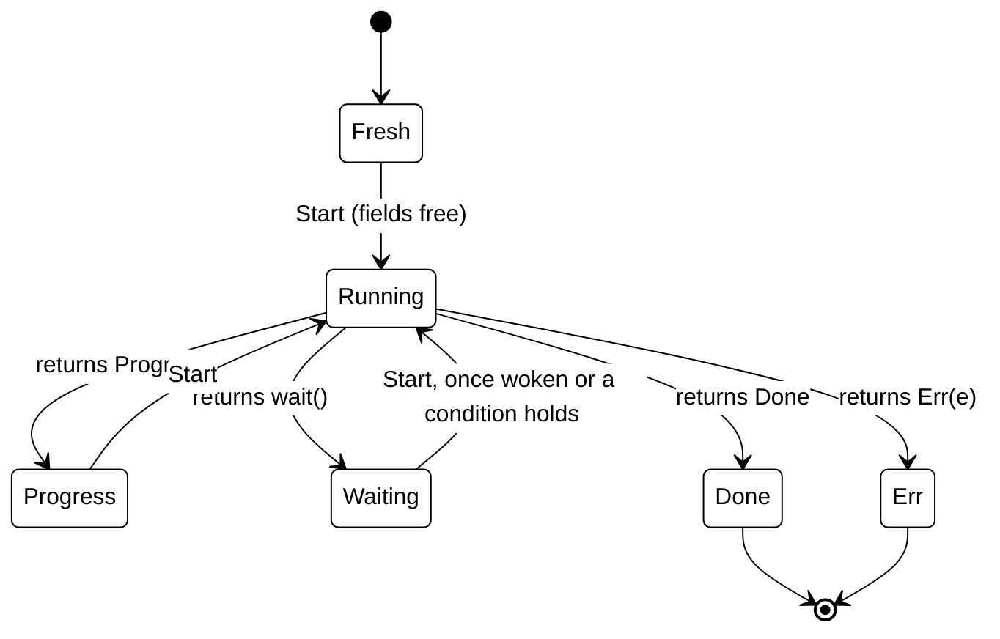
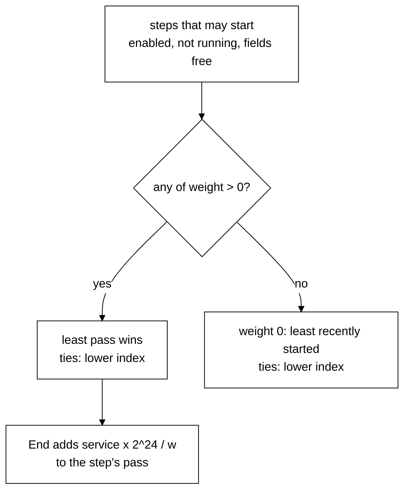
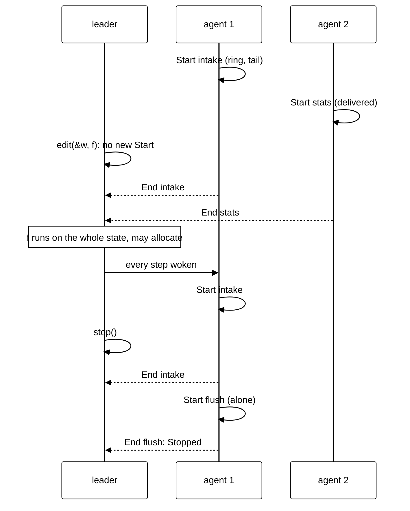
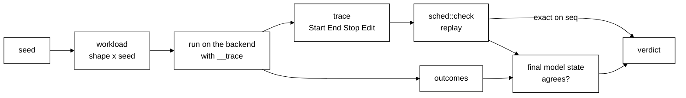

# Workers as state and steps

A worker is a state, built by the leader, and steps: functions over the fields of that state. Steps
of one worker run at once when their fields do not conflict. The leader launches workers, may edit
them between steps, stops them, and takes their states back at the join. This file describes the
code on branch `worker-model`; the design note TRAME-DN-01 gives the reasons.

Every diagram here is drawn in black on white, as in the design note. The `%%{init}%%` line at the
top of each one sets that style: theme variables for most colours, and `themeCSS` for the ones
Mermaid 11 writes inline (actor boxes, lifelines, notes, arrowheads). It is the same line in every
diagram; copy it for a new one.

## 1. The run, from the leader



```rust
#[trame::state(steps(intake, deliver), stop = flush)]
struct Pipe { ring: Vec<u32>, head: u64, tail: u64, delivered: u64, flushed: u64 }

#[trame::step(Pipe, receives = Job)]
fn intake(ring: &mut Vec<u32>, head: &u64, tail: &mut u64) -> Status { /* ... */ }

let mut t = Topology::new();
let w = t.worker(Pipe { ring: vec![0; 64], head: 0, tail: 0, delivered: 0, flushed: 0 });
t.route::<Job>(LEADER, w.id(), 16);
let run = t.launch()?;
run.edit(&w, |p| p.ring.resize(128, 0));   // between steps; queued frames are kept
run.stop();
let outcomes = run.join();                 // [Stopped]
let pipe = w.take();
```

A step's parameters name fields of its state. `&T` reads the field and `&mut T` writes it; the
macro turns the parameter list into the step's read set R and write set W, one bit per field. A
parameter that names no field, or a field of another type, does not compile. `pool: &P` reads the
host's pool instead of a field.

## 2. One step's life



Start takes all of a step's fields at once: no running step may write a field it uses, and no running
step may read a field it writes. End gives them back, and wakes every step that uses a field the
ending step wrote. A step never blocks while it holds its fields, so there is no deadlock between
steps, and a step waits for another for at most one step's duration.

`wait()` with no condition is woken only by such a write. `.frame()`, `.room::<M>(to)` and
`.until(t)` add conditions; any one wakes the step.

## 3. Which step starts: weights

Each step has a weight in [0, 1], 0 by default, set statically (`#[trame::step(S, weight = 0.5)]`)
or by the status it returns (`Status::Progress.weight(w)`), for instance from how full a queue is.



This is stride scheduling (Waldspurger and Weihl, 1995). Under contention the steps of positive
weight share the worker's *service* in proportion to their weights; a weight-0 step runs only when no
positive-weight step can. A step that was waiting does not bank its absence: when a step starts, the
pass of every waiting step is raised to at least the started step's pass.

Service is the backend's measure: 1 per step on seq, which keeps seq deterministic, and nanoseconds
on a backend with real threads, which makes the shares shares of time.

Measured on seq (`cargo test --test conformance shares`, gros-101, rustc 1.98.1): weights 1, 1/2,
1/4 and 0 on one contended field, 22 923 steps: 13 098 : 6 550 : 3 275 : 0, that is 0.5714 :
0.2857 : 0.1429, the model's 4/7 : 2/7 : 1/7.

## 4. Leader edits, pools and stop



An edit waits for the worker's running steps to end, keeps any from starting, runs on the whole
state (it may allocate and resize), and wakes every step. Frames queued for the worker are kept.

The pool is read-only data of the host. `Run::publish` installs a new version; a step reads the
version current at its start for its whole duration, and an old version is freed when its last
reader ends (read-copy-update, McKenney and Slingwine 1998).

After `stop()`, no ordinary step starts; the stop step, if the state has one, runs alone once no step
runs, and the worker's outcome is `Stopped`. A stop step may send, so the leader keeps receiving
until `join`.

## 5. The backend contract, and how each clause is checked

The scheduler belongs to the backend: seq schedules with the reference agent of `worker.rs`; a
threaded or GPU backend may schedule by itself. Every backend keeps the clauses of `backend.rs`:

| clause | says | checked by |
|---|---|---|
| S1 Exclusion | a running step holds its fields | trace replay (`sched::check`), every Start |
| S2 Enabledness | a step starts only when `may_start` holds | trace replay |
| S3 Wake | no wake is lost | the outcome check: a `Deadlock` must be a state where no step could start even if every deadline passed |
| S4 Edit | an edit runs when no step does | trace replay (an `Edit` event while a step runs is a violation) |
| S5 Stop | after a stop only the stop step, alone | trace replay |
| S6 Shares | service follows weights | seq: `Sched::choose` replayed exactly; other backends: measured shares within a tolerance |
| S7 Trace | the trace is consistent with the run | the replay itself |
| T1-T3, P1-P2 | FIFO, Full and lossy, at most once; pool versions | programs/ and the MPI transport checks |



`tests/conformance.rs` runs three shapes (a chain, a hot field, readers and a writer) over seeds; a
failure prints the shape and seed; the seed then goes into the file's `REGRESSIONS` list, which every
later run tries. On seq, 300 seeds x 3 shapes replay
179 334 events exactly. A mutant that makes seq's join forget pending deadlines is caught on seed 0.

The replay is not a proof. For the reference agent it is partly circular: the agent decides with the
same model it is checked against, so the replay catches errors in the glue (recording, conditions,
outcomes, the backend's deadlock rule), not in the model. The model itself is checked by the unit
tests of `sched.rs`; a TLA+ model of field locks and weights is still to be written.

## 6. What is not there yet

- MPI and threaded backends: the MPI backend compiles against the new seam, but stop, edit, pool and
  traces are not carried to other ranks, and steps of one worker do not yet run on several threads.
- The driver's checks (no allocation in a step, D5) still look for the old markers.
- spec.md has not been rewritten.
- Hosts, leaders per host, agreement, Relay or Direct per host pair, and the bulk log route.
