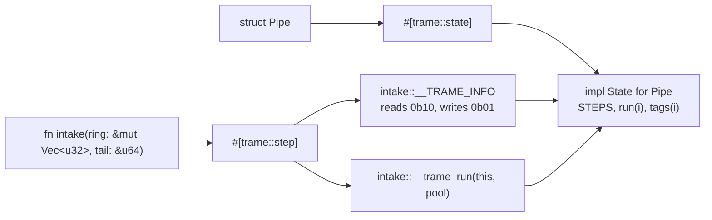
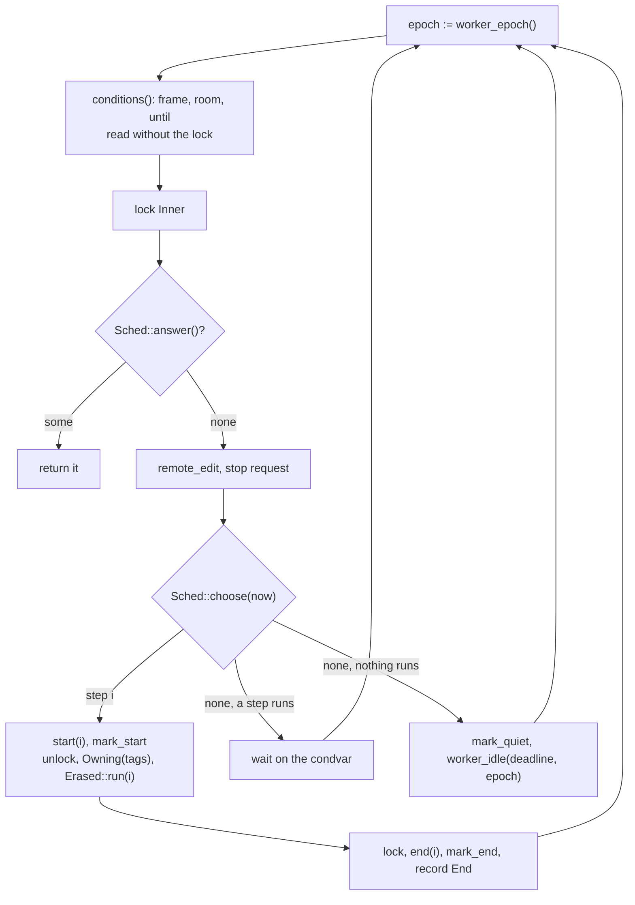

# Workers and steps

A worker is a state and its steps. This note follows a worker from the macros that describe it, to
the block that holds it, to the agent that runs its steps. The code is `crates/macros/state.rs` and
`worker.rs`.

## What the macros generate

`#[trame::step(S, receives = A, B, weight = w)]` keeps the function and adds a hidden unit struct of
the same name. The struct carries four things. `__TRAME_INFO` is a `StepInfo`: the step's name, a
read mask and a write mask with one bit per field, and its weight as 16-bit fixed point.
`__trame_tags` lists the received types as `(TypeId, name)` pairs, `__trame_offered` asks the backend
whether any of them has a frame, and `__trame_run` projects each field from a raw `*mut S` and calls
the function.

`#[trame::state(steps(a, b), stop = f, pool = P, error = E)]` implements `State` for the struct.
`STEPS` is the list of the steps' `__TRAME_INFO`, ordinary steps first and the stop step last, and
`run(this, pool, i)` matches on `i` to call step i's `__trame_run`. Field bits come from field order;
bit 63 is the pool (`sched::POOL`). The macro also implements `Plain` for the state, beside a
function that requires `Plain` of each field at that field's span, so an error names the field.

Each step also gets `__trame_check`, which calls the level marker `__check::step`. The driver finds
those calls after monomorphization and checks the step's body at the step level.

## The block

A worker's memory is a `Block<S>`: the state in a `ManuallyDrop`, a `failed` flag, and the error
cell. It lies in the worker's domain. `Core<S>` is the handle every side shares, an `AtomicPtr` to
the block plus a `taken` flag, null until the builder runs. On mpi a worker process that did not
build the state adopts the leader's address (`Core::adopt`), which is valid because the segment is
mapped at one address on every rank of a node.

`Core` never forms a `&Block<S>` or a `&S`. Steps hold `&mut` to single fields while other agents
use the block, so every access projects a field from the raw pointer. The first step that fails sets
`failed` and alone writes `error`; the leader reads it after the join. Debug builds keep a *witness*
in `Core`, the fields that running steps actually hold, and panic on a conflict (S1).

## Erasure

Backends see a worker as `Arc<dyn Erased>`. The trait answers the static description (`steps`,
`has_stop`, `tags`, `pool_type`) and runs step i with the pool passed as `&dyn Any`, downcast to
`PoolCore<S::Pool>` inside. A failing step's error is stored in the block and answered as
`Err(())`, so the backend never handles the error type. `model(w)` builds the initial `Sched` from
the erased steps.

## The reference agent

`Slot` is one worker under the reference scheduler: the erased worker, an `Inner` under a mutex, and
a condvar signalled at every end, edit and stop. `Inner` holds the `Sched`, the `Waits` of each
waiting step, the optional trace, the state of a remote edit, and `dead`, set when a step unwound.

`agent(slot, service, pool)` loops until the model answers a result. Each turn reads the worker's
epoch first, then the wait conditions without the lock, since they call the backend. Under the lock
it applies a pending stop or remote edit and asks `Sched::choose`.

Reading the epoch before the conditions is what makes S3 hold: a change after the read moves the
epoch, and `worker_idle` returns at once on a stale epoch. `ended` turns a `Status` into the model's
`Ended` and checks that an `.until` reading is of this agent's clock. `Unwinding` is a drop guard
around the call: a step that unwinds marks the slot dead, and every waiter then gives up.

## Holds and edits on seq

`Slot::hold(fields)` adds the fields to `Sched::editing`, records a `Hold`, and waits on the condvar
until `Sched::touching` is false. `Slot::release` calls `Sched::edited`, which wakes the touching
steps, and records an `Edit`. `Slot::edit` is the two around the closure. On mpi the leader is in
another process, so it asks through words in the segment, and each agent calls `remote_edit` once
per turn to hold, acknowledge and release on the leader's behalf.
