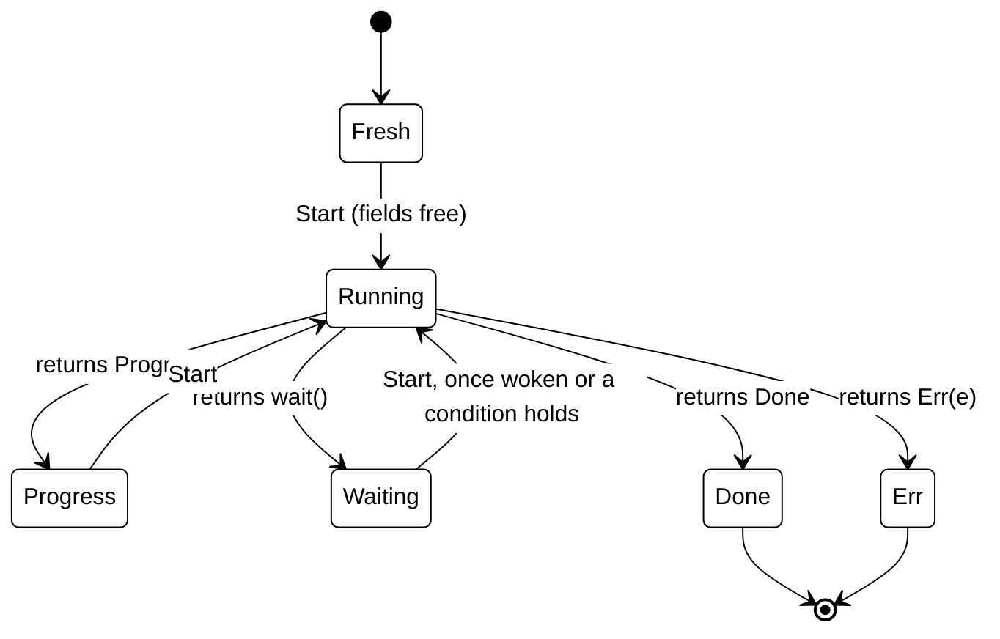
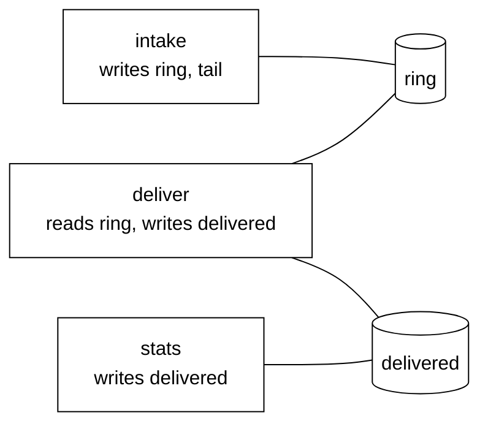

# Workers and steps

A worker is a state and the steps that run over its fields. Steps of one worker run at once when
their fields do not conflict. This file describes a worker's parts and the life of one step;
`scheduling.md` describes which step starts.

## State

A state is a struct marked `#[trame::state(steps(a, b), stop = f, pool = P, error = E)]`. `steps`
lists its steps. `stop`, `pool` and `error` are optional.

A state has at most 63 fields: each is one bit of a step's sets, and bit 63 is the pool. A state has
at most 64 steps, the stop step included. A state is plain Rust data that is `Send + Sync`.

```rust
#[trame::state(steps(intake, deliver), stop = flush)]
struct Pipe { ring: Vec<u32>, head: u64, tail: u64, delivered: u64, flushed: u64 }
```

## Step

A step is a function marked `#[trame::step(S, receives = A, B, weight = w)]`. Each parameter names a
field of `S`: `&T` reads it and `&mut T` writes it. A parameter named `pool` of type `&P` reads the
pool (`pool.md`). A parameter that names no field, or a field of another type, does not compile.

```rust
#[trame::step(Pipe, receives = Job)]
fn intake(ring: &mut Vec<u32>, head: &u64, tail: &mut u64) -> Status { /* ... */ }
```

A step returns `Status`, or `Result<Status, E>` when the state names an error type `E`. The macro
turns the parameter list into the step's read set R and write set W, one bit per field.

## Receives

`receives` names the message types a step takes with `trame::recv`. A `recv` of another type in that
step answers `None`. Two steps of one worker may not receive the same type: the launch refuses it
(`Refused::TwoOwners`). A step receives at most 16 types.

## Status

A step's return value says what the step needs next.

**Progress.** The step did work and can run again.

**Done.** The step is finished and never starts again.

**wait.** The step has nothing to do until a condition holds. `Status::wait()` names no condition;
`.frame()`, `.room::<M>(to)` and `.until(reading)` each add one. A step woken by any one of them
runs again.

**weight.** `.weight(w)` on `Progress` or on a `wait` sets the step's weight, in [0, 1], from its
next start on. A `Done` has no next start, so a weight on it panics.

**Err(e).** The step failed. The worker's result is `Failed`, and `Worker::error` returns `e` after
the join.

The conditions are states that the scheduler rechecks, not events that could be missed
(`CONTRACT.md`, S3). `.room` names one of the worker's first 64 outgoing routes, and aborts when the
worker has no such route. `.until` takes a reading of the worker's own clock.

## Life of a step



## Field locks

Two steps *conflict* when one writes a field the other reads or writes. A step starts only when no
running step conflicts with it, and it takes all its fields at once. When it ends it gives them
back, and wakes every step that uses a field it wrote.

A step never blocks while it holds fields, so steps cannot deadlock one another. A step waits for
another for at most one step's duration. `CONTRACT.md` S1 and S3 state the obligations.



In the picture, `intake` and `deliver` conflict on `ring`, and `deliver` and `stats` conflict on
`delivered`. `intake` and `stats` touch no common field, so they run at once.

## Stop step

A state may name a stop step with `stop = f`. After `Run::stop`, no ordinary step starts. The stop
step starts when no step runs, runs alone, and may send. When it is done the worker's result is
`Stopped`; a state with no stop step is `Stopped` as soon as nothing runs (`CONTRACT.md`, S5).

## Result

A worker has a result when no step runs and one of these holds.

**Returned.** Every ordinary step is `Done`.

**Stopped.** The leader stopped the run, and the stop step, if any, is done.

**Failed.** A step failed. No step of the worker starts again, and the first error is kept
(`CONTRACT.md`, S8).

**Deadlock.** The backend ended the worker because no step could ever start again
(`spec.md`, Definition (Deadlock)).

A panic in a step is not a result. It aborts the run (`spec.md`, Definition (Abort)).
