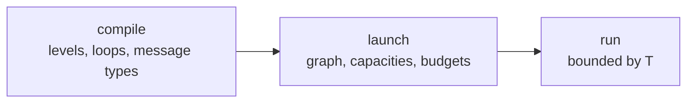
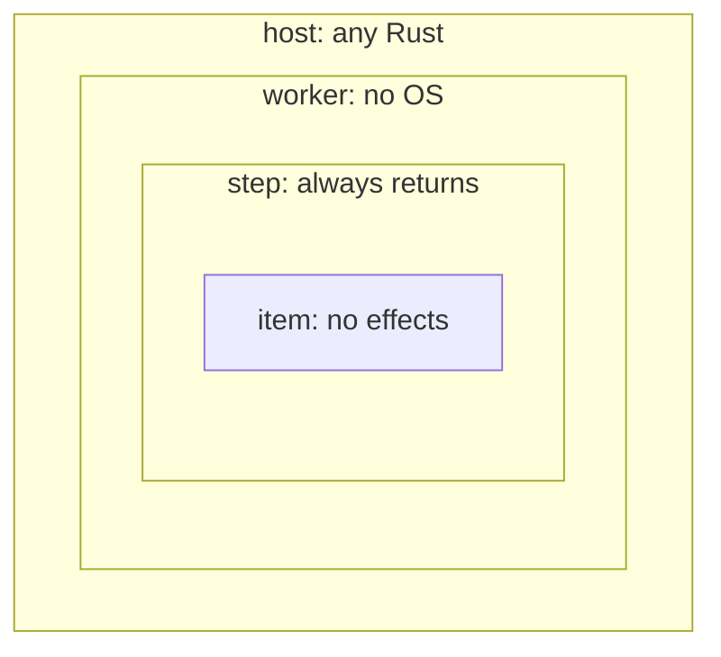
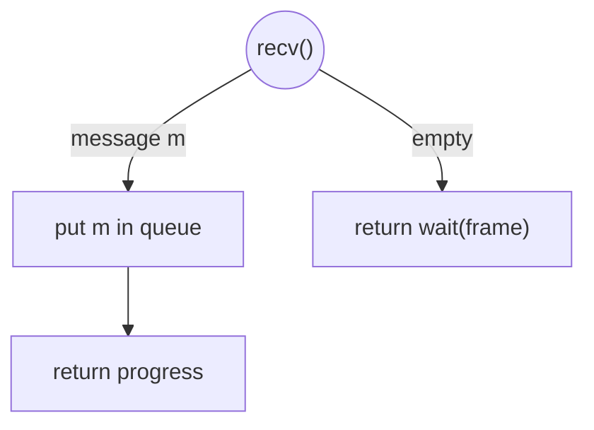
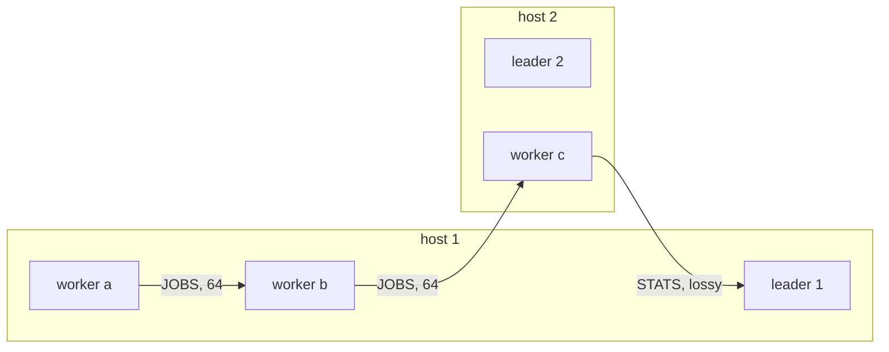
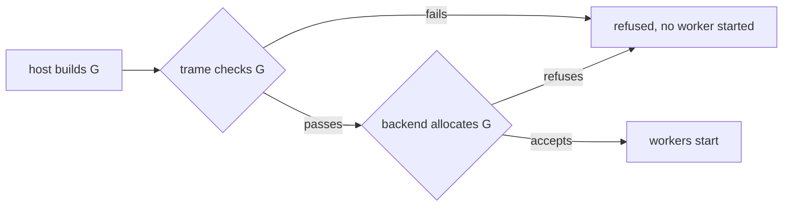
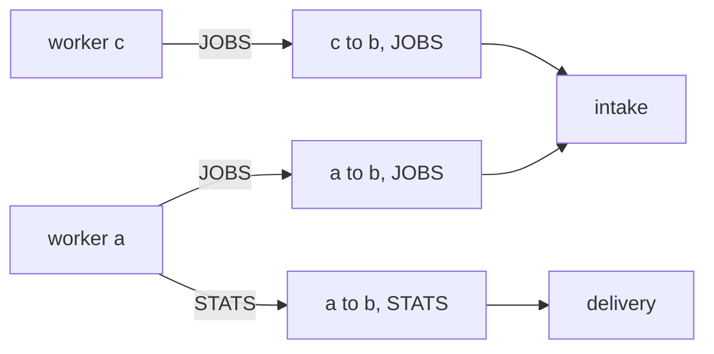
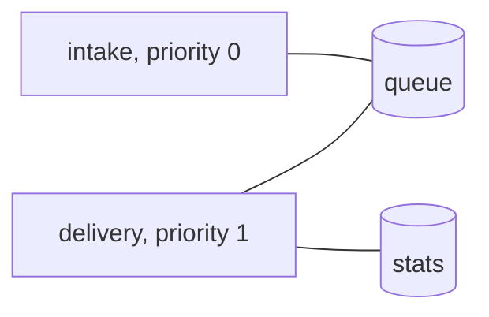
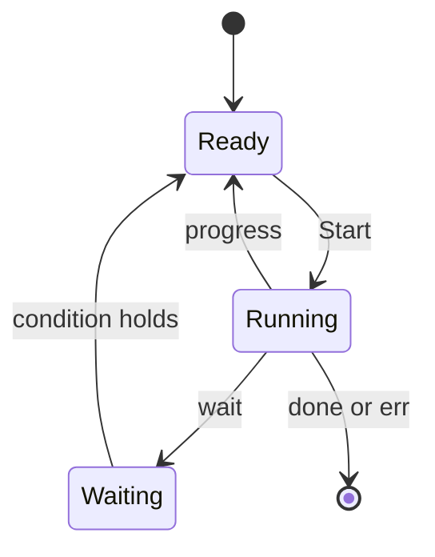
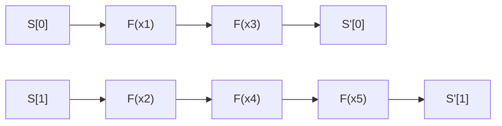
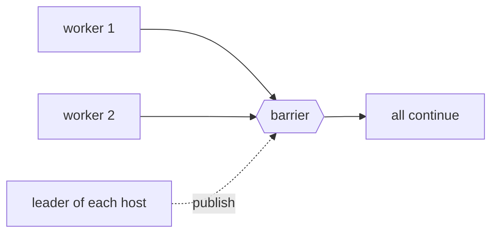

# Trame

Trame is a way of writing Rust so that a program means the same thing on every machine that runs
it. A program is split into four nested levels, and each level may make only certain requests to
its environment. These requests are called effects. An abstract machine $T$ answers the effects,
and in doing so it defines every behaviour the program is allowed to have. A backend answers the
same effects on real hardware. It is correct when every behaviour it produces is one that $T$
allows.

Trame narrows what can happen in three phases. Compiling checks the code. Launching fixes the
communication graph, before any worker starts. Running is then bounded by $T$. Each phase removes
possibilities, and every possibility removed is one that neither the program nor the backend has to
handle.



**Reading this document.** Quoted blocks and displayed formulas are normative. They are the parts
a mechanization must cover. Plain paragraphs, code and diagrams explain them and never add a
requirement.

## 1. Levels

A Trame program has four levels. Each level runs inside the one above it and may perform fewer
effects.



Each restriction buys one guarantee.
- **Worker.** A worker reaches the outside world only through Trame effects. It never calls the
  operating system, so a backend can run it where there is none, for instance on a GPU or on a
  bare-metal core.
- **Step.** A process runs as a sequence of steps, and every step returns. A step holds its shared
  cells while it runs and releases them when it returns, so every cell is eventually released.
- **Item.** An item performs no effect at all. Its result depends only on its arguments, so it is
  the same in whatever order the backend runs the items.

The compile-time checks of Section 3 enforce these restrictions.

> **Definition (Effect sets).** The effects allowed at each level are
> $\Sigma_I = \varnothing$ for items,
> $\Sigma_C = \{\mathsf{send}, \mathsf{recv}, \mathsf{now}, \mathsf{parallel}\}$ for steps, and
> $\Sigma_W = \Sigma_C \cup \{\mathsf{concurrent}, \mathsf{barrier}\}$ for workers. Each effect's
> answer type is given in the section that defines the effect.

## 2. Programs as interaction trees

Code under Trame runs until it requests an effect. The environment answers, and the answer decides
what the code does next. The following step receives a message and handles each possible answer.

```rust
fn step(&mut self, queue: &mut Queue) -> Result<Status, E> {
    match trame::io::recv() {
        Recv::Message(job) => queue.put(job).map(|_| Status::Progress),
        Recv::Empty => Ok(Status::Wait(Wait::FRAME)),
    }
}
```

Drawn as a tree, each effect is a node and each possible answer is an edge.



A step's tree is finite, because a step always returns. A worker's tree may be infinite, because a
worker may loop forever.

> **Definition (Interaction tree).** An interaction tree over a set of effects $\Sigma$ with
> results in $R$ either returns a value of $R$, or performs an effect $\sigma \in \Sigma$ and
> continues with a tree chosen by the answer (Xia et al., POPL 2020).

$$
\mathit{ITree}(\Sigma, R) = R + \textstyle\sum_{\sigma \in \Sigma} \big(\mathit{Ans}_\sigma \to \mathit{ITree}(\Sigma, R)\big)
$$

> Read inductively, this equation defines the finite trees $\mathit{ITree}^{\mathrm{fin}}$. Read
> coinductively, it defines $\mathit{ITree}^{\infty}$, which also contains trees that never return.

> **Definition (Denotation).**
> - A worker's `run`, applied to the context it receives at launch (Section 4), denotes a tree in
>   $\mathit{ITree}^{\infty}(\Sigma_W, R)$.
> - One call of a process's `step` denotes a tree in $\mathit{ITree}^{\mathrm{fin}}(\Sigma_C, \mathit{Status})$.
>   $\mathit{Status}$ is defined in Section 5.3.
> - One call of an item function $F$ denotes a function $I \times S \times C \to S$.
> - Host and leader code is not denoted. It is part of the environment.

These sets embed into each other, so code that is valid at an inner level can be used at every
outer level.

$$
(I \times S \times C \to S) \hookrightarrow \mathit{ITree}^{\mathrm{fin}}(\varnothing) \hookrightarrow \mathit{ITree}^{\mathrm{fin}}(\Sigma_C) \hookrightarrow \mathit{ITree}^{\infty}(\Sigma_W)
$$

## 3. Compile time

The driver is a rustc driver. It checks every function on MIR after monomorphization, at the level
where the function is used, so Rust types carry no capability tokens. A function may call items of
`core` and `alloc` only from three nested lists $A_I \subseteq A_C \subseteq A_W$. Each listed
item comes with a summary of its effects. The driver cannot read the bodies of non-generic `core`
items, so these lists are trusted.

> **Requirement (All levels).** No `unsafe`, FFI, `std`, threads, globals or indirect calls. Drop
> glue counts as a call. `UnsafeCell` appears only inside `Lock`, and no `Lock` contains a `Lock`.

> **Requirement (Worker).** A worker calls only items of $A_W$ and effects of $\Sigma_W$. It may
> use any loop and may recurse. It allocates only with fixed capacities, within its memory budget
> (Section 4). It writes only its own state.

> **Requirement (Step).** A step calls only items of $A_C$ and effects of $\Sigma_C$. Every loop is
> counted, and it does not recurse. It allocates only with fixed capacities, within its worker's
> memory budget. It writes only its own state and its cells $L(p)$ (Section 5.3).

> **Requirement (Item).** An item calls only items of $A_I$. Every loop is counted, and it neither
> recurses nor allocates. It writes only its slot.

> **Definition (Counted loop).** A loop is counted when it is a `for` over a range, a slice or an
> array that the body does not mutate.

Counted loops over an acyclic call graph are LOOP programs (Meyer & Ritchie, 1967), and LOOP
programs always terminate. This is why every step returns. It bounds the work of a step but not
its duration. Unbounded work must be split into more steps or more items.

A tag names a kind of message. Tags and their message types belong to the program, so they are
fixed here. Which workers exchange them is fixed later, at launch.

> **Definition (Tags).** A program declares a finite set of tags. Each tag $t$ has a message type
> $M_t$.

> **Requirement (Messages).** Every message type is plain data. It contains no reference, no
> pointer, no `Lock` and no route handle.

A worker therefore cannot pass a route to another worker. The routes it can use are exactly the
ones it receives at launch.

> **Requirement (Tag ownership).** In one `concurrent!`, no tag is owned by two processes.

> **Requirement (Run-time aborts).** Overflow, an index out of range, division by zero, and
> exceeding a capacity or a memory budget abort the launch. Overflow checks are on in every build
> profile.

With overflow checks always on, `+` means the same thing in every build. An item's abort depends
only on its inputs, so items stay deterministic.

> **Requirement (Floating point).** Floating point follows IEEE 754 with round to nearest even, no
> FMA contraction and no flush to zero. Results are bit-identical except for the sign and payload
> of NaNs, which Rust leaves unspecified. Each `trame::optim` primitive is defined by its portable
> code, and a backend's version must match that code bit for bit.

> **Requirement (Checked builds).** The driver compiles with `--cfg trame_checked`. Without this
> flag, `concurrent!` and `parallel!` expand to `compile_error!`.

The flag prevents accidental unchecked builds. It does not prevent deliberate ones.

## 4. Launch time

The host builds the communication graph, called the topology, while it runs. It can use its own
data, for instance the number of devices or a partition of the work. Trame checks the topology,
and the backend allocates everything it needs or refuses. No worker starts before both accept.
Once workers run, the graph never changes and no resource can run out.

```rust
let mut g = Topology::new();
let a = g.worker(produce, device(0), budget);
let b = g.worker(consume, device(1), budget);
g.route(a, b, JOBS, 64);
let run = g.launch(&backend)?;
```

The following topology has three workers on two hosts. Each arrow is a route, labelled with its tag
and its capacity.



> **Definition (Topology).** A topology $G$ consists of the following.
> - Hosts, each with one leader, and devices, each on one host. $\mathrm{host}(d)$ is the host of
>   device $d$.
> - A set $W$ of workers. Each worker $w$ runs an admitted worker program, is placed on a device
>   $\mathrm{dev}(w)$, and has a memory budget $\mathrm{mem}(w)$.
> - A list $R$ of routes. Each route $r$ has a sender $\mathit{from}(r)$ and a receiver
>   $\mathit{to}(r)$, each a worker or a leader, a tag $\mathrm{tag}(r)$, a capacity
>   $\mathrm{cap}(r) \geq 1$ and a flag $\mathrm{lossy}(r)$. Both ends may be the same worker. The
>   position of $r$ in $R$ is its rank.
> - An initial publication $\mathit{Pub}_0(h)$ for each host $h$.

> **Requirement (Launch checks).** Before any worker starts, trame refuses $G$ unless no two routes
> have the same sender, receiver and tag, and every message type $M_{\mathrm{tag}(r)}$ encodes in
> at most $\mathrm{MAX}$ bytes. $\mathrm{MAX}$ is the backend's frame limit, and every backend
> supports $\mathrm{MAX} \geq 65\,544$.

> **Requirement (Acceptance).** The backend then accepts or refuses $G$. It may refuse for any
> reason, for instance memory for the queues and budgets, links between devices, or room to run
> every worker at once. A backend that accepts allocates everything $G$ needs before any worker
> starts, and it never refuses for lack of resources afterwards.



On a GPU, room to run every worker at once means co-residency or a cooperative launch. A backend
that cannot guarantee it refuses the launch.

> **Definition (Context).** Each worker $w$ starts with a context. It holds a handle for every
> route $r$ with $\mathit{from}(r) = w$, and the initial publication of $\mathrm{host}(\mathrm{dev}(w))$.

The worker passes handles on to its processes. Messages cannot carry handles, so no worker can ever
reach a route outside $G$.

## 5. Run time

A run is a sequence of transitions $\Gamma \xrightarrow{\ell} \Gamma'$ between configurations. A
configuration $\Gamma$ is the state of the whole launch. Each subsection below introduces the
components of $\Gamma$ that its rules read and write, with their initial values.

> **Definition (Agents).** An agent is a worker, a process or a leader. $w(x)$ is the worker that
> runs agent $x$, and $w(x) = x$ when $x$ is a worker or a leader.

> **Definition (Run).** The rules of this section are the only transitions. A label
> $x : \sigma / v$ records that agent $x$ performed the effect $\sigma$ and received the answer
> $v$. Transitions without a label are internal.

> **Definition (Residual trees).** $\Gamma$ contains $\Pi$. $\Pi(w)$ is the remaining tree of
> worker $w$, initially the tree of its `run` applied to its context. $\Pi(p)$ is the remaining tree
> of process $p$ while a step of $p$ runs, and $\bot$ otherwise. $\Pi(x) = \sigma \cdot k$ means
> that $x$ is about to perform $\sigma$ and then continues with $k$ applied to the answer. Every
> labelled rule $x : \sigma / v$ also sets $\Pi(x) := k(v)$, and the rules below leave this update
> implicit.

> **Definition (Initial configuration).** $\Gamma_0$ gives every component the initial value
> stated where the component is introduced.

> **Definition (Abort).** If any code panics, the run ends, and every agent that has no result yet
> gets the result $\mathsf{abort}$.

### 5.1 Time

Programs never see real time directly. They read clocks, and each clock shows real time plus an
unknown offset. Two readings can be compared only when they come from the same clock, so Trame
never needs to synchronize clocks.

> **Definition (Time).** $\Gamma$ contains the real time $\tau \in \mathbb{R}_{\geq 0}$, initially
> $0$. Each device has one clock, and $\mathrm{clock}(x)$ is the clock of $\mathrm{dev}(w(x))$ for
> a worker or a process $x$. $\Gamma_0$ fixes an arbitrary offset $\theta(c)$ for each clock $c$,
> and no rule changes it. The effect $\mathsf{now}()$ answers a reading, which pairs a clock with a
> value. `since` is defined only between two readings of the same clock. In Rust the effect is
> `trame::now`.

$$
\frac{\tau' \geq \tau}{\Gamma \to \Gamma[\tau := \tau']}
\ \textbf{Tick}
\qquad
\frac{c = \mathrm{clock}(x)}{\Gamma \xrightarrow{x\,:\,\mathsf{now}\,/\,(c,\ \tau + \theta(c))} \Gamma}
\ \textbf{Now}
$$

### 5.2 Communication

Every route has its own queue. When a frame is sent, the environment chooses the time at which it
arrives, which models latency. Arrival times never decrease along a route, so every route is FIFO.
On the receiving worker each tag belongs to one agent, and that agent receives every route with
that tag. Since each tag has its own queue, one agent's backlog fills only its own routes.



Here `intake` owns `JOBS` on worker `b`, so it receives from two routes. `recv` always takes the
oldest available frame among them, so a frame is never overtaken by a frame that became available
after it.

> **Definition (Queues).** $\Gamma$ contains $Q$. $Q(r)$ is the sequence of frames on route $r$,
> initially empty. A frame $f = (m, a)$ has a message $m$ and an arrival time $a$. It is
> *available* when $a \leq \tau$. $a_{\mathrm{last}}(Q(r))$ is the arrival time of the last frame
> of $Q(r)$, or $0$ when $Q(r)$ is empty.

> **Definition (Ownership).** While worker $w$ performs $\mathsf{concurrent}(\bar P)$, each process
> $p \in \bar P$ owns its tags $\mathrm{tags}(p)$. $\mathrm{own}(w, t)$ is the process that owns
> $t$, or $w$ itself when no process does or when $w$ performs no $\mathsf{concurrent}$. A leader
> $\ell$ owns every tag, so $\mathrm{own}(\ell, t) = \ell$. Agent $x$ owns route $r$ when
> $\mathrm{own}(\mathit{to}(r), \mathrm{tag}(r)) = x$.

> **Definition (Offers).** A frame $f$ is an offer to agent $x$ on route $r$ when $x$ owns $r$,
> $f$ is the first frame of $Q(r)$, and $f$ is available. The oldest offer to $x$ is the offer with
> the smallest arrival time, with ties going to the route of lower rank.

> **Definition (Communication effects).** $\mathsf{send}(r, m)$, with $r$ a route handle and
> $m \in M_{\mathrm{tag}(r)}$, answers $\mathsf{ok}$ or $\mathsf{full}$. $\mathsf{recv}()$ answers
> a tag with a message, or $\mathsf{empty}$. In Rust these are `trame::io::send` and
> `trame::io::recv`.

$$
\frac{\mathit{from}(r) = w(x) \quad |Q(r)| < \mathrm{cap}(r) \quad a \geq \max(\tau, a_{\mathrm{last}}(Q(r)))}
{\Gamma \xrightarrow{x\,:\,\mathsf{send}(r,m)\,/\,\mathsf{ok}} \Gamma[Q(r) := Q(r) \cdot (m,a)]}
\ \textbf{Send}
$$

$$
\frac{\mathit{from}(r) = w(x) \quad \neg\,\mathrm{lossy}(r) \quad |Q(r)| = \mathrm{cap}(r)}
{\Gamma \xrightarrow{x\,:\,\mathsf{send}(r,m)\,/\,\mathsf{full}} \Gamma}
\ \textbf{Full}
$$

$$
\frac{\mathit{from}(r) = w(x) \quad \mathrm{lossy}(r) \quad Q(r) = f \cdot q \quad |Q(r)| = \mathrm{cap}(r) \quad a \geq \max(\tau, a_{\mathrm{last}}(Q(r)))}
{\Gamma \xrightarrow{x\,:\,\mathsf{send}(r,m)\,/\,\mathsf{ok}} \Gamma[Q(r) := q \cdot (m,a)]}
\ \textbf{Overwrite}
$$

$$
\frac{f \text{ is the oldest offer to } x \text{, on } r \quad Q(r) = f \cdot q}
{\Gamma \xrightarrow{x\,:\,\mathsf{recv}\,/\,(\mathrm{tag}(r),\ m_f)} \Gamma[Q(r) := q]}
\ \textbf{Recv}
\qquad
\frac{\text{no frame is an offer to } x}
{\Gamma \xrightarrow{x\,:\,\mathsf{recv}\,/\,\mathsf{empty}} \Gamma}
\ \textbf{Empty}
$$

$$
\frac{\mathrm{lossy}(r) \quad Q(r) = q \cdot f \cdot q' \quad q' \neq \varepsilon}
{\Gamma \to \Gamma[Q(r) := q \cdot q']}
\ \textbf{Drop}
$$

These are the only answers. **Full** applies only to a route that is not lossy, and only when its
queue is at capacity. Without that precondition, a backend that answered $\mathsf{full}$ to every
send would deliver nothing and still never contradict $T$. With it, such a backend produces an
answer that $T$ cannot produce, so it is incorrect.

A lossy route never makes its sender wait. When its queue is full, a send replaces the oldest frame
(**Overwrite**). The transport may also lose any frame except the newest (**Drop**). A receiver
that keeps receiving therefore ends up with the latest frame.

### 5.3 Scheduling

A worker runs several processes at once with `concurrent!`. A process is a struct with a `step`
method. Each process owns some tags and declares the cells it writes. A cell is a `Lock<T>`, which
is the only type shared between processes. A step takes all its cells before it starts and gives
them back when it returns.

```rust
concurrent!(recv(JOBS) => intake(&queue), delivery(&queue, &stats))

// delivery's step receives its cells as &mut borrows
fn step(&mut self, queue: &mut Queue, stats: &mut Stats) -> Result<Status, E>
```

Here `intake` owns `JOBS` and uses `queue`. `delivery` uses `queue` and `stats`. The two share
`queue`, so their steps never overlap.



A process moves through the following states. Ready means enabled, and a step starts only when
all its cells are also free.



Priority is the order of declaration. When several processes could start, the earliest declared
one wins, so a process that never waits starves every process below it. A step takes all its cells
at once and never waits while holding one, so cells cannot deadlock, whatever the number of
execution agents. A process waiting for a frame, for room on a route, or for a deadline returns
$\mathsf{wait}$ instead of polling. Each wait condition is a state that the scheduler rechecks,
not an event that could be missed.

> **Definition (Processes).** In $\mathsf{concurrent}(\bar P)$, each process $p \in \bar P$ has a
> priority $\pi(p)$, its position in $\bar P$, a set of tags $\mathrm{tags}(p)$, and a cell set
> $L(p)$, the `Lock` arguments of its `step`. Each run of `concurrent!` creates fresh processes.
> $\Gamma$ contains $H$, $\mathit{St}$ and $D$. $H(x)$ is the process holding cell $x$, initially
> $\bot$. $\mathit{St}(p)$ is the latest status of $p$, initially $\mathsf{fresh}$. $D(p)$ records
> that another process freed one of the cells of $p$ since $p$ last ended, initially false. The
> borrow checker guarantees that a step's `&mut` borrows end when it returns. The backend
> guarantees the exclusion required by **Start**.

> **Definition (Status).** A step returns
> $\mathit{Status} = \{\mathsf{progress}, \mathsf{done}\} + \mathsf{wait}(\Omega) + \mathsf{err}(E)$,
> where $\Omega$ is a set of conditions.
> - $\mathsf{frame}$ holds when some frame is an offer to $p$.
> - $\mathsf{room}(r)$ holds when $|Q(r)| < \mathrm{cap}(r)$.
> - $\mathsf{until}(d)$ holds when $\tau + \theta(\mathrm{clock}(p)) \geq d$.

> **Definition (Enabled).** Process $p$ is enabled when $\mathit{St}(p)$ is $\mathsf{fresh}$ or
> $\mathsf{progress}$, or when $\mathit{St}(p) = \mathsf{wait}(\Omega)$ and either some condition
> in $\Omega$ holds or $D(p)$ is true.

In **Start**, $q$ ranges over the processes of the same `concurrent!`.

$$
\frac{\Pi(p) = \bot \quad p \text{ enabled} \quad H(L(p)) = \bot \quad \forall q.\ \mathit{St}(q) \neq \mathsf{err}(\_) \quad \neg\exists q.\ \big(q \text{ enabled} \wedge \pi(q) < \pi(p) \wedge H(L(q)) = \bot\big)}
{\Gamma \to \Gamma[H(L(p)) := p,\ \Pi(p) := \mathit{step}_p]}
\ \textbf{Start}
$$

$$
\frac{\Pi(p) = \mathsf{ret}(s)}
{\Gamma \to \Gamma\big[H(L(p)) := \bot,\ \Pi(p) := \bot,\ \mathit{St}(p) := s,\ D(p) := \mathsf{false},\ D(q) := \mathsf{true} \text{ for each } q \neq p \text{ with } L(q) \cap L(p) \neq \varnothing\big]}
\ \textbf{End}
$$

> **Definition (Concurrent effect).** $\mathsf{concurrent}(\bar P)$ answers $\mathsf{done}$ or
> $\mathsf{err}(e)$.

$$
\frac{\forall p \in \bar P.\ \mathit{St}(p) = \mathsf{done}}
{\Gamma \xrightarrow{w\,:\,\mathsf{concurrent}(\bar P)\,/\,\mathsf{done}} \Gamma}
\ \textbf{Done}
\qquad
\frac{p \in \bar P \quad \mathit{St}(p) = \mathsf{err}(e) \quad \forall q \in \bar P.\ \Pi(q) = \bot}
{\Gamma \xrightarrow{w\,:\,\mathsf{concurrent}(\bar P)\,/\,\mathsf{err}(e)} \Gamma}
\ \textbf{Fail}
$$

Once a process fails, no new step starts. The running steps finish, and `concurrent!` answers with
one of the errors.

### 5.4 Items

`parallel!` applies an item function to many inputs. Each input has a key, and each key selects a
slot. The inputs with the same key are folded into their slot in input order. Different keys are
independent, so a backend may run them in parallel. A map is the case where each input has its own
key.



In this example $x_1$ and $x_3$ have key $0$, and $x_2$, $x_4$ and $x_5$ have key $1$. The two
chains may run at the same time. Each chain runs in input order.

> **Definition (Parallel effect).** $\mathsf{parallel}(F, \kappa, C, \bar x, S)$ takes an item
> function $F$, a key function $\kappa$, a shared context $C$, inputs $\bar x$ and slots $S$. It
> answers $\mathsf{range}$, before running any item, unless $\kappa(x_i) < |S|$ for every $i$.
> Otherwise it answers the slots $S'$ defined below. For each key $k$, let $i_1 < \dots < i_m$ be
> the positions whose key is $k$. In Rust, an item is `fn f(item: &I, slot: &mut S, cx: &C)`, run
> as `parallel!(f, key, &cx, &items, &mut slots)`.

$$
s_0 = S[k], \qquad s_j = F(x_{i_j},\ s_{j-1},\ C), \qquad S'[k] = s_m
$$

### 5.5 Barrier

The barrier is the only effect that involves every worker. It happens only when every worker's
next effect is the barrier. While all workers wait there, the leader of each host may replace the
publication of its host. A publication is a value that the workers of that host read.



> **Definition (Publication).** $\Gamma$ contains $\mathit{Pub}$. $\mathit{Pub}(h)$ is the
> publication of host $h$, initially $\mathit{Pub}_0(h)$. Only **Publish** changes it, and the
> leader of $h$ chooses the new value $P$.

> **Definition (Barrier effect).** $\mathsf{barrier}$ answers the publication of the worker's
> host. In Rust it is `trame::barrier`, and its answer is a borrow that ends at the next barrier.
> $\Pi(W) = \mathsf{barrier} \cdot k$ means that $\Pi(w) = \mathsf{barrier} \cdot k_w$ for every
> worker $w$. **Barrier** carries the label
> $w : \mathsf{barrier} / \mathit{Pub}(\mathrm{host}(\mathrm{dev}(w)))$ for every worker $w$ at
> once.

$$
\frac{\Pi(W) = \mathsf{barrier} \cdot k}{\Gamma \to \Gamma\big[\Pi(w) := k_w(\mathit{Pub}(\mathrm{host}(\mathrm{dev}(w)))) \text{ for every } w \in W\big]}
\ \textbf{Barrier}
\qquad
\frac{\Pi(W) = \mathsf{barrier} \cdot k}{\Gamma \xrightarrow{\mathsf{publish}(h, P)} \Gamma[\mathit{Pub}(h) := P]}
\ \textbf{Publish}
$$

If a worker returns, or never reaches the barrier, the other workers wait there forever. This is
an error in the program, and the driver does not detect it.

## 6. Backends

$T$ defines which behaviours are allowed. A backend may refuse a launch, but only before any worker
starts. After it accepts, it must never produce a behaviour outside $T$, and it must keep making
progress.

> **Definition (Observations).** $\mathit{Obs}(B, P, G)$ is the set of runs of program $P$ with
> topology $G$ on backend $B$. Each run is recorded as the tuple of every agent's sequence of labels
> and its result.

> **Requirement (Safety).** For every admitted program $P$ and every topology $G$ that $B$ accepts,
> $\mathit{Obs}(B, P, G) \subseteq \mathit{Obs}(T, P, G)$.

A backend that does nothing satisfies safety. Progress rules it out.

> **Requirement (Progress).** For every accepted launch, assuming the hardware keeps running,
> - time diverges,
> - every frame becomes available unless a lossy route removes it first,
> - every effect is answered,
> - every started step reaches **End**,
> - if the premises of **Start** hold for $p$ from some point on, then $p$ is eventually started.

The sequential backend runs every worker, process and item on one thread, on Rust's own semantics.
It is the reference and is proved against $T$, assuming the driver is sound. Other backends
declare this contract and are tested by conformance until they are proved.

**Conformance.** A monitor checks a logged trace against Section 5 and names the first transition
that $T$ forbids. A finite trace can show that safety fails, but it cannot show that progress
holds.

**Latency.** $T$ leaves latency to the environment. Measured round trips are records kept under a
separate protocol, and they are not part of correctness.