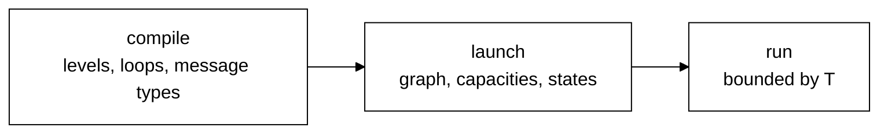
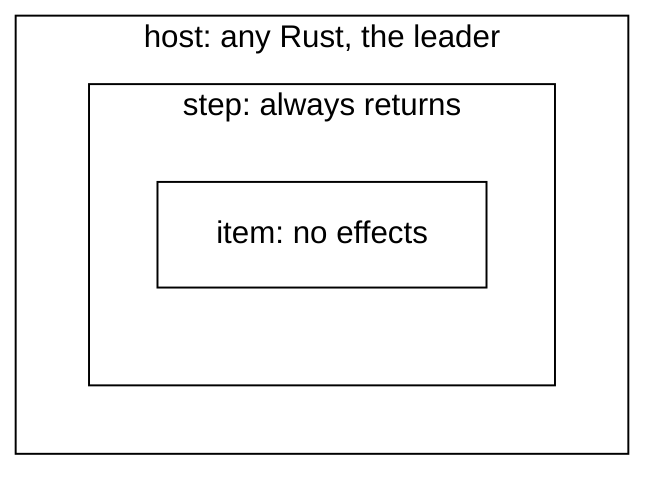
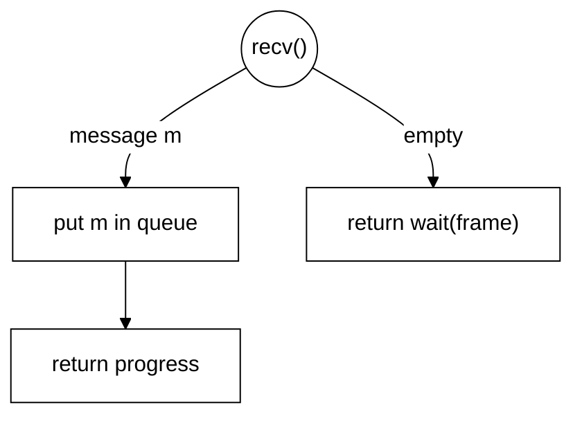
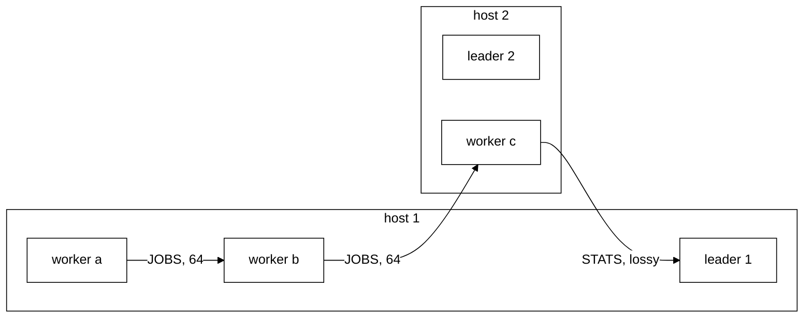
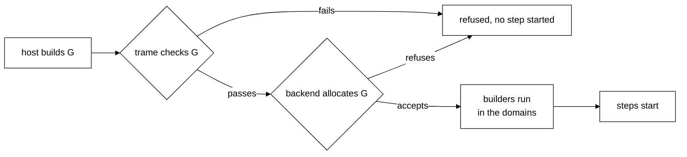
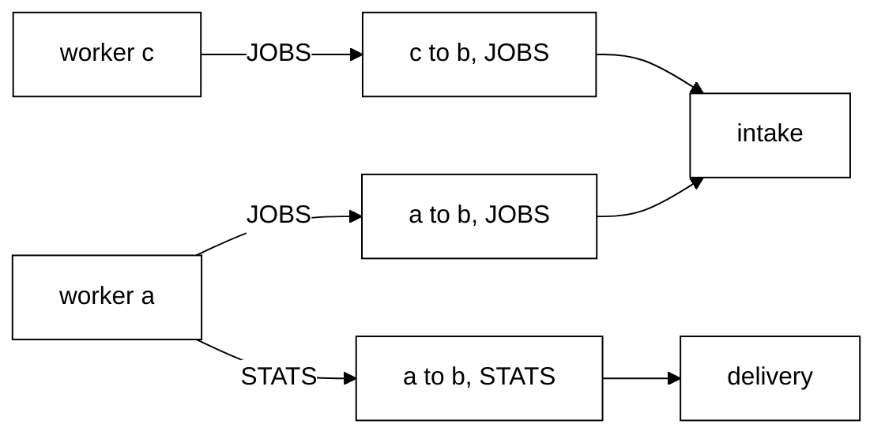
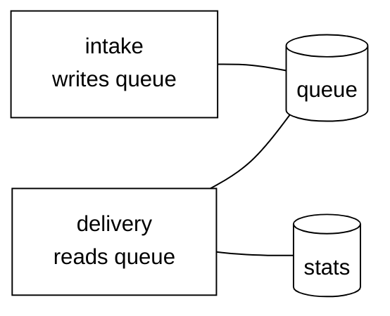
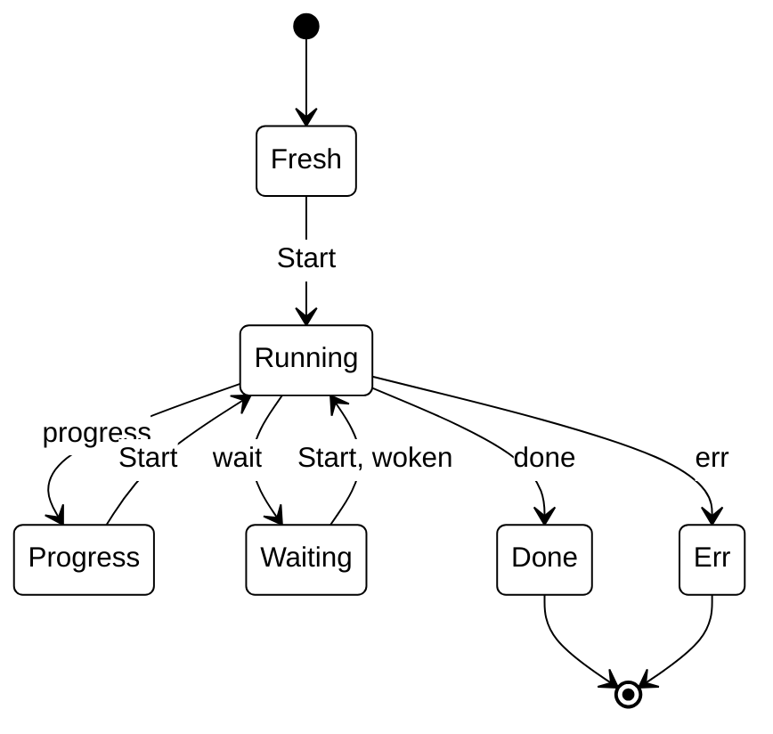
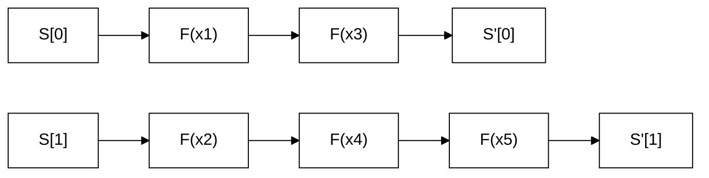
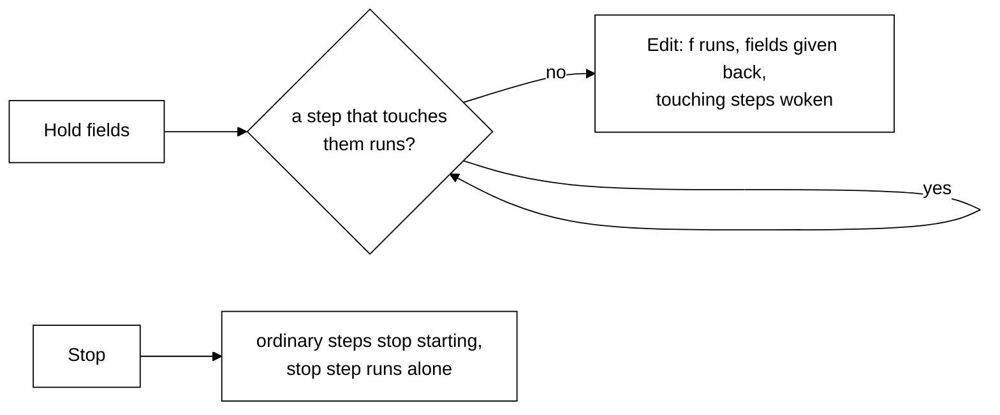

# Trame

Trame is a way of writing Rust so that a program means the same thing on every machine that runs
it. A program is split into three nested levels, and each level may make only certain requests to
its environment. These requests are called effects. An abstract machine $T$ answers the effects,
and in doing so it defines every behaviour the program is allowed to have. A backend answers the
same effects on real hardware. It is correct when every behaviour it produces is one that $T$
allows.

Trame narrows what can happen in three phases. Compiling checks the code. Launching fixes the
communication graph and builds every state, before any step starts. Running is then bounded by $T$.
Each phase removes possibilities, and every possibility removed is one that neither the program nor
the backend has to handle.



**Reading this document.** Quoted blocks and displayed formulas are normative. They are the parts
a mechanization must cover. Plain paragraphs, code and diagrams explain them and never add a
requirement. `CONTRACT.md` states what a backend must keep beyond the signatures of its trait, and
`PROOFS.md` says how each clause is checked.

## 1. Levels

A Trame program has three levels. Each level runs inside the one above it and may perform fewer
effects. A worker is not a level: it is a state with steps, and its code is its steps.



Each restriction buys one guarantee.
- **Step.** A step reaches the outside world only through Trame effects. It never calls the
  operating system, so a backend can run it where there is none, for instance on a GPU or on a
  bare-metal core. Every step returns, and it holds its fields only while it runs, so every field is
  eventually released.
- **Item.** An item performs no effect at all. Its result depends only on its arguments, so it is
  the same in whatever order the backend runs the items.

The compile-time checks of Section 3 enforce these restrictions.

> **Definition (Effect sets).** The effects allowed at each level are
> $\Sigma_I = \varnothing$ for items and
> $\Sigma_C = \{\mathsf{send}, \mathsf{recv}, \mathsf{me}, \mathsf{now}, \mathsf{parallel}\}$ for
> steps. Each effect's answer type is given in the section that defines the effect.

## 2. Programs as interaction trees

Code under Trame runs until it requests an effect. The environment answers, and the answer decides
what the code does next. The following step receives a message and handles each possible answer.

```rust
#[trame::step(Intake, receives = Job)]
fn intake(queue: &mut Queue) -> Status {
    match trame::recv::<Job>() {
        Some(job) => { queue.put(job); Status::Progress }
        None => Status::wait().frame(),
    }
}
```

Drawn as a tree, each effect is a node and each possible answer is an edge.



A step's tree is finite, because a step always returns. A worker has no tree of its own: it is the
scheduling of its steps, defined in Section 5.3.

> **Definition (Interaction tree).** An interaction tree over a set of effects $\Sigma$ with
> results in $R$ either returns a value of $R$, or performs an effect $\sigma \in \Sigma$ and
> continues with a tree chosen by the answer (Xia et al., POPL 2020). The finite trees, which
> always return, are the inductive reading of the equation below.

$$
\mathit{ITree}^{\mathrm{fin}}(\Sigma, R) = R + \textstyle\sum_{\sigma \in \Sigma} \big(\mathit{Ans}_\sigma \to \mathit{ITree}^{\mathrm{fin}}(\Sigma, R)\big)
$$

> **Definition (Denotation).**
> - One call of a step function applied to the fields of its read and write sets denotes a tree in
>   $\mathit{ITree}^{\mathrm{fin}}(\Sigma_C, \mathit{Status})$. $\mathit{Status}$ is defined in
>   Section 5.3.
> - One call of an item function $F$ denotes a function $I \times S \times C \to S$.
> - Host and leader code is not denoted. It is part of the environment.

These sets embed into each other, so code that is valid at an inner level can be used at every
outer level.

$$
(I \times S \times C \to S) \hookrightarrow \mathit{ITree}^{\mathrm{fin}}(\varnothing) \hookrightarrow \mathit{ITree}^{\mathrm{fin}}(\Sigma_C)
$$

## 3. Compile time

The driver is a rustc driver. It checks every function on MIR after monomorphization, at the level
where the function is used, so Rust types carry no capability tokens. A function may call items of
`core` and `alloc` only from two nested lists $A_I \subseteq A_C$. Each listed item comes with a
summary of its effects. The driver cannot read the bodies of non-generic `core` items, so these
lists are trusted.

> **Requirement (All levels).** No `unsafe`, FFI, `std`, threads, globals or indirect calls. Drop
> glue counts as a call. No `UnsafeCell`, so no interior mutability: a step changes a state only
> through the fields of its write set.

> **Requirement (Step).** A step calls only items of $A_C$ and effects of $\Sigma_C$. Every loop is
> counted, and it does not recurse. It neither allocates nor frees (`CONTRACT.md`, M4): it rewrites
> in place the buffers its state holds. It writes
> only the fields of its write set $W(i)$ (Section 5.3).

> **Requirement (State memory).** Every field of a `#[trame::state]` struct, and its pool type, is
> `trame::Plain` (CONTRACT.md, M2, M3). Numbers, `bool`, `char`, arrays, tuples, `Option`, `Vec`,
> `Box`, `String`, the `alloc` collections, `Duration`, `Reading`, `WorkerId`, `HostId` and message
> types are plain when what they hold is; a user type is plain by `#[derive(trame::Plain)]`. A
> function pointer, a closure, a trait object, a reference, a raw pointer, an `Rc`, an `Arc`, a
> cell, an atomic and a lock are not.

> **Requirement (Item).** An item calls only items of $A_I$. Every loop is counted, and it neither
> recurses nor allocates. It writes only its slot.

> **Definition (Counted loop).** A loop is counted when it is a `for` over a range, a slice or an
> array, or over one of these reversed, that the body does not mutate.

Counted loops over an acyclic call graph are LOOP programs (Meyer & Ritchie, 1967), and LOOP
programs always terminate. This is why every step returns. It bounds the work of a step but not
its duration. Unbounded work must be split into more steps or more items.

A state is a struct, and its steps are functions whose parameters name its fields. The macros
`#[trame::state]` and `#[trame::step]` read them.

> **Requirement (State and step).** A state has at most 63 fields and at most 64 steps, the stop
> step included. A step's parameters each name a field of its state, of the type the field has, as
> `&T` (read) or `&mut T`, or are `pool: &P`, the pool of the state's pool type $P$. A parameter
> that names no field, or a field of another type, is a compile error. A step takes the pool only as
> `&P`. A state holds no value whose meaning depends on the process that made it (`CONTRACT.md`,
> M2, M3).

A tag names a kind of message. Tags and their message types belong to the program, so they are
fixed here. Which workers exchange them is fixed later, at launch.

> **Definition (Tags).** A program declares a finite set of message types, and each message type
> is a tag: $M_t$ is the type of tag $t$. Two kinds of message with the same fields are two types.

> **Requirement (Messages).** Every message type is plain data: a type with no padding, no pointer
> into this process, and no bit pattern that is invalid (bytemuck's `Pod`). Numbers, arrays of plain
> data and structs of plain data are messages. `#[trame::message]` on a struct makes it plain data,
> and refuses references, pointers, function pointers and padding. A message is sent as its bytes
> in its `repr(C)` layout, its size is the size of that type, and the bytes are little-endian. Trame
> supports little-endian targets only. The crate does not check the byte order of the target: a
> big-endian build is outside the contract.

> **Requirement (Run-time aborts).** Overflow, an index out of range, division by zero, and
> running out of memory abort the launch. Overflow checks are on in every build
> profile.

With overflow checks always on, `+` means the same thing in every build. An item's abort depends
only on its inputs, so items stay deterministic.

> **Requirement (Floating point).** Floating point follows IEEE 754 with round to nearest even, no
> FMA contraction and no flush to zero. Results are bit-identical except for the sign and payload
> of NaNs, which Rust leaves unspecified. An operation is allowed at every level when Rust
> specifies its result bit for bit: the arithmetic operators, negation, comparisons, `abs`,
> `copysign`, `signum`, `clamp`, `total_cmp`, the classification predicates (`is_nan`,
> `is_finite`, ...), `to_bits` and `from_bits`. `max` and `min` are not among them: the sign of a
> zero result is unspecified. Every other numeric function comes from `trame::math`, where it is defined by one
> portable code with no backend-specific version.

> **Requirement (Checked builds).** The driver compiles with `--cfg trame_checked`. Without this
> flag, `#[trame::state]` and `parallel!` expand to `compile_error!`.

The flag prevents accidental unchecked builds. It does not prevent deliberate ones.

## 4. Launch time

The host builds the communication graph, called the topology, while it runs. It can use its own
data, for instance the number of devices or a partition of the work. A worker is declared first and
given its state afterwards, so a state can name workers declared after it. Trame checks the
topology, and the backend allocates everything it needs or refuses. No step starts before both
accept and every state is built. Once workers run, the graph never changes and no route or queue can
run out. Memory is the one resource a program can still exhaust, by allocating, and that aborts.

```rust
let mut g = Topology::new();
let a = g.worker::<Produce>();
let b = g.worker::<Consume>();
let table = g.pool::<Table>();
g.set(&a, || Produce { /* ... */ });
g.set(&b, || Consume { /* ... */ });
g.set(&table, || Table { /* ... */ });
g.route::<Job>(a.id(), b.id(), 64);
let run = g.launch()?;
```

A backend may run the host program in several operating-system processes, as MPI does. Each
process then runs the host code up to `launch` and builds $G$, and `launch` refuses unless every
process built the same $G$. In the leader's process `launch` returns the run. In a worker's process
it runs that worker and ends the process, so host code after `launch` runs only in the leader's.

The following topology has three workers on two hosts. Each arrow is a route, labelled with its tag
and its capacity.



> **Definition (Topology).** A topology $G$ consists of the following.
> - Hosts, each with one leader, and devices, each on one host. $\mathrm{host}(d)$ is the host of
>   device $d$.
> - A set $W$ of workers. Each worker $w$ has a state type $S_w$ with its steps, and is placed on a
>   device $\mathrm{dev}(w)$. The backend chooses $\mathrm{dev}(w)$ when it accepts $G$.
> - At most one pool, of a type $P$, which no worker owns.
> - A builder for each worker and for the pool, given by `set`.
> - A list $R$ of routes. Each route $r$ has a sender $\mathit{from}(r)$ and a receiver
>   $\mathit{to}(r)$, each a worker or a leader, a tag $\mathrm{tag}(r)$, a capacity
>   $\mathrm{cap}(r) \geq 1$ and a flag $\mathrm{lossy}(r)$. Both ends may be the same worker. The
>   position of $r$ in $R$ is its rank.

> **Requirement (Launch checks).** Before any step starts, trame refuses $G$ with a `Refused` value
> (Section 7) unless all of these hold.
> - Every route names workers of $G$ (`UnknownWorker`), and has capacity at least 1
>   (`ZeroCapacity`).
> - No two routes have the same sender, receiver and tag (`Duplicate`).
> - `trame::Alloc` is the program's global allocator (`Alloc`).
> - The pool and every worker have a builder (`PoolUnset`, `Unset`).
> - Every worker whose steps take a pool has the pool type of $G$ (`PoolType`).
> - No two steps of one worker receive the same tag (`TwoOwners`).

A message of any size is one frame. A backend whose transport has a smaller unit splits it
internally, and that is invisible to $T$.

> **Requirement (Acceptance).** The backend then accepts or refuses $G$ (`Backend`). It may refuse
> for any reason, for instance memory for the queues or the domains, links between devices, or room
> to run every worker at once. A backend that accepts allocates everything $G$ needs before any
> step starts, and it never refuses for lack of resources afterwards.



On a GPU, room to run every worker at once means co-residency or a cooperative launch. A backend
that cannot guarantee it refuses the launch.

A *domain* is the memory in which a worker's state lives, and in which its agents and its leader
address it at the same addresses. `trame::Alloc` gives the allocations of a builder or of an edit
to the domain.

> **Definition (Building).** Each builder runs once, in the domain of the worker or the pool it
> fills, before any step starts. Every byte that the built value owns lies in that domain
> (`CONTRACT.md`, L3, M1).

A send names its receiver and its message type, and the route is looked up in $G$. A send with no
such route aborts, so no worker can reach a route outside $G$.

## 5. Run time

A run is a sequence of transitions $\Gamma \xrightarrow{\ell} \Gamma'$ between configurations. A
configuration $\Gamma$ is the state of the whole launch. Each subsection below introduces the
components of $\Gamma$ that its rules read and write, with their initial values.

> **Definition (Agents).** An agent is a step instance or a leader. $w(x)$ is the worker whose
> state step $x$ runs over, and $w(x) = x$ when $x$ is a leader.

> **Definition (Run).** The rules of this section, and the endings of Definitions Abort and
> Deadlock, are the only transitions. A label
> $x : \sigma / v$ records that agent $x$ performed the effect $\sigma$ and received the answer
> $v$. Transitions without a label are internal.

> **Definition (Residual trees).** $\Gamma$ contains $\Pi$. $\Pi(p)$ is the remaining tree of step
> $p$ while $p$ runs, and $\bot$ otherwise. $\Pi(p) = \sigma \cdot k$ means that $p$ is about to
> perform $\sigma$ and then continues with $k$ applied to the answer. Every labelled rule
> $x : \sigma / v$ also sets $\Pi(x) := k(v)$, and the rules below leave this update implicit.

> **Definition (Initial configuration).** $\Gamma_0$ gives every component the initial value
> stated where the component is introduced.

> **Definition (Identity).** The effect $\mathsf{me}$ answers the identity of $w(x)$. In Rust it is
> `trame::me`.

> **Definition (Abort).** If any code panics, the run ends. Every worker that has no result yet
> unwinds at its next effect, and every leader call on the ended run, including one already blocked,
> panics with `trame: worker <w> panicked: <message>`. Here $w$ is the first worker that panicked
> and $\mathrm{message}$ its panic message, or `<non-string panic payload>` when the payload is
> neither a `&str` nor a `String`. The leader observes no result of an aborted run.

> **Definition (Join).** The leader's last act is $\mathsf{join}$. After it, no transition of that
> leader occurs. In Rust it is `Run::join`, which answers each worker's result and returns once
> every worker has one. After it, the leader may take every state (`Worker::take`) and every error
> (`Worker::error`).

> **Definition (Deadlock).** A worker $w$ is stuck in $\Gamma$ when no run from $\Gamma$ contains a
> Start of a step of $w$. A backend may end a stuck worker, and it then gets the result
> $\mathsf{deadlock}$. A leader call that can never return is stuck too. A backend that shows it
> panics that call with `trame: deadlock: the leader waits and nothing can arrive`.

Without this rule, a backend that detects a deadlock and reports it would produce a result that
$T$ never produces, so it would fail safety. A backend need not decide stuckness, which is
undecidable in general: it may report $\mathsf{deadlock}$ only where it can show that the worker is
stuck. One case is cheap. Once the leader is in `join`, a worker is stuck when no step of any
worker can start, now or after time passes. A worker waiting for a frame before then is never
reported, since the leader may still send. A leader blocked in `wait` is stuck when no worker can
move now or after time passes, since only a worker can change what it sees. The seq backend shows
this case. The MPI backend does not, as the rule permits.

### 5.1 Time

Programs never see real time directly. They read clocks, and each clock shows real time plus an
unknown offset. Two readings can be compared only when they come from the same clock, so Trame
never needs to synchronize clocks.

> **Definition (Time).** $\Gamma$ contains the real time $\tau \in \mathbb{R}_{\geq 0}$, initially
> $0$. Each device has one clock, and $\mathrm{clock}(x)$ is the clock of $\mathrm{dev}(w(x))$ for
> a step $x$. $\Gamma_0$ fixes an arbitrary offset $\theta(c)$ for each clock $c$,
> and no rule changes it. The effect $\mathsf{now}()$ answers a reading, which pairs a clock with a
> value. `since` between two readings of the same clock answers the span between them, and between
> readings of different clocks it aborts. `after` adds a span to a reading, giving a reading of the
> same clock. Spans are `core::time::Duration`. In Rust the effect is
> `trame::now`.

$$
\frac{\tau' \geq \tau}{\Gamma \to \Gamma[\tau := \tau']}
\ \textbf{Tick}
\qquad
\frac{c = \mathrm{clock}(x)}{\Gamma \xrightarrow{x\,:\,\mathsf{now}\,/\,(c,\ \tau + \theta(c))} \Gamma}
\ \textbf{Now}
$$

### 5.2 Communication

Every route has its own queue. When a frame is sent, the environment chooses the time at which it
arrives, which models latency. Arrival times never decrease along a route, so every route is FIFO.
Each tag a worker receives belongs to one of its steps, and that step receives every route with
that tag. Since each tag has its own queue, one step's backlog fills only its own routes.



Here `intake` owns `JOBS` on worker `b`, so it receives from two routes. Each route is FIFO, but
nothing orders the two routes against each other: `recv` may take the head of either. Ordering
frames across routes would need one clock that every sender agrees on, which trame does not have.

> **Definition (Queues).** $\Gamma$ contains $Q$. $Q(r)$ is the sequence of frames on route $r$,
> initially empty. A frame $f = (m, a)$ has a message $m$ and an arrival time $a$. It is
> *available* when $a \leq \tau$. $a_{\mathrm{last}}(Q(r))$ is the arrival time of the last frame
> of $Q(r)$, or $0$ when $Q(r)$ is empty. $\Gamma$ also contains $U$. $U(r)$ counts the frames
> taken from $Q(r)$ whose slot the sender has not yet got back, initially $0$. It stays $0$ on a
> lossy route. $\mathrm{held}(r) = |Q(r)| + U(r)$ is the number of slots of $r$ in use.

> **Definition (Ownership).** Step $i$ of worker $w$ owns the tags $\mathrm{tags}(i)$, the message
> types in its `receives` list. A step owns route $r$ when $\mathit{to}(r) = w$ and
> $\mathrm{tag}(r) \in \mathrm{tags}(i)$. A `recv` of a tag the calling step does not own answers
> $\mathsf{empty}$. A leader owns every route that ends at it.

Frames still queued when an edit or a stop happens stay queued. What a leader receives is the
environment's business: **Take** removes frames from its routes in any order, and conformance does
not check it. In Rust the leader takes frames with `Run::recv`, which never blocks, and blocks with
`Run::wait` until a frame reaches it or a worker gets a result.

> **Definition (Offers).** A frame $f$ is an offer to agent $x$ on route $r$ when $x$ owns $r$,
> $f$ is the first frame of $Q(r)$, and $f$ is available.

> **Definition (Communication effects).** $\mathsf{send}(r, m)$ with $m \in M_{\mathrm{tag}(r)}$
> answers $\mathsf{ok}$ or $\mathsf{full}$. $\mathsf{recv}(t)$ answers a message of type $M_t$,
> or $\mathsf{empty}$. In Rust these are `trame::send(to, m)`, where $r$ is the route of $G$ from
> $w(x)$ to `to` with the tag of `m`'s type, and `trame::recv::<M>()`.

$$
\frac{\mathit{from}(r) = w(x) \quad \mathrm{held}(r) < \mathrm{cap}(r) \quad a \geq \max(\tau, a_{\mathrm{last}}(Q(r)))}
{\Gamma \xrightarrow{x\,:\,\mathsf{send}(r,m)\,/\,\mathsf{ok}} \Gamma[Q(r) := Q(r) \cdot (m,a)]}
\ \textbf{Send}
$$

$$
\frac{\mathit{from}(r) = w(x) \quad \neg\,\mathrm{lossy}(r) \quad \mathrm{held}(r) = \mathrm{cap}(r)}
{\Gamma \xrightarrow{x\,:\,\mathsf{send}(r,m)\,/\,\mathsf{full}} \Gamma}
\ \textbf{Full}
$$

$$
\frac{\mathit{from}(r) = w(x) \quad \mathrm{lossy}(r) \quad Q(r) = f \cdot q \quad |Q(r)| = \mathrm{cap}(r) \quad a \geq \max(\tau, a_{\mathrm{last}}(Q(r)))}
{\Gamma \xrightarrow{x\,:\,\mathsf{send}(r,m)\,/\,\mathsf{ok}} \Gamma[Q(r) := q \cdot (m,a)]}
\ \textbf{Overwrite}
$$

$$
\frac{\mathrm{tag}(r) = t \quad f \text{ is an offer to } x \text{ on } r \quad Q(r) = f \cdot q}
{\Gamma \xrightarrow{x\,:\,\mathsf{recv}(t)\,/\,m_f} \Gamma[Q(r) := q,\ U(r) := U(r) + [\neg\,\mathrm{lossy}(r)]]}
\ \textbf{Recv}
\qquad
\frac{\text{no frame on a route of tag } t \text{ is an offer to } x}
{\Gamma \xrightarrow{x\,:\,\mathsf{recv}(t)\,/\,\mathsf{empty}} \Gamma}
\ \textbf{Empty}
$$

$$
\frac{\mathit{to}(r) \text{ is a leader} \quad Q(r) = f \cdot q}
{\Gamma \to \Gamma[Q(r) := q,\ U(r) := U(r) + [\neg\,\mathrm{lossy}(r)]]}
\ \textbf{Take}
\qquad
\frac{U(r) > 0}
{\Gamma \to \Gamma[U(r) := U(r) - 1]}
\ \textbf{Release}
$$

$$
\frac{\mathrm{lossy}(r) \quad Q(r) = q \cdot f \cdot q' \quad q' \neq \varepsilon}
{\Gamma \to \Gamma[Q(r) := q \cdot q']}
\ \textbf{Drop}
$$

$[\varphi]$ is $1$ when $\varphi$ holds and $0$ otherwise.

These are the only answers. **Full** applies only to a route that is not lossy, and only when all
its slots are in use. Without that precondition, a backend that answered $\mathsf{full}$ to every
send would deliver nothing and still never contradict $T$. With it, such a backend produces an
answer that $T$ cannot produce, so it is incorrect.

A receive frees its slot only at **Release**, which the environment fires later. Between the two,
the frame is gone from the queue but its slot still counts against the sender. Across a network,
the receiver's progress is a message on its way back to the sender, and until it arrives the
sender may still be answered $\mathsf{full}$. Without **Release**, a backend would have to order
that message before every message that the receiver sends afterwards, on every path that can reach
the sender. A program therefore learns that a route has room only from $\mathsf{room}$ or from an
$\mathsf{ok}$ answer, never from knowing that the receiver received. A backend on one memory may
fire **Release** at once after every receive.

A lossy route never makes its sender wait. When its queue is full, a send replaces the oldest frame
(**Overwrite**). The transport may also lose any frame except the newest (**Drop**). A receiver
that keeps receiving therefore ends up with the latest frame.

### 5.3 State, steps and scheduling

A worker is a state and its steps. The state has fields. Each step names the fields it reads and the
fields it writes, and steps of one worker run at once when their fields do not conflict. A step
takes all its fields before it starts and gives them back when it returns.

```rust
#[trame::state(steps(intake, delivery), stop = flush, error = E)]
struct Pipe { queue: Queue, stats: Stats }

#[trame::step(Pipe, receives = Job)]
fn intake(queue: &mut Queue) -> Status { ... }

#[trame::step(Pipe, weight = 0.5)]
fn delivery(queue: &Queue, stats: &mut Stats) -> Result<Status, E> { ... }
```

Here `intake` writes `queue` and owns `Job`. `delivery` reads `queue` and writes `stats`.
The two touch `queue`, and `intake` writes it, so their steps never overlap.



A step moves through the following states. A step is enabled when it is fresh, has made progress,
or waits and was woken. It starts only when all its fields are also free.



A step waiting for a frame, for room on a route, or for a deadline returns $\mathsf{wait}$ instead of
polling. Each wait condition is a state that the scheduler rechecks, not an event that could be
missed.

> **Definition (States and steps).** A worker $w$ has a set of fields $F_w$ and steps
> $0, \dots, n-1$, and at most one stop step $n$. Step $i$ has a read set $R(i)$ and a write set
> $W(i)$, both subsets of $F_w \cup \{\mathsf{pool}\}$, a set of tags $\mathrm{tags}(i)$, and an
> initial weight $\omega_0(i) \in [0, 1]$. $\mathrm{fields}(i) = R(i) \cup W(i)$. Steps $i$ and $j$
> *conflict* when $W(i) \cap \mathrm{fields}(j) \neq \varnothing$ or
> $W(j) \cap \mathrm{fields}(i) \neq \varnothing$. $\Gamma$ contains, for each step $p$, its latest
> status $\mathit{St}(p)$, initially $\mathsf{fresh}$, a flag $D(p)$, initially false, that records
> that a conflicting step ended since $p$ last ended, its weight $\omega(p)$, initially
> $\omega_0(p)$, its pass $\pi(p)$, initially $0$, and the count $\ell(p)$ of the start at which it
> last started, initially $0$. $\Gamma$ also contains, for each worker, the set $E(w)$ of fields
> that its leader holds for an edit, initially empty, and a flag $Z(w)$, set by a stop, initially
> false.

> **Definition (Status).** A step returns
> $\mathit{Status} = \{\mathsf{progress}, \mathsf{done}\} + \mathsf{wait}(\Omega) + \mathsf{err}(E)$,
> where $\Omega$ is a set of conditions. Any status but $\mathsf{done}$ may carry a weight
> $\omega' \in [0, 1]$ for the step's next start.
> - $\mathsf{frame}$ holds when some frame is an offer to $p$.
> - $\mathsf{room}(r)$ holds when $\mathrm{held}(r) < \mathrm{cap}(r)$ or $r$ is lossy.
> - $\mathsf{until}(d)$, where $d$ is a reading of $\mathrm{clock}(p)$, holds when
>   $\tau + \theta(\mathrm{clock}(p)) \geq d$. Waiting on a reading of another clock aborts.
>
> $\Omega$ may be empty, and then only $D(p)$ wakes $p$. In Rust, `Status::wait()` is $\mathsf{wait}(\varnothing)$,
> and `.frame()`, `.room::<M>(to)` and `.until(reading)` each add one condition. `.weight(w)` sets
> $\omega'$. A step of a state that names an error type $E$ may return `Err(e)`, which is
> $\mathsf{err}(e)$.

> **Definition (Enabled and wanting).** Step $p$ is enabled when $\mathit{St}(p)$ is
> $\mathsf{fresh}$ or $\mathsf{progress}$, or when $\mathit{St}(p) = \mathsf{wait}(\Omega)$ and either
> some condition in $\Omega$ holds or $D(p)$ is true. Step $p$ wants to start when $\Pi(p) = \bot$,
> $p$ is enabled, no step of $w(p)$ has status $\mathsf{err}(\_)$, and either $Z(w(p))$ is false and
> $p$ is an ordinary step, or $Z(w(p))$ is true, $p$ is the stop step and no step of $w(p)$ runs.

> **Definition (Rank).** The rank of $p$ is the triple
> $(\omega(p) = 0,\ \omega(p) > 0\,?\,\pi(p) : \ell(p),\ \text{index of } p)$, and a smaller triple
> ranks higher, with false below true. Priority goes by rank: positive weights before weight 0, then
> the least pass, or the earliest last start for weight 0, then the lowest index
> (`sched.rs`, `Sched::rank`).

In **Start**, $q$ ranges over the steps of $w(p)$.

$$
\frac{p \text{ wants to start} \quad \forall q \neq p.\ \Pi(q) \neq \bot \Rightarrow \neg\,\mathrm{conflict}(p, q) \quad \mathrm{fields}(p) \cap E(w(p)) = \varnothing \quad \neg\exists q \neq p.\ \big(q \text{ wants to start} \wedge \mathrm{rank}(q) < \mathrm{rank}(p) \wedge \mathrm{conflict}(p, q)\big)}
{\Gamma \to \Gamma\big[\Pi(p) := \mathit{step}_p,\ \ell(p) := 1 + \max_q \ell(q),\ \pi(q) := \max(\pi(q), \pi(p)) \text{ for each } q \text{ with } \mathit{St}(q) = \mathsf{wait}(\_)\big]}
\ \textbf{Start}
$$

$$
\frac{\Pi(p) = \mathsf{ret}(s) \quad \mathit{ser} \text{ is the service the backend measured for the step}}
{\Gamma \to \Gamma\big[\Pi(p) := \bot,\ \mathit{St}(p) := s,\ D(p) := \mathsf{false},\ \pi(p) := \pi(p) + \mathit{ser} \cdot 2^{24} / \omega(p),\ \omega(p) := \omega'(s),\ D(q) := \mathsf{true} \text{ for each } q \neq p \text{ with } W(p) \cap \mathrm{fields}(q) \neq \varnothing\big]}
\ \textbf{End}
$$

In **End**, $\omega'(s)$ is the weight $s$ carries, or $\omega(p)$ when it carries none, and the pass
grows only when $\omega(p) > 0$. The service is the backend's measure of what the step used. The
backend states the unit and the tolerance it keeps; `CONTRACT.md`, S7 states the obligation on
shares.

Any step that ends wakes the steps it conflicts with through a write, even one that returns
$\mathsf{wait}$, because it may have changed a field before waiting. So two steps that wait only on
each other's fields keep waking each other. That run is not stuck, so it is not a deadlock. It
spins, and the spinning is the program's error.

A step takes all its fields at once and never waits while holding them, so fields cannot deadlock,
whatever the number of agents. A step waits for another for at most one step's duration.
**Start**'s last premise is the priority rule of `CONTRACT.md`, S6: a step waiting for a field is
overtaken by no conflicting step of lower rank, and a weight-0 step may wait for ever behind steps of
positive weight.

> **Definition (Result).** $\mathrm{ans}(w)$ is undefined while a step of $w$ runs. Otherwise it is
> $\mathsf{failed}(e)$ when a step of $w$ has status $\mathsf{err}(e)$, taking the first; otherwise,
> when $Z(w)$ is true, $\mathsf{stopped}$ if $w$ has no stop step or its stop step has status
> $\mathsf{done}$; otherwise $\mathsf{returned}$ when every ordinary step has status
> $\mathsf{done}$. The result of $w$ is the first value $\mathrm{ans}(w)$ takes along the run, or
> $\mathsf{deadlock}$ when a backend ends $w$ by Definition (Deadlock). In Rust, `Run::join` answers
> `Returned`, `Stopped`, `Failed` or `Deadlock`.

Once a step fails, no new step of its worker starts. The running steps finish, and the worker's
result is $\mathsf{failed}(e)$.

### 5.4 Items

`parallel!` applies an item function to many inputs. Each input has a key, and each key selects a
slot. The inputs with the same key are folded into their slot in input order. Different keys are
independent, so a backend may run them in parallel. A map is the case where each input has its own
key. The fold works on the data in place and allocates nothing.



In this example $x_1$ and $x_3$ have key $0$, and $x_2$, $x_4$ and $x_5$ have key $1$. The two
chains may run at the same time. Each chain runs in input order.

> **Definition (Parallel effect).** $\mathsf{parallel}(F, \kappa, C, \bar x, S)$ takes an item
> function $F$, a key function $\kappa$, a shared context $C$, inputs $\bar x$ and slots $S$. It
> aborts, before running any item, unless $\kappa(x_i) < |S|$ for every $i$, as an index out of
> range does. Otherwise it answers the slots $S'$ defined below. For each key $k$, let $i_1 < \dots < i_m$ be
> the positions whose key is $k$. In Rust, an item is `#[trame::item(key = ...)] fn f(item: &I,
> slot: &mut S, cx: &C)`, where the key is an expression over `item`, run as
> `parallel!(f, &cx, &items, &mut slots)`.

$$
s_0 = S[k], \qquad s_j = F(x_{i_j},\ s_{j-1},\ C), \qquad S'[k] = s_m
\qquad\qquad
\frac{a \text{ is the answer defined above}}{\Gamma \xrightarrow{x\,:\,\mathsf{parallel}(F, \kappa, C, \bar x, S)\,/\,a} \Gamma}
\ \textbf{Parallel}
$$

### 5.5 Leader acts

The leader acts on a run in four ways besides communication: it holds and edits a state or the
pool, stops the workers, and joins. These acts are part of the environment, so no program step
performs them. A worker that wants the pool changed sends the leader a message.



> **Definition (Pool).** $\Gamma$ contains the pool value, initially the one its builder made.
> Steps with $\mathsf{pool} \in R(i)$ read it. Only an edit writes it (`CONTRACT.md`, P1).

> **Definition (Edit).** The leader's act $\mathsf{edit}(h, f)$ on a handle $h$ is two rules. For a
> worker $w$, $\varphi = F_w$. For the pool, $\varphi = \{\mathsf{pool}\}$ in every worker.
> **Hold** adds $\varphi$ to $E(w)$, so that no step touching $\varphi$ starts. **Edit** applies $f$
> and gives the fields back once no step touching $\varphi$ runs. It answers $\mathsf{false}$, and
> applies nothing, when $w$ already has a result. In Rust it is `Run::edit`.

$$
\frac{}{\Gamma \to \Gamma[E(w) := E(w) \cup \varphi]}
\ \textbf{Hold}
\qquad
\frac{\varphi \subseteq E(w) \quad \forall p \text{ of } w.\ \Pi(p) \neq \bot \Rightarrow \mathrm{fields}(p) \cap \varphi = \varnothing}
{\Gamma \xrightarrow{\mathsf{edit}(w, \varphi, f)} \Gamma\big[\varphi \text{ of } w \text{ := } f(\varphi \text{ of } w),\ E(w) := E(w) \setminus \varphi,\ D(q) := \mathsf{true} \text{ for each } q \text{ with } \mathrm{fields}(q) \cap \varphi \neq \varnothing\big]}
\ \textbf{Edit}
$$

For a pool edit, **Edit** applies to every worker at once: its premise holds for $\varphi =
\{\mathsf{pool}\}$ in every worker, and it replaces the pool once. What the edit wrote is visible to
every step that starts after it returns and to no step that ran during it (`CONTRACT.md`, M5).
Queued frames are kept.

> **Definition (Stop).** The leader's act $\mathsf{stop}$ sets $Z(w) := \mathsf{true}$ for every
> worker $w$. It is one rule, **Stop**, and in Rust it is `Run::stop`.

$$
\frac{}{\Gamma \xrightarrow{\mathsf{stop}} \Gamma[Z(w) := \mathsf{true} \text{ for every worker } w]}
\ \textbf{Stop}
$$

After a stop no ordinary step starts, and the stop step starts when no step of its worker runs
(Definition (Enabled and wanting)).

## 6. Backends

$T$ defines which behaviours are allowed. A backend may refuse a launch, but only before any step
starts. After it accepts, it must never produce a behaviour outside $T$, and it must keep making
progress.

> **Definition (Observations).** $\mathit{Obs}(B, P, G)$ is the set of runs of program $P$ with
> topology $G$ on backend $B$. Each run is recorded as the tuple of every agent's sequence of labels
> and its result.

> **Requirement (Safety).** For every admitted program $P$ and every topology $G$ that $B$ accepts,
> $\mathit{Obs}(B, P, G) \subseteq \mathit{Obs}(T, P, G)$.

A backend that does nothing satisfies safety. Progress rules it out.

> **Requirement (Progress).** For every accepted launch, assuming the hardware keeps running and
> every agent that runs forever performs effects forever (a backend may run other agents only at
> effects),
> - time diverges,
> - every frame becomes available unless a lossy route removes it first,
> - **Release** eventually fires on every route $r$ with $U(r) > 0$,
> - every effect that $T$ can still answer is answered,
> - every started step reaches **End**,
> - a frame that stays an offer to $x$ on $r$, while $x$ performs $\mathsf{recv}(\mathrm{tag}(r))$
>   infinitely often, is eventually received,
> - if the premises of **Start** hold for $p$ from some point on, then $p$ is eventually started,
> - if **Hold** has added $\varphi$ to $E(w)$, then **Edit** eventually fires for it.

Three backends are in the tree: `seq`, `threads` and `mpi`, one per build. Each is tested on the
programs of `programs/`, and `programs/run.sh` checks that each prints the expected output.

The sequential backend (`backends/seq`) is the reference. It runs one agent at a time, on Rust's own
semantics. Each worker has one thread, because a step may run for long. A baton passes between
workers at every effect, so exactly one agent executes at any moment and the schedule is
deterministic. When every worker that can move has moved, and no idle worker has seen a change,
after `join` the run is stuck: the backend ends each remaining worker with $\mathsf{deadlock}$.

The threads backend (`backends/threads`) runs the workers in one process with several agents per
worker and no baton, so steps whose fields do not conflict run in parallel.

The MPI backend (`backends/mpi`, described in its `README.md`) runs one MPI rank per worker, with the
leader on the last rank, so `mpirun` needs W + 1 ranks. Workers on one shared-memory node share one
memory window, with one ring per route, and an agent that waits sleeps on a futex word in that
window. Across nodes, each node runs a relay: two threads that send the node's frames, credits and
results to the other nodes and apply what arrives. Each node has its own clock. A launch over
several nodes needs `MPI_THREAD_MULTIPLE`, and is refused without it. This backend reports no
$\mathsf{deadlock}$, which the rule above permits and does not require.

The scheduling model is `sched.rs`. A backend may drive it with the reference agent of `worker.rs`
or schedule by itself. `CONTRACT.md` states what a backend must keep, and `PROOFS.md` says how each
clause is checked and where each check stops.

**Conformance.** A monitor checks a logged trace against the scheduling rules of Section 5.3 and 5.5
and names the first transition that $T$ forbids (`sched::check`). A finite trace can show that safety
fails, but it cannot show that progress holds.

**Latency.** $T$ leaves latency to the environment, so no proof says anything about it. The MPI
backend has a recorder, `backends/mpi/tests/latency.rs`, which writes round trips between workers in
the nixsci record format and computes no verdict. No latency claim is checked: the tree holds no
nixsci experiment that locks those records by content hash. A claim has this form: that the
fraction of round trips whose half exceeds the fastest one by more than 100 µs is below 0.1%, at
confidence 0.99. Its verdict is supported, contradicted or inconclusive, under the experiment's
sampling assumptions. A proof is conditional on its model, and a claim on its samples. An
importer that relies on both states both conditions.

## 7. Rust surface

Every public name of the crate is listed here with the part of $T$ it stands for. A name that is
not listed is not part of the contract, and a name with a leading `__` is internal. All names are at
the crate root, except the functions of `trame::math`. `trame::math` holds pure numeric
functions: code at the item level, not effects, and each gives the same bits on every backend. A
function is added there when a program needs it. No program has to call one to meet this
specification.

| Name | Kind | Stands for |
|---|---|---|
| `#[trame::message]` | attribute on a struct, which makes it plain data | a tag and its message type (Section 3) |
| `#[trame::state(steps(a, b), stop = f, pool = P, error = E)]` | attribute on a struct | a worker's fields $F_w$ and its steps; `stop`, `pool` and `error` are optional (5.3) |
| `#[trame::step(S, receives = A, B, weight = w)]` | attribute on a fn | a step of state `S`: its sets $R(i)$, $W(i)$, its tags and its initial weight; `receives` and `weight` are optional (5.3) |
| `#[trame::item(key = e)]` | attribute on a fn | an item function $F$ and its key $\kappa$ (5.4) |
| `parallel!(f, &cx, &items, &mut slots)` | macro | $\mathsf{parallel}$ (5.4) |
| `send(to, m) -> Result<(), Full>` | fn | $\mathsf{send}$ on the route from this worker to `to` with the tag of `m` (5.2) |
| `recv::<M>() -> Option<M>` | fn | $\mathsf{recv}(t)$ for the tag of `M` (5.2) |
| `me() -> WorkerId` | fn | $\mathsf{me}$ (5) |
| `now() -> Reading` | fn | $\mathsf{now}$ (5.1) |
| `Reading` | type: `since`, `after` | a reading of one clock (5.1) |
| `Status` | type: `Progress`, `Done`, `wait()` with `.frame()`, `.room::<M>(to)`, `.until(r)`, and `.weight(w)` | $\mathit{Status}$ (5.3) |
| `Full` | type | the answer $\mathsf{full}$ (5.2) |
| `Message` | trait, implemented by every plain-data type: `zeroed` | plain data of a tag (Section 3) |
| `Alloc` | type: `Alloc::new(inner)`, a global allocator | the domain allocation of builders and edits (Section 4, Definition (Building)) |
| `Topology` | type: `new`, `worker::<S>`, `pool::<P>`, `set`, `route::<M>`, `lossy::<M>`, `launch` | $G$, its declaration and its launch (Section 4) |
| `Worker<S>` | type: `id`, `take`, `error` | a declared worker, and the leader's access to its state after the join (Section 4, Definition (Join)) |
| `Pool<P>` | type | the declared pool (Section 4) |
| `Handle` | trait, implemented by `Worker<S>` and `Pool<P>` only | what `Topology::set` and `Run::edit` act on |
| `WorkerId` | type | a worker, of this host or another (`(HostId, k)`) |
| `Leader` | type, unit | this host's leader as an end of a route. Not a worker: it has no index, state or steps |
| `Refused` | enum: `UnknownWorker`, `Duplicate`, `ZeroCapacity`, `TwoOwners`, `PoolType`, `Alloc`, `PoolUnset`, `Unset`, `Backend` | a refusal at launch (Section 4, Requirement (Launch checks), Requirement (Acceptance)) |
| `Run` | type: `send`, `recv`, `wait`, `edit`, `stop`, `join` | the leader's side of a run (5.2, 5.5, Join) |
| `Outcome` | enum: `Returned`, `Stopped`, `Failed`, `Deadlock` | a worker's result (5.3, Definition (Result)). A panic is Definition Abort, not a result |
| `math::f32::exp` | fn | the portable f32 exponential (Requirement (Floating point)). Its accuracy is claimed for inputs in $[-30, 0]$: relative error below 2e-6 against `f64::exp`, tested in `math/f32/tests.rs`. Outside that range it returns what the same code computes, with no accuracy claim |
| `math::f64::{exp, ln, exp_m1, powf}` | fn | ports of fdlibm (`e_exp.c`, `e_log.c`, `s_expm1.c`, `e_pow.c`) in plain IEEE arithmetic. The tests assert at most 2 ulp from glibc on 200,000 samples each; the largest measured was 1 ulp (`math/f64/tests/sweep.rs`). A sample, not a proof. `powf(1, NaN)` and `powf(-1, ±inf)` are NaN, as in fdlibm |
| `math::f64::{sqrt, round}` | fn | correctly rounded square root and round-half-away-from-zero, in integer arithmetic: exact |
| `math::f64::powi` | fn | integer power by squaring in a fixed order, not correctly rounded |

`Duration` is the standard one. A state is a struct with named fields, and a step is a function
over them that returns `Status`, or `Result<Status, E>` where `Err(e)` is $\mathsf{err}(e)$. Every
program installs `trame::Alloc` as its `#[global_allocator]`.
