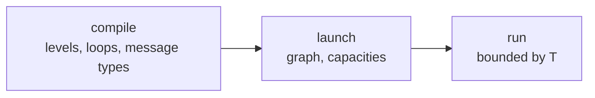
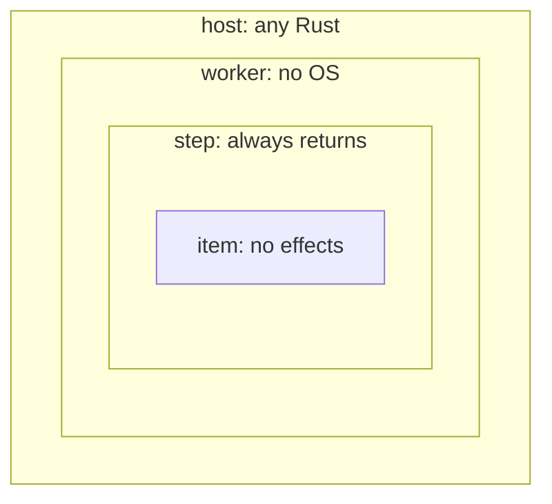
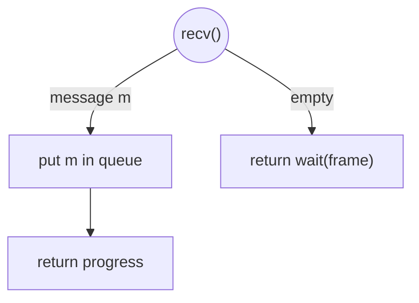
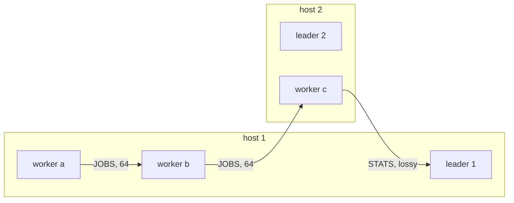
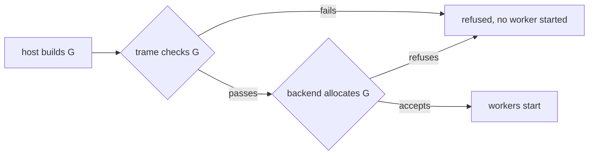
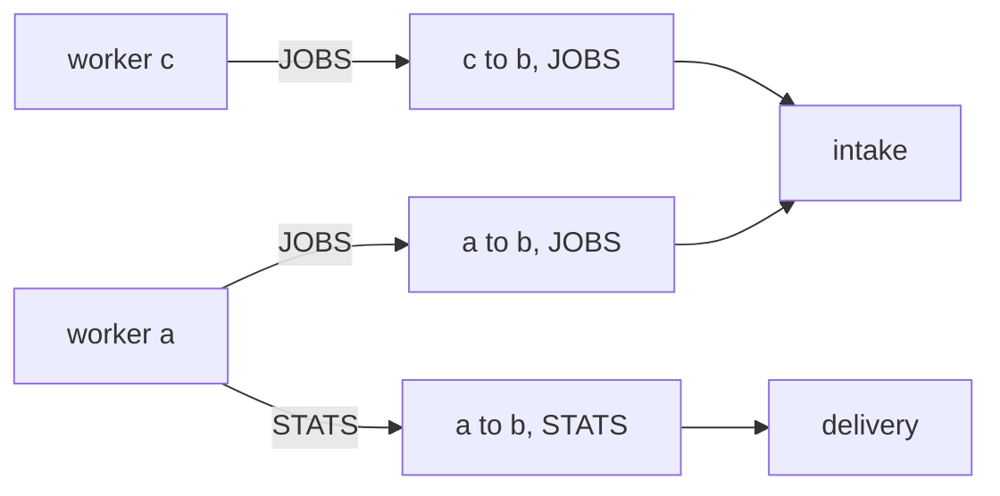
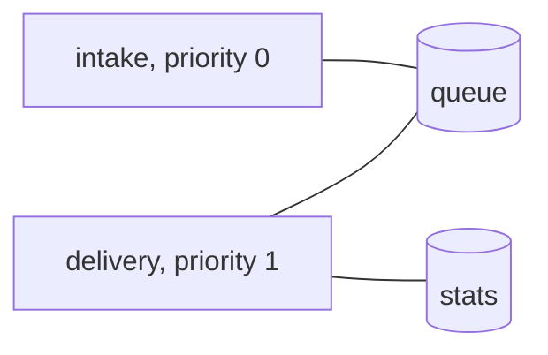
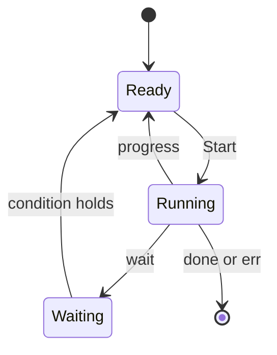
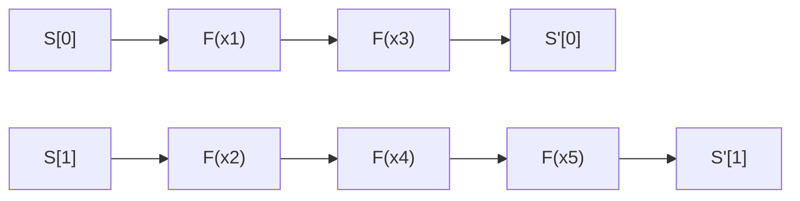
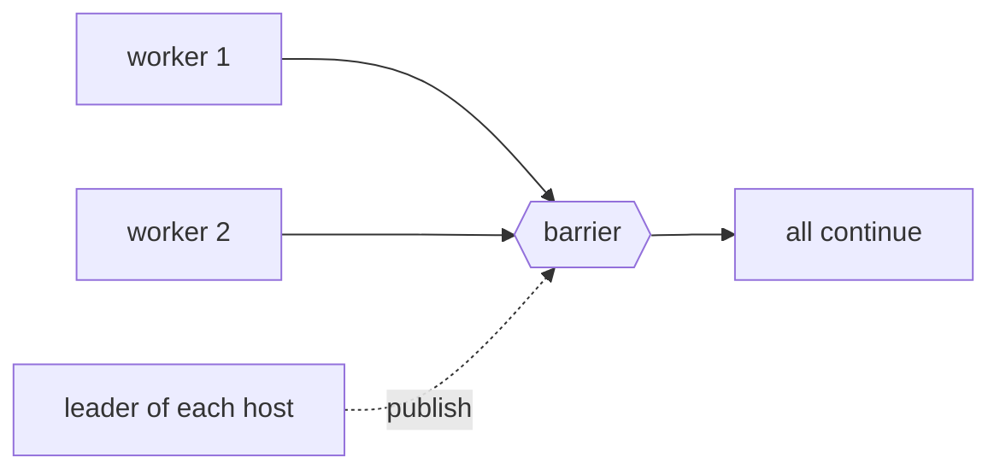

# Trame

Trame is a way of writing Rust so that a program means the same thing on every machine that runs
it. A program is split into four nested levels, and each level may make only certain requests to
its environment. These requests are called effects. An abstract machine $T$ answers the effects,
and in doing so it defines every behaviour the program is allowed to have. A backend answers the
same effects on real hardware. It is correct when every behaviour it produces is one that $T$
allows.

Trame narrows what can happen in three phases. Compiling checks the code. Launching fixes the
communication graph, before any worker starts. Running is then bounded by $T$. Each phase removes
possibilities, and every possibility removed is one that neither the program nor the backend has to
handle.



**Reading this document.** Quoted blocks and displayed formulas are normative. They are the parts
a mechanization must cover. Plain paragraphs, code and diagrams explain them and never add a
requirement.

## 1. Levels

A Trame program has four levels. Each level runs inside the one above it and may perform fewer
effects.



Each restriction buys one guarantee.
- **Worker.** A worker reaches the outside world only through Trame effects. It never calls the
  operating system, so a backend can run it where there is none, for instance on a GPU or on a
  bare-metal core.
- **Step.** A process runs as a sequence of steps, and every step returns. A step holds its shared
  cells while it runs and releases them when it returns, so every cell is eventually released.
- **Item.** An item performs no effect at all. Its result depends only on its arguments, so it is
  the same in whatever order the backend runs the items.

The compile-time checks of Section 3 enforce these restrictions.

> **Definition (Effect sets).** The effects allowed at each level are
> $\Sigma_I = \varnothing$ for items,
> $\Sigma_C = \{\mathsf{send}, \mathsf{recv}, \mathsf{now}, \mathsf{parallel}\}$ for steps, and
> $\Sigma_W = \Sigma_C \cup \{\mathsf{concurrent}, \mathsf{barrier}\}$ for workers. Each effect's
> answer type is given in the section that defines the effect.

## 2. Programs as interaction trees

Code under Trame runs until it requests an effect. The environment answers, and the answer decides
what the code does next. The following step receives a message and handles each possible answer.

```rust
fn step(&mut self, queue: &mut Queue) -> Status {
    match trame::recv::<Job>() {
        Some(job) => { queue.put(job); Status::Progress }
        None => Status::wait().frame(),
    }
}
```

Drawn as a tree, each effect is a node and each possible answer is an edge.



A step's tree is finite, because a step always returns. A worker's tree may be infinite, because a
worker may loop forever.

> **Definition (Interaction tree).** An interaction tree over a set of effects $\Sigma$ with
> results in $R$ either returns a value of $R$, or performs an effect $\sigma \in \Sigma$ and
> continues with a tree chosen by the answer (Xia et al., POPL 2020).

$$
\mathit{ITree}(\Sigma, R) = R + \textstyle\sum_{\sigma \in \Sigma} \big(\mathit{Ans}_\sigma \to \mathit{ITree}(\Sigma, R)\big)
$$

> Read inductively, this equation defines the finite trees $\mathit{ITree}^{\mathrm{fin}}$. Read
> coinductively, it defines $\mathit{ITree}^{\infty}$, which also contains trees that never return.

> **Definition (Denotation).**
> - A worker's `run`, applied to the context it receives at launch (Section 4), denotes a tree in
>   $\mathit{ITree}^{\infty}(\Sigma_W, R)$.
> - One call of a process's `step` denotes a tree in $\mathit{ITree}^{\mathrm{fin}}(\Sigma_C, \mathit{Status})$.
>   $\mathit{Status}$ is defined in Section 5.3.
> - One call of an item function $F$ denotes a function $I \times S \times C \to S$.
> - Host and leader code is not denoted. It is part of the environment.

These sets embed into each other, so code that is valid at an inner level can be used at every
outer level.

$$
(I \times S \times C \to S) \hookrightarrow \mathit{ITree}^{\mathrm{fin}}(\varnothing) \hookrightarrow \mathit{ITree}^{\mathrm{fin}}(\Sigma_C) \hookrightarrow \mathit{ITree}^{\infty}(\Sigma_W)
$$

## 3. Compile time

The driver is a rustc driver. It checks every function on MIR after monomorphization, at the level
where the function is used, so Rust types carry no capability tokens. A function may call items of
`core` and `alloc` only from three nested lists $A_I \subseteq A_C \subseteq A_W$. Each listed
item comes with a summary of its effects. The driver cannot read the bodies of non-generic `core`
items, so these lists are trusted.

> **Requirement (All levels).** No `unsafe`, FFI, `std`, threads, globals or indirect calls. Drop
> glue counts as a call. No `UnsafeCell`, so no interior mutability: a step changes shared state
> only through its cells.

> **Requirement (Worker).** A worker calls only items of $A_W$ and effects of $\Sigma_W$. It may
> use any loop and may recurse. It may allocate. It writes only its own state.

> **Requirement (Step).** A step calls only items of $A_C$ and effects of $\Sigma_C$. Every loop is
> counted, and it does not recurse. It may allocate. It writes only its own state and its cells
> $L(p)$ (Section 5.3).

> **Requirement (Item).** An item calls only items of $A_I$. Every loop is counted, and it neither
> recurses nor allocates. It writes only its slot.

> **Definition (Counted loop).** A loop is counted when it is a `for` over a range, a slice or an
> array that the body does not mutate.

Counted loops over an acyclic call graph are LOOP programs (Meyer & Ritchie, 1967), and LOOP
programs always terminate. This is why every step returns. It bounds the work of a step but not
its duration. Unbounded work must be split into more steps or more items.

A tag names a kind of message. Tags and their message types belong to the program, so they are
fixed here. Which workers exchange them is fixed later, at launch.

> **Definition (Tags).** A program declares a finite set of message types, and each message type
> is a tag: $M_t$ is the type of tag $t$. Two kinds of message with the same fields are two types.

> **Requirement (Messages).** Every message type is plain data: a type with no padding, no pointer
> into this process, and no bit pattern that is invalid (bytemuck's `Pod`). Numbers, arrays of plain
> data and structs of plain data are messages. `#[trame::message]` on a struct makes it plain data,
> and refuses references, pointers, function pointers and padding. A message is sent as its bytes
> in its `repr(C)` layout, its size is the size of that type, and the bytes are little-endian. Trame
> supports little-endian targets only. The crate does not check the byte order of the target: a
> big-endian build is outside the contract.

> **Requirement (Run-time aborts).** Overflow, an index out of range, division by zero, and
> running out of memory abort the launch. Overflow checks are on in every build
> profile.

With overflow checks always on, `+` means the same thing in every build. An item's abort depends
only on its inputs, so items stay deterministic.

> **Requirement (Floating point).** Floating point follows IEEE 754 with round to nearest even, no
> FMA contraction and no flush to zero. Results are bit-identical except for the sign and payload
> of NaNs, which Rust leaves unspecified. Each numeric function trame provides, such as `trame::math::exp`,
> is defined by one portable code, lives in `trame::math`, and has no backend-specific version.

> **Requirement (Checked builds).** The driver compiles with `--cfg trame_checked`. Without this
> flag, `concurrent!` and `parallel!` expand to `compile_error!`.

The flag prevents accidental unchecked builds. It does not prevent deliberate ones.

## 4. Launch time

The host builds the communication graph, called the topology, while it runs. It can use its own
data, for instance the number of devices or a partition of the work. Trame checks the topology,
and the backend allocates everything it needs or refuses. No worker starts before both accept.
Once workers run, the graph never changes and no route or queue can run out. Memory is the one
resource a program can still exhaust, by allocating, and that aborts.

```rust
let mut g = Topology::new();
let a = g.worker(produce);
let b = g.worker(consume);
g.route::<Job>(a, b, 64);
let run = g.launch()?;
```

A backend may run the host program in several operating-system processes, as MPI does. Each
process then runs the host code up to `launch` and builds $G$, and `launch` refuses unless every
process built the same $G$. In the leader's process `launch` returns the run. In a worker's process
it runs that worker and ends the process, so host code after `launch` runs only in the leader's.

The following topology has three workers on two hosts. Each arrow is a route, labelled with its tag
and its capacity.



> **Definition (Topology).** A topology $G$ consists of the following.
> - Hosts, each with one leader, and devices, each on one host. $\mathrm{host}(d)$ is the host of
>   device $d$.
> - A set $W$ of workers. Each worker $w$ runs an admitted worker program, is placed on a device
>   $\mathrm{dev}(w)$. The backend chooses $\mathrm{dev}(w)$ when it accepts $G$.
> - A list $R$ of routes. Each route $r$ has a sender $\mathit{from}(r)$ and a receiver
>   $\mathit{to}(r)$, each a worker or a leader, a tag $\mathrm{tag}(r)$, a capacity
>   $\mathrm{cap}(r) \geq 1$ and a flag $\mathrm{lossy}(r)$. Both ends may be the same worker. The
>   position of $r$ in $R$ is its rank.
> - An initial publication $\mathit{Pub}_0(h)$ for each host $h$.

> **Requirement (Launch checks).** Before any worker starts, trame refuses $G$ unless no two routes
> have the same sender, receiver and tag.

A message of any size is one frame. A backend whose transport has a smaller unit splits it
internally, and that is invisible to $T$.

> **Requirement (Acceptance).** The backend then accepts or refuses $G$. It may refuse for any
> reason, for instance memory for the queues, links between devices, or room to run
> every worker at once. A backend that accepts allocates everything $G$ needs before any worker
> starts, and it never refuses for lack of resources afterwards.



On a GPU, room to run every worker at once means co-residency or a cooperative launch. A backend
that cannot guarantee it refuses the launch.

> **Definition (Context).** Each worker starts with a context: its own identity and the identities
> of all workers in declaration order. In Rust these are `Context::me` and `Context::workers`.

A send names its receiver and its message type, and the route is looked up in $G$. A send with no
such route aborts, so no worker can reach a route outside $G$.

## 5. Run time

A run is a sequence of transitions $\Gamma \xrightarrow{\ell} \Gamma'$ between configurations. A
configuration $\Gamma$ is the state of the whole launch. Each subsection below introduces the
components of $\Gamma$ that its rules read and write, with their initial values.

> **Definition (Agents).** An agent is a worker, a process or a leader. $w(x)$ is the worker that
> runs agent $x$, and $w(x) = x$ when $x$ is a worker or a leader.

> **Definition (Run).** The rules of this section, and the endings of Definitions Abort and
> Deadlock, are the only transitions. A label
> $x : \sigma / v$ records that agent $x$ performed the effect $\sigma$ and received the answer
> $v$. Transitions without a label are internal.

> **Definition (Residual trees).** $\Gamma$ contains $\Pi$. $\Pi(w)$ is the remaining tree of
> worker $w$, initially the tree of its `run` applied to its context. $\Pi(p)$ is the remaining tree
> of process $p$ while a step of $p$ runs, and $\bot$ otherwise. $\Pi(x) = \sigma \cdot k$ means
> that $x$ is about to perform $\sigma$ and then continues with $k$ applied to the answer. Every
> labelled rule $x : \sigma / v$ also sets $\Pi(x) := k(v)$, and the rules below leave this update
> implicit.

> **Definition (Initial configuration).** $\Gamma_0$ gives every component the initial value
> stated where the component is introduced.

> **Definition (Abort).** If any code panics, the run ends, and every agent that has no result yet
> gets the result $\mathsf{abort}$.

> **Definition (Join).** The leader's last act is $\mathsf{join}$. After it, no transition of that
> leader occurs. In Rust it is `Run::join`, which answers each worker's result.

> **Definition (Deadlock).** A worker or process $x$ is stuck in $\Gamma$ when no run from
> $\Gamma$ contains another transition of $x$. A backend may end a stuck agent, and it then gets
> the result $\mathsf{deadlock}$.

Without this rule, a backend that detects a deadlock and reports it would produce a result that
$T$ never produces, so it would fail safety. A backend need not decide stuckness, which is
undecidable in general: it may report $\mathsf{deadlock}$ only where it can show that the agent is
stuck. Two cases are cheap. A worker waiting at a barrier while another worker has a result is
stuck, whatever anyone does. After every leader has joined, an agent is stuck when no worker or
process can take any transition, now or after time passes. A process waiting for a frame before its
leader joins is never reported, since the leader may still send.

### 5.1 Time

Programs never see real time directly. They read clocks, and each clock shows real time plus an
unknown offset. Two readings can be compared only when they come from the same clock, so Trame
never needs to synchronize clocks.

> **Definition (Time).** $\Gamma$ contains the real time $\tau \in \mathbb{R}_{\geq 0}$, initially
> $0$. Each device has one clock, and $\mathrm{clock}(x)$ is the clock of $\mathrm{dev}(w(x))$ for
> a worker or a process $x$. $\Gamma_0$ fixes an arbitrary offset $\theta(c)$ for each clock $c$,
> and no rule changes it. The effect $\mathsf{now}()$ answers a reading, which pairs a clock with a
> value. `since` between two readings of the same clock answers the span between them, and between
> readings of different clocks it aborts; `after` adds a span to a reading, giving a reading of the
> same clock. Spans are `core::time::Duration`. In Rust the effect is
> `trame::now`.

$$
\frac{\tau' \geq \tau}{\Gamma \to \Gamma[\tau := \tau']}
\ \textbf{Tick}
\qquad
\frac{c = \mathrm{clock}(x)}{\Gamma \xrightarrow{x\,:\,\mathsf{now}\,/\,(c,\ \tau + \theta(c))} \Gamma}
\ \textbf{Now}
$$

### 5.2 Communication

Every route has its own queue. When a frame is sent, the environment chooses the time at which it
arrives, which models latency. Arrival times never decrease along a route, so every route is FIFO.
On the receiving worker each tag belongs to one agent, and that agent receives every route with
that tag. Since each tag has its own queue, one agent's backlog fills only its own routes.



Here `intake` owns `JOBS` on worker `b`, so it receives from two routes. Each route is FIFO, but
nothing orders the two routes against each other: `recv` may take the head of either. Ordering
frames across routes would need one clock that every sender agrees on, which trame does not have.

> **Definition (Queues).** $\Gamma$ contains $Q$. $Q(r)$ is the sequence of frames on route $r$,
> initially empty. A frame $f = (m, a)$ has a message $m$ and an arrival time $a$. It is
> *available* when $a \leq \tau$. $a_{\mathrm{last}}(Q(r))$ is the arrival time of the last frame
> of $Q(r)$, or $0$ when $Q(r)$ is empty. $\Gamma$ also contains $U$. $U(r)$ counts the frames
> taken from $Q(r)$ whose slot the sender has not yet got back, initially $0$; it stays $0$ on a
> lossy route. $\mathrm{held}(r) = |Q(r)| + U(r)$ is the number of slots of $r$ in use.

> **Definition (Ownership).** While worker $w$ performs $\mathsf{concurrent}(\bar P)$, each process
> $p \in \bar P$ owns its tags $\mathrm{tags}(p)$. $\mathrm{own}(w, t)$ is the process that owns
> $t$, or $w$ itself when no process does or when $w$ performs no $\mathsf{concurrent}$. Agent $x$
> owns route $r$ when $\mathit{to}(r)$ is a worker and $\mathrm{own}(\mathit{to}(r), \mathrm{tag}(r)) = x$.

Frames still queued when a `concurrent!` answers stay queued, and from then on they are offers to
the worker itself. What a leader receives is the environment's business: **Take** removes frames
from its routes in any order, and conformance does not check it. In Rust the leader takes frames
with `Run::recv`, which never blocks, and blocks with `Run::wait` until a frame reaches it or a
worker gets a result.

> **Definition (Offers).** A frame $f$ is an offer to agent $x$ on route $r$ when $x$ owns $r$,
> $f$ is the first frame of $Q(r)$, and $f$ is available.

> **Definition (Communication effects).** $\mathsf{send}(r, m)$ with $m \in M_{\mathrm{tag}(r)}$
> answers $\mathsf{ok}$ or $\mathsf{full}$. $\mathsf{recv}(t)$ answers a message of type $M_t$,
> or $\mathsf{empty}$. In Rust these are `trame::send(to, m)`, where $r$ is the route of $G$ from
> $w(x)$ to `to` with the tag of `m`'s type, and `trame::recv::<M>()`.

$$
\frac{\mathit{from}(r) = w(x) \quad \mathrm{held}(r) < \mathrm{cap}(r) \quad a \geq \max(\tau, a_{\mathrm{last}}(Q(r)))}
{\Gamma \xrightarrow{x\,:\,\mathsf{send}(r,m)\,/\,\mathsf{ok}} \Gamma[Q(r) := Q(r) \cdot (m,a)]}
\ \textbf{Send}
$$

$$
\frac{\mathit{from}(r) = w(x) \quad \neg\,\mathrm{lossy}(r) \quad \mathrm{held}(r) = \mathrm{cap}(r)}
{\Gamma \xrightarrow{x\,:\,\mathsf{send}(r,m)\,/\,\mathsf{full}} \Gamma}
\ \textbf{Full}
$$

$$
\frac{\mathit{from}(r) = w(x) \quad \mathrm{lossy}(r) \quad Q(r) = f \cdot q \quad |Q(r)| = \mathrm{cap}(r) \quad a \geq \max(\tau, a_{\mathrm{last}}(Q(r)))}
{\Gamma \xrightarrow{x\,:\,\mathsf{send}(r,m)\,/\,\mathsf{ok}} \Gamma[Q(r) := q \cdot (m,a)]}
\ \textbf{Overwrite}
$$

$$
\frac{\mathrm{tag}(r) = t \quad f \text{ is an offer to } x \text{ on } r \quad Q(r) = f \cdot q}
{\Gamma \xrightarrow{x\,:\,\mathsf{recv}(t)\,/\,m_f} \Gamma[Q(r) := q,\ U(r) := U(r) + [\neg\,\mathrm{lossy}(r)]]}
\ \textbf{Recv}
\qquad
\frac{\text{no frame on a route of tag } t \text{ is an offer to } x}
{\Gamma \xrightarrow{x\,:\,\mathsf{recv}(t)\,/\,\mathsf{empty}} \Gamma}
\ \textbf{Empty}
$$

$$
\frac{\mathit{to}(r) \text{ is a leader} \quad Q(r) = f \cdot q}
{\Gamma \to \Gamma[Q(r) := q,\ U(r) := U(r) + [\neg\,\mathrm{lossy}(r)]]}
\ \textbf{Take}
\qquad
\frac{U(r) > 0}
{\Gamma \to \Gamma[U(r) := U(r) - 1]}
\ \textbf{Release}
$$

$$
\frac{\mathrm{lossy}(r) \quad Q(r) = q \cdot f \cdot q' \quad q' \neq \varepsilon}
{\Gamma \to \Gamma[Q(r) := q \cdot q']}
\ \textbf{Drop}
$$

$[\varphi]$ is $1$ when $\varphi$ holds and $0$ otherwise.

These are the only answers. **Full** applies only to a route that is not lossy, and only when all
its slots are in use. Without that precondition, a backend that answered $\mathsf{full}$ to every
send would deliver nothing and still never contradict $T$. With it, such a backend produces an
answer that $T$ cannot produce, so it is incorrect.

A receive frees its slot only at **Release**, which the environment fires later. Between the two,
the frame is gone from the queue but its slot still counts against the sender. Across a network,
the receiver's progress is a message on its way back to the sender, and until it arrives the
sender may still be answered $\mathsf{full}$. Without **Release**, a backend would have to order
that message before every message that the receiver sends afterwards, on every path that can reach
the sender. A program therefore learns that a route has room only from $\mathsf{room}$ or from an
$\mathsf{ok}$ answer, never from knowing that the receiver received. A backend on one memory may
fire **Release** at once after every receive.

A lossy route never makes its sender wait. When its queue is full, a send replaces the oldest frame
(**Overwrite**). The transport may also lose any frame except the newest (**Drop**). A receiver
that keeps receiving therefore ends up with the latest frame.

### 5.3 Scheduling

A worker runs several processes at once with `concurrent!`. A process is a struct with a `step`
method. Each process owns the message types it receives and declares the cells it writes: the
`&mut` parameters of its `step`. Cells are the only state shared between processes, and they are
matched to steps by type, so each cell has a type of its own. A step takes all its cells before it
starts and gives them back when it returns.

```rust
#[trame::process(receives = Job)]
impl Intake { fn step(&mut self, queue: &mut Queue) -> Status { ... } }

#[trame::process]
impl Delivery { fn step(&mut self, queue: &mut Queue, stats: &mut Stats) -> Result<Status, E> { ... } }

trame::concurrent!(intake, delivery; queue, stats)
```

Here `intake` owns `Job` and uses `queue`. `delivery` uses `queue` and `stats`. The two share
`queue`, so their steps never overlap.



A process moves through the following states. Ready means enabled, and a step starts only when
all its cells are also free.



Priority is the order of declaration. When several processes could start, the earliest declared
one wins, so a process that never waits starves every process below it. A step takes all its cells
at once and never waits while holding one, so cells cannot deadlock, whatever the number of
execution agents. A process waiting for a frame, for room on a route, or for a deadline returns
$\mathsf{wait}$ instead of polling. Each wait condition is a state that the scheduler rechecks,
not an event that could be missed.

> **Definition (Processes).** In $\mathsf{concurrent}(\bar P)$, each process $p \in \bar P$ has a
> priority $\pi(p)$, its position in $\bar P$, a set of tags $\mathrm{tags}(p)$, and a cell set
> $L(p)$, the `&mut` parameters of its `step` after `self`. Each run of `concurrent!` creates fresh processes.
> $\Gamma$ contains $H$, $\mathit{St}$ and $D$. $H(x)$ is the process holding cell $x$, initially
> $\bot$. $\mathit{St}(p)$ is the latest status of $p$, initially $\mathsf{fresh}$. $D(p)$ records
> that another process freed one of the cells of $p$ since $p$ last ended, initially false. The
> borrow checker guarantees that a step's `&mut` borrows end when it returns. The backend
> guarantees the exclusion required by **Start**.

> **Definition (Status).** A step returns
> $\mathit{Status} = \{\mathsf{progress}, \mathsf{done}\} + \mathsf{wait}(\Omega) + \mathsf{err}(E)$,
> where $\Omega$ is a set of conditions.
> - $\mathsf{frame}$ holds when some frame is an offer to $p$.
> - $\mathsf{room}(r)$ holds when $\mathrm{held}(r) < \mathrm{cap}(r)$ or $r$ is lossy.
> - $\mathsf{until}(d)$, where $d$ is a reading of $\mathrm{clock}(p)$, holds when
>   $\tau + \theta(\mathrm{clock}(p)) \geq d$. Waiting on a reading of another clock aborts.
>
> $\Omega$ may be empty; then only $D(p)$ wakes $p$. In Rust, `Status::wait()` is $\mathsf{wait}(\varnothing)$,
> and `.frame()`, `.room::<M>(to)` and `.until(reading)` each add one condition.

> **Definition (Enabled).** Process $p$ is enabled when $\mathit{St}(p)$ is $\mathsf{fresh}$ or
> $\mathsf{progress}$, or when $\mathit{St}(p) = \mathsf{wait}(\Omega)$ and either some condition
> in $\Omega$ holds or $D(p)$ is true.

In **Start**, $q$ ranges over the processes of the same `concurrent!`.

$$
\frac{\Pi(p) = \bot \quad p \text{ enabled} \quad H(L(p)) = \bot \quad \forall q.\ \mathit{St}(q) \neq \mathsf{err}(\_) \quad \neg\exists q.\ \big(\Pi(q) = \bot \wedge q \text{ enabled} \wedge \pi(q) < \pi(p) \wedge H(L(q)) = \bot\big)}
{\Gamma \to \Gamma[H(L(p)) := p,\ \Pi(p) := \mathit{step}_p]}
\ \textbf{Start}
$$

$$
\frac{\Pi(p) = \mathsf{ret}(s)}
{\Gamma \to \Gamma\big[H(L(p)) := \bot,\ \Pi(p) := \bot,\ \mathit{St}(p) := s,\ D(p) := \mathsf{false},\ D(q) := \mathsf{true} \text{ for each } q \neq p \text{ with } L(q) \cap L(p) \neq \varnothing\big]}
\ \textbf{End}
$$

Any step that ends wakes the processes it shares a cell with, even one that returns
$\mathsf{wait}$, because it may have changed the cell before waiting. So two processes that wait
only on each other's cells keep waking each other. That run is not stuck, so it is not a deadlock;
it spins, and the spinning is the program's error.

> **Definition (Concurrent effect).** $\mathsf{concurrent}(\bar P)$ answers $\mathsf{done}$ or
> $\mathsf{err}(e)$.

$$
\frac{\forall p \in \bar P.\ \mathit{St}(p) = \mathsf{done}}
{\Gamma \xrightarrow{w\,:\,\mathsf{concurrent}(\bar P)\,/\,\mathsf{done}} \Gamma}
\ \textbf{Done}
\qquad
\frac{p \in \bar P \quad \mathit{St}(p) = \mathsf{err}(e) \quad \forall q \in \bar P.\ \Pi(q) = \bot}
{\Gamma \xrightarrow{w\,:\,\mathsf{concurrent}(\bar P)\,/\,\mathsf{err}(e)} \Gamma}
\ \textbf{Fail}
$$

> **Requirement (Concurrent checks).** $\mathsf{concurrent}(\bar P)$ aborts before any step
> starts if two processes receive the same tag, two cells have the same type, a step takes a cell
> type that no cell provides, or a cell is taken by no step. The macro sees values, not their
> types, so these are checked when `concurrent!` runs, not when it compiles.

Once a process fails, no new step starts. The running steps finish, and `concurrent!` answers with
one of the errors.

### 5.4 Items

`parallel!` applies an item function to many inputs. Each input has a key, and each key selects a
slot. The inputs with the same key are folded into their slot in input order. Different keys are
independent, so a backend may run them in parallel. A map is the case where each input has its own
key.



In this example $x_1$ and $x_3$ have key $0$, and $x_2$, $x_4$ and $x_5$ have key $1$. The two
chains may run at the same time. Each chain runs in input order.

> **Definition (Parallel effect).** $\mathsf{parallel}(F, \kappa, C, \bar x, S)$ takes an item
> function $F$, a key function $\kappa$, a shared context $C$, inputs $\bar x$ and slots $S$. It
> aborts, before running any item, unless $\kappa(x_i) < |S|$ for every $i$, as an index out of
> range does. Otherwise it answers the slots $S'$ defined below. For each key $k$, let $i_1 < \dots < i_m$ be
> the positions whose key is $k$. In Rust, an item is `#[trame::item(key = ...)] fn f(item: &I,
> slot: &mut S, cx: &C)`, where the key is an expression over `item`, run as
> `parallel!(f, &cx, &items, &mut slots)`.

$$
s_0 = S[k], \qquad s_j = F(x_{i_j},\ s_{j-1},\ C), \qquad S'[k] = s_m
\qquad\qquad
\frac{a \text{ is the answer defined above}}{\Gamma \xrightarrow{x\,:\,\mathsf{parallel}(F, \kappa, C, \bar x, S)\,/\,a} \Gamma}
\ \textbf{Parallel}
$$

### 5.5 Barrier

The barrier is the only effect that involves every worker. It happens only when every worker's
next effect is the barrier. The leader of each host may replace the publication of its host at any
time, and a barrier answers the publication current when it fires. A publication is a value that the
workers of that host read.



> **Definition (Publication).** $\Gamma$ contains $\mathit{Pub}$. $\mathit{Pub}(h)$ is the
> publication of host $h$, initially $\mathit{Pub}_0(h)$. Only **Publish** changes it, and the
> leader of $h$ chooses the new value $P$. A publication is a byte string of any length, and no
> bound is set on its length.

> **Definition (Barrier effect).** $\mathsf{barrier}$ answers the publication of the worker's
> host. In Rust it is `trame::barrier`, and its answer is a snapshot of the publication that the
> worker may keep.
> $\Pi(W) = \mathsf{barrier} \cdot k$ means that $\Pi(w) = \mathsf{barrier} \cdot k_w$ for every
> worker $w$. **Barrier** carries the label
> $w : \mathsf{barrier} / \mathit{Pub}(\mathrm{host}(\mathrm{dev}(w)))$ for every worker $w$ at
> once.

$$
\frac{\Pi(W) = \mathsf{barrier} \cdot k}{\Gamma \xrightarrow{w\,:\,\mathsf{barrier}\,/\,\mathit{Pub}(\mathrm{host}(\mathrm{dev}(w)))\ \text{for every}\ w \in W} \Gamma\big[\Pi(w) := k_w(\mathit{Pub}(\mathrm{host}(\mathrm{dev}(w)))) \text{ for every } w \in W\big]}
\ \textbf{Barrier}
\qquad
\frac{}{\Gamma \xrightarrow{\mathsf{publish}(h, P)} \Gamma[\mathit{Pub}(h) := P]}
\ \textbf{Publish}
$$

Workers read the publication only at a barrier, so a backend may keep the newest publication
aside and install it when the next barrier fires: no worker can tell the difference. Two
publications between barriers leave only the second visible.

If a worker returns, or never reaches the barrier, the other workers wait there forever. This is
an error in the program, and the driver does not detect it. Definition (Deadlock) lets a backend
end those waiters.

## 6. Backends

$T$ defines which behaviours are allowed. A backend may refuse a launch, but only before any worker
starts. After it accepts, it must never produce a behaviour outside $T$, and it must keep making
progress.

> **Definition (Observations).** $\mathit{Obs}(B, P, G)$ is the set of runs of program $P$ with
> topology $G$ on backend $B$. Each run is recorded as the tuple of every agent's sequence of labels
> and its result.

> **Requirement (Safety).** For every admitted program $P$ and every topology $G$ that $B$ accepts,
> $\mathit{Obs}(B, P, G) \subseteq \mathit{Obs}(T, P, G)$.

A backend that does nothing satisfies safety. Progress rules it out.

> **Requirement (Progress).** For every accepted launch, assuming the hardware keeps running and
> every agent that runs forever performs effects forever (a backend may run other agents only at
> effects),
> - time diverges,
> - every frame becomes available unless a lossy route removes it first,
> - **Release** eventually fires on every route $r$ with $U(r) > 0$,
> - every effect that $T$ can still answer is answered,
> - every started step reaches **End**,
> - a frame that stays an offer to $x$ on $r$, while $x$ performs $\mathsf{recv}(\mathrm{tag}(r))$
>   infinitely often, is eventually received,
> - if the premises of **Start** hold for $p$ from some point on, then $p$ is eventually started.

Two backends are in the tree. Both are tested on the programs of `programs/`, and `programs/run.sh`
checks that they print the same output.

The sequential backend (`backends/seq`) is the reference. It runs one agent at a time, on Rust's own
semantics. Each worker has its own thread, because `run` is ordinary code that may loop forever. A
baton passes between them at every effect, so exactly one agent executes at any moment and the
schedule is deterministic. Processes and items run on their worker's thread. When every agent that
can move has moved, and no idle worker has seen a change, after `join` the run is stuck: the backend
ends each remaining agent with $\mathsf{deadlock}$.

The MPI backend (`backends/mpi`, described in its `README.md`) runs one MPI rank per worker, with the
leader on the last rank, so `mpirun` needs W + 1 ranks. Workers on one shared-memory node share one
memory window, with one ring per route, and a worker that waits sleeps on a futex word in that
window. Across nodes, each node runs a relay: two threads that send the node's frames, credits,
barrier arrivals and results to the other nodes and apply what arrives. Each node has its own clock.
A launch over several nodes needs `MPI_THREAD_MULTIPLE`, and is refused without it. This backend
reports $\mathsf{deadlock}$ at a barrier that can never fire, but it does not yet detect a stuck run
after `join`, which the rule above permits and does not require.

The scheduling of `concurrent!` is the same Rust code for every backend (`concurrent.rs`, `sched.rs`).
`sched.rs` is checked against **Start** and **End** by a test that enumerates every state up to a
bounded size (`start_and_end_exhaustive_up_to_bounds`). That is a bounded check, not a proof. A new
backend declares this contract and must print the same output as the reference on the same programs.

**Conformance.** A monitor checks a logged trace against Section 5 and names the first transition
that $T$ forbids. A finite trace can show that safety fails, but it cannot show that progress
holds.

**Latency.** $T$ leaves latency to the environment, so no proof says anything about it. The MPI
backend has a recorder, `backends/mpi/tests/latency.rs`, which writes round trips between workers in
the nixsci record format and computes no verdict. The tree holds no nixsci experiment that locks
those records by content hash yet, so no latency claim is checked. A claim has this form: that the
fraction of round trips whose half exceeds the fastest one by more than 100 µs is below 0.1%, at
confidence 0.99. Its verdict is supported, contradicted or inconclusive, under the experiment's
sampling assumptions. A proof is conditional on its model; a claim is conditional on its samples; an
importer that relies on both states both conditions.

## 7. Rust surface

Every public name of the crate is listed here with the part of $T$ it stands for. A name that is
not listed is not part of the contract, and a name with a leading `__` is internal. All names are at
the crate root, except `math::exp`, which is in `trame::math`. `trame::math` holds pure numeric
functions: code at the item level, not effects, and each gives the same bits on every backend. A
function is added there when a program needs it; no program has to call one to meet this
specification.

| Name | Kind | Stands for |
|---|---|---|
| `#[trame::message]` | attribute on a struct, which makes it plain data | a tag and its message type (Section 3) |
| `#[trame::process(receives = A, B)]` | attribute on an `impl` with `step` | a process, its tags and its cells $L(p)$ (5.3) |
| `#[trame::item(key = e)]` | attribute on a fn | an item function $F$ and its key $\kappa$ (5.4) |
| `concurrent!(p, q; c, d)` | macro | $\mathsf{concurrent}(\bar P)$, cells matched by type (5.3) |
| `parallel!(f, &cx, &items, &mut slots)` | macro | $\mathsf{parallel}$ (5.4) |
| `send(to, m) -> Result<(), Full>` | fn | $\mathsf{send}$ on the route from this worker to `to` with the tag of `m` (5.2) |
| `recv::<M>() -> Option<M>` | fn | $\mathsf{recv}(t)$ for the tag of `M` (5.2) |
| `now() -> Reading` | fn | $\mathsf{now}$ (5.1) |
| `barrier() -> Arc<[u8]>` | fn | $\mathsf{barrier}$, answering a snapshot of the publication (5.5) |
| `Reading` | type: `since`, `after` | a reading of one clock (5.1) |
| `Status` | type: `Progress`, `Done`, `wait()` with `.frame()`, `.room::<M>(to)`, `.until(r)` | $\mathit{Status}$ (5.3) |
| `Full` | type | the answer $\mathsf{full}$ (5.2) |
| `Message` | trait, implemented by every plain-data type: `zeroed` | plain data of a tag (Section 3) |
| `Topology` | type: `new`, `worker`, `route::<M>`, `lossy::<M>`, `publish`, `launch` | $G$ and its launch (Section 4) |
| `WorkerId`, `LEADER` | type, constant | a worker, the leader |
| `Context` | type: `me`, `workers` | the context (Section 4) |
| `Refused` | type | a refusal at launch (Section 4) |
| `Run` | type: `send`, `recv`, `wait`, `publish`, `join` | the leader's side of a run (5.2, 5.5, Join) |
| `Outcome` | type: `Returned`, `Abort`, `Deadlock` | a worker's result (Section 5) |
| `math::exp` | fn | the portable exponential (Requirement (Floating point)). Its accuracy is claimed for inputs in $[-30, 0]$: relative error below 2e-6 against `f64::exp`, tested in `math.rs`. Outside that range it returns what the same code computes, with no accuracy claim |

`Duration` and `Arc` are the standard ones. A worker is any `Fn(&Context)`; a step is
`fn step(&mut self, c: &mut C, ...) -> Status` or `-> Result<Status, E>`, where `Err(e)` is
$\mathsf{err}(e)$.
