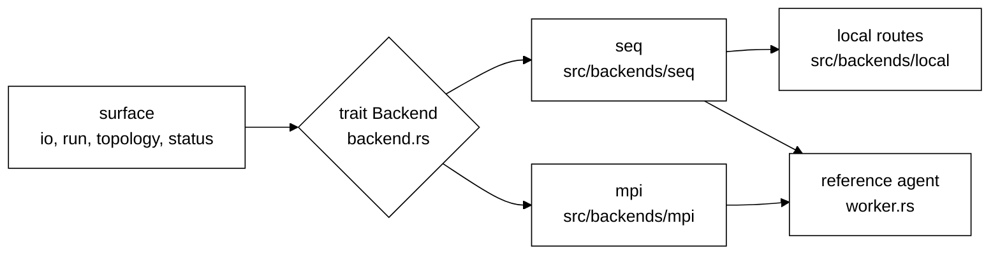

# Backends

A backend runs a launched topology. It implements the trait `Backend` in `backend.rs`, the one seam
between the surface and the hardware, and it keeps the clauses of `CONTRACT.md`. This file is the only
place in the repository that describes the backends one by one. Everything outside `src/backends/` is
written so that it holds for any backend.

A build selects one backend by a cargo feature. The features are exclusive, and a build with none of
them refuses every launch. The default feature is the reference backend, `seq`.

## The backends

**seq** is the reference. It runs every worker of a host in one process, one thread per worker, and one
agent at a time: a baton passes between workers at each effect. Its schedule is deterministic, and it
follows `Sched::choose` exactly. Every other backend is judged against its output on the programs of
`check/programs/`.

**mpi** runs one MPI rank per worker and the leader on the last rank of each host, so a host of W workers
needs W + 1 ranks. Each shared-memory node is a host. Workers of one host share a window with one ring per
route, and routes between hosts are two-sided messages with credits.

`src/backends/local/` is not a backend. It holds the route rings that `seq` uses, and it is compiled only
under the `seq` feature.

## The seam

The surface calls the `Backend` functions and nothing else in a backend. They fall in four groups.

**Launch.** `agree` checks that every process of the launch holds the same plan. `launch` accepts a
checked plan or refuses it, and it has allocated everything the plan needs when it accepts.

**Worker.** `worker_send`, `worker_recv`, `worker_offer`, `worker_route`, `worker_room`, `worker_now`,
`worker_epoch` and `worker_idle` serve the agents of one worker.

**Leader.** `leader_send`, `leader_recv`, `leader_edit`, `leader_stop`, `leader_wait` and `leader_join`
serve the leader.

**Domain.** `domain_alloc`, `domain_contains` and `domain_dealloc` serve `trame::Alloc`
(`docs/memory-domains.md`).

## How each backend meets the parts

| part | seq | mpi |
|---|---|---|
| worker | one thread, one agent | one rank, several agents |
| service (S7) | 1 per step | nanoseconds |
| choice (S2) | exactly `Sched::choose` | any start `Sched::may_start` allows |
| scheduler | reference agent | reference agent |
| routes | rings under one lock | rings in a shared window; two-sided MPI between hosts |
| wake | one counter of acts | epoch words and futexes |
| domain (M1) | the process heap | a shared segment of the node (`src/backends/mpi/memory/segment.rs`) |
| leader | a thread outside the baton | the last rank of each host |
| `Deadlock` (E2) | shown when every agent that can move has moved | shown once every host's leader waits, joins or has ended |
| trace (S9) | replayed exactly | replayed against `may_start` |

Service is the backend's measure of what a step used. On `seq` it is 1 per step, which keeps the schedule
deterministic. On `mpi` it is wall time, so the shares of `S7` are shares of time.

## Where each part lives

Paths below are relative to the repository root; the mpi paths are inside `src/backends/mpi/`, whose `README.md` lists its directories. The shared code (`worker.rs`, `sched.rs`, `domain.rs`) is not
listed.

| part | seq | mpi |
|---|---|---|
| the `Backend` functions | `src/backends/seq/ops.rs`, `mod.rs` | `src/backends/mpi/backend.rs`, `mod.rs` |
| launch and the plan check | `ops.rs` (`launch`, `build_all`) | `setup/` (`open.rs`, `plan.rs`, `shape.rs`, `refusal.rs`) |
| routes | `src/backends/local/routes.rs` | `rings/`, `transport/cross/`, `memory/layout.rs` |
| domain | the process heap, through `domain.rs` | `memory/` |
| wake | `state.rs` (park, advance) | `waiting/` |
| edits | `edit.rs` | `roles/leader.rs` `edit`, `roles/worker.rs` `edit_request` |
| leader | `ops.rs` (`leader_*`) | `roles/leader.rs` |
| stuck detection | `stuck.rs` | `roles/detect.rs` |
| host numbering and nodes | one host | `transport/` |
| step limit | `limit.rs` | none |
| results and abort | `state.rs` | `roles/results.rs` |

## seq

Each worker has one thread, because a step may loop for a long time. The leader runs outside the baton,
under the same lock. `sched::check` replays the traces of `seq` with `exact`, which also requires the model's
choice at each start (`PROOFS.md`, Replay).

When every agent that can move has moved, and no idle worker has seen a change, the run is stuck. `seq` ends
each remaining worker with `Deadlock`, and panics a leader whose `wait` can never return
(`src/backends/seq/stuck.rs`).

`TRAME_SEQ_STEP_LIMIT=n` ends the process at the baton's step n + 1, with a message and exit status 3. The
mutant checks use it to kill a mutant that loops for ever, and the count of steps, not seconds, makes that
result repeatable.

## mpi

Workers of one host share a window with one ring per route; a route between hosts goes rank to rank by
two-sided MPI. The leaders show a run stuck by rounds of a nonblocking allreduce. How each part works is in the
README of its directory: `src/backends/mpi/README.md` is the index, and `transport/` holds the hosts and the
measurements of the lanes.

Several hosts on one machine come from `TRAME_MPI_NODE_RANKS=k`, which cuts a node into hosts of k ranks. It is
for testing and never a default. `TRAME_PROBE=ranks` makes a program print `trame-ranks N` and stop, and the
launch uses it to ask for the rank count.

Open MPI may print `osc_ucx_component` errors on stderr on some machines; they come from Open MPI, not from
the program. A process that did not build a state adopts the leader's address (`build_or_adopt`,
`setup/adopt.rs`), which is valid because the segment is mapped at one address on every rank of a node.

## Limits

These are implementation limits, not part of T. A state has at most 63 fields and at most 64 steps, the stop
step included. A step receives at most 16 message types, and a `.room` wait names one of a worker's first 64
routes. Exceeding one is refused or aborts with a message naming it.

`seq` has the step limit above. `mpi` holds back the detection of a stuck run across hosts while a leader
runs its own code, as described under mpi. Latency is not guaranteed by any backend, and T leaves it to the
environment.

## Build and run

Build with the reference backend, the default:

    nix develop
    RUSTFLAGS='--cfg trame_checked' cargo run --example ring

Build with `mpi`:

    nix develop .#mpi
    RUSTFLAGS='--cfg trame_checked' CARGO_TARGET_DIR=target/mpi \
      cargo build --no-default-features --features mpi --example ring
    mpirun --oversubscribe -n 5 target/mpi/debug/examples/ring

The ring example has four workers, so `mpirun` needs five ranks. Any other count is refused on every rank
before a worker starts.

With the trame CLI, the backend is a build choice, so the backend flag is given to both `build` and `run`:
`nix run .#trame -- build <flag> [--check] [cargo args]` and `nix run .#trame -- run <flag> [-n RANKS]
[--node-ranks K] PROGRAM [-- args]`. The flag for `mpi` is `--mpi`; `seq` takes none. For `mpi`, `run` asks
the program how many ranks it needs (`TRAME_PROBE=ranks`, which prints `trame-ranks N` and stops) and starts
`mpirun` with that count. Inside a nixsci job on several hosts, the hostfile, the placement and the launch
agent come from `nixsci.lab.mpi`, and `crates/cli/check.sh` tests that path.

## Launch

Every backend provides `src/backends/<b>/launch`, with the same interface:

    src/backends/<b>/launch [--split S] [--bind B] [--timeout T] --out DIR -- PROGRAM ARGS

The launcher runs the program as hosts of the backend, and it writes four files into DIR. `host<h>.out` and
`host<h>.err` hold host h's stdout and stderr, with consecutive duplicate lines collapsed. `cpu.tsv` has the
header `host rank machine user_s sys_s wall_s` and one row per rank, with CPU times from GNU time.
`config.txt` records the setup: for `seq` the argument vector, for `mpi` the MCA files, the MPI version, the
MCA variables and the full command line.

`--split S` is the number of hosts per machine. `seq` accepts 1 only, and `mpi` accepts the values in its
descriptor. `--bind` is passed to the launcher's placement; `seq` accepts and ignores it. The launcher exits
with the program's status, 124 when `--timeout` ended the run, and 2 when the backend refuses the host
count. It also exits 2 on a usage error. A launcher that must ask the program for its size first exits 3
when that first run ends without launching a topology: the program ran once, exited 0, and that run is
`host0.out` and `host0.err`. A test harness counts such a test as passed and never reruns it outside the
launcher.

The job's machines come from `NIX_DEPLOY_HOSTFILE` when it is set, and otherwise from this machine. `seq`
refuses a job that names more than one machine.

## The descriptor

Each backend has `src/backends/<b>/backend.nix`, a function of `pkgs` that the flake reads. It returns the
following fields.

| field | meaning | seq | mpi |
|---|---|---|---|
| `packages` | build inputs beyond the common set | none | the MPI development output |
| `env` | environment variables of the build | none | `MPICC` |
| `launchRuntime` | programs the launcher needs on its path | bash, coreutils, time, grep | MPI runtime, Python, coreutils, time, procps, util-linux, grep |
| `maxMachines` | the largest job the flake accepts | 1 | 1024 |
| `splits` | the values `--split` may take | `[ 1 ]` | `[ 1 2 ]` |
| `deterministic` | whether a run is a function of the program | true | false |
| `cargoTests` | whether the root crate's cargo tests run on it | true | false |
| `bins` | extra binaries built from the backend's own sources | none | `check`, `latency` |
| `postInstall` | shell run after the build | none | builds the plain-MPI baselines |
| `experiments` | the backend's own lab experiments, as a function of its arguments | none | `experiments.nix` |

`deterministic = true` makes the backend's programs and mutants validate verdicts, which are derivations.
Otherwise they are lab experiments, which run real processes.

## skip.txt

A backend may list programs it does not run in `src/backends/<b>/skip.txt`. The file has one program per line,
the program's name, then a space and the reason. `check/programs/run.sh` skips a listed program for that
backend, and the reason is for the reader. No backend has a `skip.txt` at the time of writing.

## Checks by backend

The clauses of `CONTRACT.md` are checked by the methods of `PROOFS.md`, and some checks belong to one backend.
This section lists those.

**seq.** The launch tests in `src/backends/seq/tests_launch.rs`, and `launch::build_all` for L3. The exact replay
of S2. The mutant that forgets deadlines is killed by the outcome check (S3). The domain is the heap (M1), and
the workers run only inside the leader's calls on the run (M7). The validate verdicts `programs-seq`,
`tests-seq` and `mutants-seq` are listed in `lab/README.md`.

**mpi, launch and refusal.** Every refusal is decided by a collective reduction, and `agree` in
`src/backends/mpi/setup/open.rs` decides L2. `setup/adopt.rs` builds the plan (L3).

**mpi, wake and transport.** The TLA+ model `Epoch` checks that no wake-up is lost with one to three sleepers
per word (S3). The edit handshake has the model `Edit`, whose larger configurations did not finish (S4). The transport checks are in `src/backends/mpi/tests/`:
FIFO with verification, overwrite, fairness, large routes and node splits (T1 to T3). The TLA+ model `Lane`
covers order, room by credits, and every frame taken and credited (F5).

**mpi, memory and hosts.** Placement is by construction in `memory/segment.rs` (M1), and `segment::alloc` answers null
past the segment's end (M6). `roles/leader.rs` holds the plan's references until `join` (M7). Hosts are numbered by
their lowest world rank (`transport/hosts.rs`, F1), and a capacity that differs between hosts refuses both
(`transport/cross/connect.rs`, F3). The tag of a cross-host message is by construction in `src/io.rs` (F4, `tag`).

**mpi, end.** `roles/detect.rs` has the model `Detect` (`check/proofs/mpi/`). E2 for
the stuck detector also rests on its programs, `xhost_deadlock` and `leader_stuck`. Its round trips are measured by
the lab's latency experiment, which judges them against the Q clauses of the backend contract, not by a
recorder of its own.

The shared-memory assumption is the mpi backend's own: its processes share memory through mappings of one
object, and it assumes atomics in such a mapping order memory across processes as they do across threads.

## Lab experiments by backend

The lab names its experiments after the backend they run. Each name is a flake attribute: an app (`nix run
.#<name>`) or a check (a validate verdict). The names below are from `nix eval --json .#apps.x86_64-linux --apply
builtins.attrNames` and `nix eval --json .#checks.x86_64-linux --apply builtins.attrNames` at this commit.

| experiment | seq | mpi |
|---|---|---|
| programs | `programs-seq`, `programs-seq-s1` | `programs-mpi`, `programs-mpi-s1`, `programs-mpi-s2`, `programs-mpi-s4` |
| transport | none | `transport-mpi` |
| mutants | check `mutants-seq` | app `mutants-mpi` |
| fanin | `fanin-seq-s1` | `fanin-mpi-s1`, `fanin-mpi-s2` |
| flow-agg | `flow-agg-seq-s1` | `flow-agg-mpi-s1`, `flow-agg-mpi-s2`, `flow-agg-mpi-s4` |
| flow-bw | `flow-bw-seq-s1` | `flow-bw-mpi-s1`, `flow-bw-mpi-s2` |
| graph | `graph-seq-s1` | `graph-mpi-s1`, `graph-mpi-s2`, `graph-mpi-s4` |
| idle | `idle-seq-s1` | `idle-mpi-s1` |
| latency | `latency-seq-s1` | `latency-mpi-s1`, `latency-mpi-s2` |
| round | `round-seq-s1` | `round-mpi-s1`, `round-mpi-s2`, `round-mpi-s4` |
| step | `step-seq-s1` | `step-mpi-s1` |
| baselines | none | `baseline-flow-agg-mpi-s1`, `-s2`, `-s4`; `baseline-flow-bw-mpi-s1`, `-s2`; `baseline-graph-mpi-s1`; `baseline-osu-bw-mpi-s1`, `-s2`; `baseline-osu-latency-mpi-s1`, `-s2`; `baseline-round-mpi-s1` |
| checks | `programs-seq`, `tests-seq`, `rejections-seq`, `mutants-seq` | `tests-mpi`, `rejections-mpi`, `protocol-mpi` |

`programs-<b>` with no span runs on one local host. `-s<N>` runs on N machines (`lab/checks.nix`, `lab/perf.nix`).

The latency experiment and the suite run for every backend, and they need no entry here: `lab/README.md`
(Experiments and datasets, Suite and report) describes them.

## Benchmarks

The scale experiments run the programs of `lab/bench/` and their baselines. The multi-process backend keeps its
baselines in `src/backends/mpi/bench/`: `barrier.c`, `flow.c` and `graph.c`. The baselines are not trame: they
measure what the same communication costs when written against the messaging library directly. The claims the scale experiments test, and what the numbers cannot show, are
in `lab/bench/README.md` and `lab/README.md`.

A timing from the reference backend is a scheduler timing, not a host timing, so it is not comparable with a
timing from a multi-process backend.

`src/backends/mpi/transport/SCALING.md` defines scaling and says where the tree does not meet it. The relay
thread it once described is gone, and the lab has no relay claim.

## A new backend

A new backend implements `Backend`, keeps the clauses of `CONTRACT.md`, and prints the same output as `seq` on
the programs of `check/programs/`. It may reuse the reference agent of `worker.rs`, or schedule by itself. It
needs a `launch`, a `backend.nix` and, if it has programs it does not run, a `skip.txt`, as described above.

Its checks go in the lab and the validate verdicts in the same way as the existing backends. Its name goes in
this file and nowhere else outside `src/backends/`.
