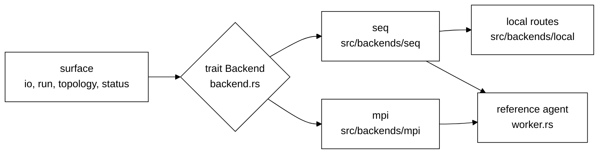

# Backends

A backend runs a launched topology. It implements the trait `Backend` in `backend.rs`, the one seam
between the surface and the hardware, and it keeps the clauses of `CONTRACT.md`. This file is the only
place in the repository that describes the backends one by one. Everything outside `src/backends/` is
written so that it holds for any backend. The flake check `no-backend-names` (`nix/names.nix`) fails on a backend name outside it.

A build selects one backend by a cargo feature. The features are exclusive, and a build with none of
them refuses every launch. There is no default feature: every cargo command names one.

**The choice is generated.** A backend is a directory of `src/backends/` with a `mod.rs` and a `backend.nix`. `build.rs` lists
those directories, reads which feature `CARGO_FEATURE_<NAME>` is on, and writes `$OUT_DIR/backends.rs` declaring that one
backend (`mod <name>`, `selected` and `NAME`). `src/backends/mod.rs` includes it and names no backend. Zero or several
features on is a `compile_error!` from the same file. `trame::__backend::NAME` is the selected backend's name, for
programs that report it.

**Adding a backend** is adding the directory with its `mod.rs` and `backend.nix`, then running `nix run .#manifest` once.
The flake, the shells, the lab, the checks and `build.rs` find it from the directory. The one thing cargo will not
discover is the feature, which a manifest must declare: `nix/manifest.nix` writes it, with the backend's optional
dependencies and binaries (the `cargo` field of the descriptor), between the `# >>> backends` markers of `Cargo.toml`.
The flake check `manifest` fails when the committed file differs, and `build.rs` fails when a directory has no feature.

## The backends

**seq** is the reference. It runs every worker of a host in one process, one thread per worker, and one
agent at a time: a baton passes between workers at each effect. Its schedule is deterministic, and it
follows `Sched::choose` exactly. Every other backend is judged against its output on the programs of
`check/programs/`.

**mpi** runs one MPI rank per worker and the leader on the last rank of each host, so a host of W workers
needs W + 1 ranks. Each shared-memory node is a host. Workers of one host share a window with one ring per
route, and routes between hosts are two-sided messages with credits.

`src/backends/local/` is not a backend. It holds the route rings that `seq` uses, and it is compiled only
under the `seq` feature.

## The seam

The surface calls the `Backend` functions and nothing else in a backend. They fall in four groups.

**Launch.** `agree` checks that every process of the launch holds the same plan. `launch` accepts a
checked plan or refuses it, and it has allocated everything the plan needs when it accepts.

**Worker.** `worker_send`, `worker_recv`, `worker_offer`, `worker_route`, `worker_room`, `worker_now`,
`worker_epoch` and `worker_idle` serve the agents of one worker.

**Leader.** `leader_send`, `leader_recv`, `leader_edit`, `leader_stop`, `leader_wait` and `leader_join`
serve the leader.

**Domain.** `domain_alloc`, `domain_contains` and `domain_dealloc` serve `trame::Alloc`
(`docs/memory-domains.md`).

## How each backend meets the parts

| part | seq | mpi |
|---|---|---|
| worker | one thread, one agent | one rank, several agents |
| service (S7) | 1 per step | nanoseconds |
| choice (S2) | exactly `Sched::choose` | any start `Sched::may_start` allows |
| scheduler | reference agent | reference agent |
| routes | rings under one lock | rings in a shared window; two-sided MPI between hosts |
| wake | one counter of acts | epoch words and futexes |
| domain (M1) | the process heap | a shared segment of the node (`src/backends/mpi/memory/segment.rs`) |
| leader | a thread outside the baton | the last rank of each host |
| `Deadlock` (E2) | shown when every agent that can move has moved | shown once every host's leader waits, joins or has ended |
| trace (S9) | replayed exactly | replayed against `may_start` |

Service is the backend's measure of what a step used. On `seq` it is 1 per step, which keeps the schedule
deterministic. On `mpi` it is wall time, so the shares of `S7` are shares of time.

## Where each part lives

Paths below are relative to the repository root; the mpi paths are inside `src/backends/mpi/`, whose `README.md` lists its directories. The shared code (`worker.rs`, `sched.rs`, `domain.rs`) is not
listed.

| part | seq | mpi |
|---|---|---|
| the `Backend` functions | `src/backends/seq/ops.rs`, `mod.rs` | `src/backends/mpi/backend.rs`, `mod.rs` |
| launch and the plan check | `ops.rs` (`launch`, `build_all`) | `setup/` (`open.rs`, `plan.rs`, `shape.rs`, `refusal.rs`) |
| routes | `src/backends/local/routes.rs` | `rings/`, `transport/cross/`, `memory/layout.rs` |
| domain | the process heap, through `domain.rs` | `memory/` |
| wake | `state.rs` (park, advance) | `waiting/` |
| edits | `edit.rs` | `roles/leader.rs` `edit`, `roles/worker.rs` `edit_request` |
| leader | `ops.rs` (`leader_*`) | `roles/leader.rs` |
| stuck detection | `stuck.rs` | `roles/detect.rs` |
| host numbering and nodes | one host | `transport/` |
| step limit | `limit.rs` | none |
| results and abort | `state.rs` | `roles/results.rs` |

## seq

Each worker has one thread, because a step may loop for a long time. The leader runs outside the baton,
under the same lock. `sched::check` replays the traces of `seq` with `exact`, which also requires the model's
choice at each start (`PROOFS.md`, Replay).

When every agent that can move has moved, and no idle worker has seen a change, the run is stuck. `seq` ends
each remaining worker with `Deadlock`, and panics a leader whose `wait` can never return
(`src/backends/seq/stuck.rs`).

`TRAME_SEQ_STEP_LIMIT=n` ends the process at the baton's step n + 1, with a message and exit status 3. The
mutant checks use it to kill a mutant that loops for ever, and the count of steps, not seconds, makes that
result repeatable.

## mpi

Workers of one host share a window with one ring per route; a route between hosts goes rank to rank by
two-sided MPI. The leaders show a run stuck by rounds of a nonblocking allreduce. How each part works is in the
README of its directory: `src/backends/mpi/README.md` is the index, and `transport/` holds the hosts and the
measurements of the lanes.

Several hosts on one machine come from `TRAME_MPI_NODE_RANKS=k`, which cuts a node into hosts of k ranks, or
`=k0,k1,...`, which gives host 0 k0 ranks, host 1 k1, and so on (the sizes add up to the launch's ranks). It is
for testing and never a default. `TRAME_PROBE=ranks` makes a program print `trame-ranks N` and stop, and the
launch uses it to ask for the rank count of each host, as host `TRAME_PROBE_HOST` of `TRAME_PROBE_HOSTS`.
`TRAME_WORKERS=n0,n1,...` is what `trame::workers(h)` answers for each host until the hosts hold their own count (INTERFACE.md 6): the launch
decides it and passes it to every rank (`src/backends/supply.rs`).

Open MPI may print `osc_ucx_component` errors on stderr on some machines; they come from Open MPI, not from
the program. A process that did not build a state adopts the leader's address (`build_or_adopt`,
`setup/adopt.rs`), which is valid because the segment is mapped at one address on every rank of a node.

## Limits

These are implementation limits, not part of T. A state has at most 63 fields and at most 64 steps, the stop
step included. A step receives at most 16 message types, and a `.room` wait names one of a worker's first 64
routes. Exceeding one is refused or aborts with a message naming it.

`seq` has the step limit above. `mpi` holds back the detection of a stuck run across hosts while a leader
runs its own code, as described under mpi. Latency is not guaranteed by any backend, and T leaves it to the
environment.

## Build and run

Build with the reference backend, `seq`:

    nix develop .#seq
    RUSTFLAGS='--cfg trame_checked' cargo run --no-default-features --features seq --example ring

Build with `mpi`:

    nix develop .#mpi
    RUSTFLAGS='--cfg trame_checked' CARGO_TARGET_DIR=target/mpi \
      cargo build --no-default-features --features mpi --example ring
    mpirun --oversubscribe -n 5 target/mpi/debug/examples/ring

The ring example has four workers, so `mpirun` needs five ranks. Any other count is refused on every rank
before a worker starts.

With the trame CLI, the backend is a build choice, so the backend flag is given to both `build` and `run`:
`nix run .#trame -- build <flag> [--check] [cargo args]` and `nix run .#trame -- run <flag> [-n RANKS]
[--node-ranks K] PROGRAM [-- args]`. The flag for `mpi` is `--mpi`; `seq` takes none. For `mpi`, `run` asks
the program how many ranks it needs (`TRAME_PROBE=ranks`, which prints `trame-ranks N` and stops) and starts
`mpirun` with that count. Inside a nixsci job on several hosts, the hostfile, the placement and the launch
agent come from `nixsci.lab.mpi`, and `crates/cli/check.sh` tests that path.

## Launch

Every backend provides `src/backends/<b>/launch`, with the same interface:

    src/backends/<b>/launch [--split S] [--workers N,N,...] [--bind B] [--timeout T] --out DIR -- PROGRAM ARGS

The launcher runs the program as hosts of the backend, and it writes four files into DIR. `host<h>.out` and
`host<h>.err` hold host h's stdout and stderr, with consecutive duplicate lines collapsed. `cpu.tsv` has the
header `host rank machine user_s sys_s wall_s` and one row per rank, with CPU times from GNU time.
`config.txt` records the setup: for `seq` the argument vector, for `mpi` the MCA files, the MPI version, the
MCA variables and the full command line.

`--split S` is the number of hosts per machine. `seq` accepts 1 only, and `mpi` accepts the values in its
descriptor. `--bind` is passed to the launcher's placement; `seq` accepts and ignores it. The launcher exits
with the program's status, 124 when `--timeout` ended the run, and 2 when the backend refuses the host
count. It also exits 2 on a usage error. A launcher that must ask the program for its size first exits 3
when that first run ends without launching a topology: the program ran once, exited 0, and that run is
`host0.out` and `host0.err`. A test harness counts such a test as passed and never reruns it outside the
launcher.

`--workers` gives `trame::workers(h)` for every host: one count for all, or one per host. Without it the counts come
from `TRAME_WORKERS` in the environment (the same form), then from a `slots=N` on the host's machine's line of the
hostfile, then from the machine's usable cores, which is `nproc` run on the machine and so follows its cpuset,
divided by `--split` (at least 1). `seq` has one host and takes one count. The counts are only what
`trame::workers` answers before a launch begins; after it, `workers(h)` is what host h declared. Each host is started with the workers it declares, which a program that wants its host's
share takes from `trame::workers(trame::host())`; on `mpi` the launcher asks the program once per host
(`TRAME_PROBE_HOST`), so hosts may differ, and it places the machine's slots as the sum of its hosts' ranks.
`check/workers.sh BACKEND` runs `check/programs/workers.rs` on hosts of different sizes.

The job's machines come from `NIX_DEPLOY_HOSTFILE` when it is set, and otherwise from this machine. `seq`
refuses a job that names more than one machine.

## The descriptor

Each backend has `src/backends/<b>/backend.nix`, a function of `pkgs` that the flake reads. It returns the
following fields.

| field | meaning | seq | mpi |
|---|---|---|---|
| `packages` | build inputs beyond the common set | none | the MPI development output |
| `env` | environment variables of the build | none | `MPICC` |
| `launchRuntime` | programs the launcher needs on its path | bash, coreutils, time, grep | MPI runtime, Python, coreutils, time, procps, util-linux, grep |
| `maxMachines` | the largest job the flake accepts | 1 | 1024 |
| `splits` | the values `--split` may take | `[ 1 ]` | `[ 1 2 ]` |
| `deterministic` | whether a run is a function of the program | true | false |
| `cargoTests` | whether the root crate's cargo tests run on it | true | false |
| `bins` | extra binaries built from the backend's own sources | none | `check`, `latency` |
| `postInstall` | shell run after the build | none | builds the plain-MPI baselines |
| `cargo` | what `Cargo.toml` needs of it: `dependencies` (optional, enabled by its feature) and `bins` (`name`, `path`) | none | the MPI crates, the `check` binary |
| `ordinaryWord` | the name is also an ordinary identifier, so `no-backend-names` looks for it only as a path, a feature or `<name> backend` | true | false |

`deterministic = true` makes the backend's programs and mutants validate verdicts, which are derivations.
Otherwise they are lab experiments, which run real processes.

## skip.txt

A backend may list programs it does not run in `src/backends/<b>/skip.txt`. The file has one program per line,
the program's name, then a space and the reason. `check/programs/run.sh` skips a listed program for that
backend, and the reason is for the reader. No backend has a `skip.txt` at the time of writing.

## Checks by backend

The clauses of `CONTRACT.md` are checked by the methods of `PROOFS.md`, and some checks belong to one backend.
This section lists those.

**seq.** The launch tests in `src/backends/seq/tests_launch.rs`, and `launch::build_all` for L3. The exact replay
of S2. The domain is the heap (M1), and
the workers run only inside the leader's calls on the run (M7). The validate verdicts `programs-seq`,
`tests-seq` and `mutants-seq` are listed in `nix/validate.nix`.

**mpi, launch and refusal.** Every refusal is decided by a collective reduction, and `agree` in
`src/backends/mpi/setup/open.rs` decides L2. `setup/adopt.rs` builds the plan (L3).

**mpi, wake and transport.** The TLA+ model `Epoch` checks that no wake-up is lost with one to three sleepers
per word (S3). The edit handshake has the model `Edit`, whose larger configurations did not finish (S4). The transport checks are in `src/backends/mpi/tests/`:
FIFO with verification, overwrite, fairness, large routes and node splits (T1 to T3). The TLA+ model `Lane`
covers order, room by credits, and every frame taken and credited (F5).

**mpi, memory and hosts.** Placement is by construction in `memory/segment.rs` (M1), and `segment::alloc` answers null
past the segment's end (M6). `roles/leader.rs` holds the plan's references until `join` (M7). Hosts are numbered by
their lowest world rank (`transport/hosts.rs`, F1), and a capacity that differs between hosts refuses both
(`transport/cross/connect.rs`, F3). The tag of a cross-host message is by construction in `src/io.rs` (F4, `tag`).

**mpi, end.** `roles/detect.rs` has the model `Detect` (`src/backends/mpi/proofs/`). E2 for
the stuck detector also rests on its programs, `xhost_deadlock` and `leader_stuck`. Its round trips are measured by
the lab's latency experiment, which judges them against the Q clauses of the backend contract, not by a
recorder of its own.

The shared-memory assumption is the mpi backend's own: its processes share memory through mappings of one
object, and it assumes atomics in such a mapping order memory across processes as they do across threads.

<!-- guarantees:start -->

## Guarantees by backend

Generated from `src/backends/<backend>/guarantees.tsv` (which also names the paths) by `check/guarantees.py`; the verdict `guarantees` (nix/validate.nix) fails on drift, a missing row or a cited path that is not in the tree.

### mpi

| Clause | Checked by | Not checked |
| --- | --- | --- |
| **R1** Safety | replay, programs, transport tests | finite traces only |
| **R2** Progress | programs, model checking | models at bounds, not the code |
| **L1** Refusal | collective refusal, programs | written cases only |
| **L2** Agreement | agreement at open | no differing-plan test |
| **L3** Building | plan built once | judged by program output |
| **S1** Exclusion | model, replay, witness | runs taken, not every schedule |
| **S2** Start | replay | choice not held exact |
| **S3** Wake | replay, outcome check, model checking | model at bounds |
| **S4** Edit | model, replay, model checking | larger configs unfinished |
| **S5** Stop | model | small cases only |
| **S6** Priority | model, replay | one shape tested |
| **S7** Shares | model, measurement | no tolerance set |
| **S8** Failure | model, programs | step failure only |
| **S9** Trace | replay | completeness unchecked |
| **T1** Order | programs, transport tests | written cases only |
| **T2** Capacity | programs, transport tests | written cases only |
| **T3** Delivery | programs, transport tests | written cases only |
| **P1** Writer | driver | unsafe code outside steps unseen |
| **P2** Edit | model, program | handshake bounds, as S4 |
| **M1** Placement | by construction | no byte-level walk |
| **M2** Meaning | driver, rejections | type-level, unsafe impls unseen |
| **M3** Mutation | driver, rejections | type-level, unsafe impls unseen |
| **M4** Allocation | allocation test, driver, rejections | trame's own allocations unseen |
| **M5** Visibility | as S3, as S4 | model at bounds |
| **M6** Bound | by construction | never filled |
| **M7** Lifetime | by construction, replay | drop without join untested |
| **F1** Identity | by construction, program | two hosts exercised |
| **F3** Port agreement | program, connection check | two cases only |
| **F4** Tag | by construction | one compilation only |
| **F5** Routes between hosts | program, model checking | lossy lanes, end unmodelled |
| **F6** Peer channel | programs | decode trusted, not authenticated |
| **E1** Abort | programs | these cases only |
| **E2** Join | model checking, programs | model at bounds, verdicts tested |
| **Q1** Median | measurement | measured, no bound set |
| **Q2** Tail | measurement | measured, no bound set |

### seq

| Clause | Checked by | Not checked |
| --- | --- | --- |
| **R1** Safety | replay, programs | finite traces only |
| **R2** Progress | programs | these programs only |
| **L1** Refusal | launch tests, programs | written cases only |
| **L2** Agreement | by construction | nothing to check |
| **L3** Building | by construction, no-alloc test | judged by program output |
| **S1** Exclusion | model, replay, witness | runs taken, not every schedule |
| **S2** Start | replay, exact | runs taken |
| **S3** Wake | replay, outcome check | one process, no protocol |
| **S4** Edit | model, replay | small cases, runs taken |
| **S5** Stop | model | small cases only |
| **S6** Priority | model, replay | one shape tested |
| **S7** Shares | model, measurement | no tolerance set |
| **S8** Failure | model, programs | step failure only |
| **S9** Trace | replay | completeness unchecked |
| **T1** Order | programs | no transport test of its own |
| **T2** Capacity | programs | programs only |
| **T3** Delivery | programs | programs only |
| **P1** Writer | driver | unsafe code outside steps unseen |
| **P2** Edit | model, program | as S4 |
| **M1** Placement | by construction | no byte-level walk |
| **M2** Meaning | driver, rejections | type-level, unsafe impls unseen |
| **M3** Mutation | driver, rejections | type-level, unsafe impls unseen |
| **M4** Allocation | allocation test, driver, rejections | trame's own allocations unseen |
| **M5** Visibility | as S4 | one process |
| **M6** Bound | by construction | never filled |
| **M7** Lifetime | by construction, replay | construction only |
| **F1** Identity | by construction, program | single host |
| **F3** Port agreement | program | two-host refusal unexercised |
| **F4** Tag | by construction | one compilation only |
| **F5** Routes between hosts | vacuous, program | no lanes on one host |
| **F6** Peer channel | program | no peers exist |
| **E1** Abort | programs | these cases only |
| **E2** Join | stuck handling, programs | no cross-host detector |
| **Q1** Median | measurement | measured, no bound set |
| **Q2** Tail | measurement | measured, no bound set |

<!-- guarantees:end -->

## Lab experiments by backend

An experiment is a directory (`lab/README.md`): `lab/<name>/` for every backend, `src/backends/<b>/lab/<name>/` for one
backend's own. Run names are `<kind>-<backend>-s` (`programs-<b>` on one local host); the list is
`nix eval --json .#apps.x86_64-linux --apply builtins.attrNames`. A backend's own experiments here:

| backend | experiments |
|---|---|
| seq | none |
| mpi | `transport` (`transport-mpi`), `xhost` (`mpi-cross-host`, `mpi-cross-host-opa`), `baselines` (`baseline-<family>-mpi-s<N>`) |

Verdicts of a deterministic backend (`programs-<b>`, `tests-<b>`, `rejections-<b>`, `mutants-<b>`) are in `nix/validate.nix`.

## Benchmarks

The benchmarks are the programs of `lab/bench/` (`lab/bench/README.md`), run by the experiments `round`, `flow`, `idle`, `fanin`,
`graph`, `step` and `latency`. A backend may add plain-library baselines of them in its `lab/baselines/`: the multi-process
backend's are `barrier.c`, `flow.c` and `graph.c`. They are not trame: they measure what the same communication costs
written against the messaging library directly. The claims are in each experiment's README.

A timing from the reference backend is a scheduler timing, not a host timing, so it is not comparable with a
timing from a multi-process backend.

`src/backends/mpi/transport/SCALING.md` defines scaling and says where the tree does not meet it. The relay
thread it once described is gone, and the lab has no relay claim.

## A new backend

A new backend implements `Backend`, keeps the clauses of `CONTRACT.md`, and prints the same output as `seq` on
the programs of `check/programs/`. It may reuse the reference agent of `worker.rs`, or schedule by itself. It
needs a `launch`, a `backend.nix` and, if it has programs it does not run, a `skip.txt`, as described above.

Its checks go in the lab and the validate verdicts in the same way as the existing backends. Its name goes in
this file and nowhere else outside `src/backends/`.

It also owes its inventory: `guarantees.tsv` (`check/guarantees.py`, Guarantees by backend), one row for every
clause of `CONTRACT.md` — what checks it, where, what it does not — or the verdict `guarantees` fails.

## Serve

`launch` runs a program to its end and collects what each host printed: it is for experiments. A service is a program
that stays up and talks over its stdin and stdout, and `serve` is its launcher: `serve -- PROGRAM [ARGS...]`, in
`src/backends/<b>/serve`. It runs in the foreground with the program's stdio, and ends with the program. On `seq` it is
`exec`. On `mpi` it asks the program for its rank count (`TRAME_PROBE=ranks`), takes the machines from
`NIX_DEPLOY_HOSTFILE` and the remote agent from `NIX_DEPLOY_AGENT` (nixsci's `mpi.command`), and replaces itself with
`mpirun --stdin <leader of host 0>`: mpirun's default is rank 0, which is a worker. Each host gets the ranks its own
topology declares, as `launch` places them (`placement.py`); `serve` reads the counts of `trame::workers` from
`TRAME_WORKERS`, or `--workers` when run directly. Stdout and stderr of every rank reach the caller,
unordered between ranks, so a service speaks on its stdout from its leader only. Checked on `leader_io` (the sorted
stdout equals its `.expected` on both backends); stdin reaching the leader was checked with plain `mpirun --stdin`, not
with a trame program.

## The export

A program's flake takes a backend from `trame.lib.<system>.backend NAME { checked ? true }` (`nix/export.nix`), where
NAME is the backend's own name. It answers `{ feature, buildFeatures, buildNoDefaultFeatures, nativeBuildInputs, env,
runtime, launcher }`. `buildFeatures` is `["trame/<NAME>"]`, the feature of the dependency, so the program's
`Cargo.toml` names no backend. `env` carries the descriptor's variables and, when `checked`, `RUSTFLAGS = "--cfg
trame_checked"`, which a build outside `cargo trame` must set (INTERFACE.md 3.1). `launcher { name, binary }` is a
derivation with `bin/NAME`, the backend's `serve` on `binary`. An unknown NAME is an evaluation error naming the
backends.
